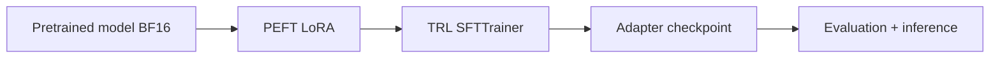
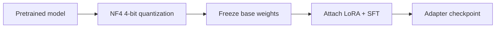
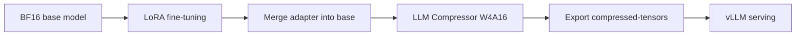
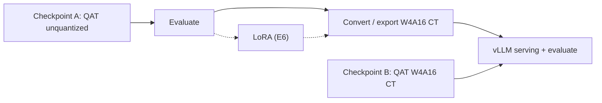
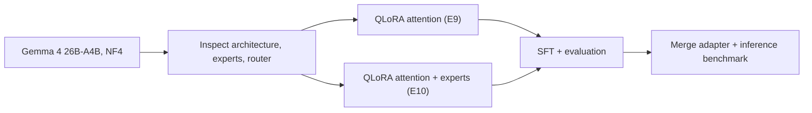
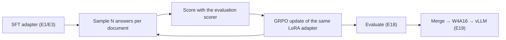

# LLM Optimization Lab

Experimental research on **fine-tuning (LoRA, QLoRA, RL with GRPO)**, **quantization (PTQ W4A16, Gemma QAT)** and **deployment (vLLM)** of small Gemma 4 and Qwen3.5/3.6 models for information extraction on **NVIDIA L40 48 GB** GPUs.

| File | Answers |
|------|---------|
| `README.md` (this file) | What we test, why, and where we stand |
| [TASKS.md](TASKS.md) | Who does what, in which order, what "done" means; daily log |
| [docs/models.md](docs/models.md) | Candidate models per input flow, and why |
| [docs/formats.md](docs/formats.md) | Data, prediction and metrics formats shared by every track |
| [docs/reading.md](docs/reading.md) | Papers and docs behind every model, technique and term used here |
| [proposal.md](proposal.md) | Original proposal with the full reasoning (Vietnamese) |

**Problem:** information extraction from documents. Each **document type** has a **field registry** (`schema.json`: fields, descriptions, examples) and short instructions; the system prompt lists the fields a request asks for. The required fields change often (weekly during go-live, monthly in production), so the model is trained to **read the field list** instead of one fixed output, and returns **printed values only**: normalization and per-customer business rules run in code ([formats §2–3](docs/formats.md#2-doc-types)). There are two input flows:

- **VLM flow:** document image → JSON
- **LLM flow:** spatial text (layout-preserving text of the document) → JSON

Outputs are nested key-value JSON. Context is about **21K–32K tokens**.

**Deployment targets:**
- **Quality:** at least **95% exact match** and **95% field-level accuracy** on the test set.
- **Serving:** a reference load of **60 concurrent requests**. Production serves both flows today with **Qwen3.6-35B-A3B-FP8** on one L40, and is too slow under that load.
- **Models:** small and medium **Gemma 4** and **Qwen3.5** models, plus cheaper versions of the production model ([candidates](docs/models.md)).

> **Final deliverable:** a technical decision table (accuracy, VRAM, latency, concurrency) and a recommendation answering *which model, which workflow, and why*.

---

## 1. Research questions

| ID | Question | Owner | Experiments |
|----|----------|:-----:|-------------|
| Q1 | How much VRAM and time does LoRA BF16 fine-tuning at 32K context take on an L40? What is the smallest rank that reaches 95% on both metrics? | A | E0, E1, E3, E7 |
| Q2 | How much training VRAM does QLoRA NF4 save, and how much accuracy does it lose compared with LoRA BF16? | B | E2, E8 |
| Q3 | Does LoRA → merge → W4A16 → vLLM keep the 95% target, and how much VRAM and latency does it save over BF16? | D | E4 |
| Q4 | Do Gemma QAT checkpoints, used directly or fine-tuned further, have a practical advantage over fine-tuning a regular model and then applying PTQ? | D | E5, E6 |
| Q5 | Which pipeline both reaches 95% and serves 60 concurrent requests on one L40, compared with the Qwen3.6-35B-A3B-FP8 production model? | C | every candidate, R0 |
| Q6 | Is LoRA on MoE (Gemma 4 26B-A4B, Qwen3.6-35B-A3B) feasible on an L40? Should it target attention or experts? Is it worth it compared with dense models? How much does W4A16 alone speed up the production model? | E | E9, E10, E12, E15, R1 |
| Q7 | Which model family and size is the cheapest to reach 95% per flow: one model for both flows, or a small text model for spatial text plus a model for images? | C (with A, B) | E7, E8, E13, E14, E16, E17 |
| Q8 | Does RL with a verifiable extraction reward (GRPO) on top of SFT raise exact match where SFT alone stops short, does the gain survive W4A16, and what does it cost on an L40? | Lead | E18, E19 |
| Q9 | Does SFT on sampled field requests keep accuracy on the trained fields and extract fields it was never trained on, compared with SFT on one fixed prompt? How many labels does a new field still need, and does W4A16 widen the gap between trained and new fields? | Lead | E20 |

## 2. Hardware and models

**GPUs:** 3–5 × **NVIDIA L40** (not L40S): 48 GB GDDR6 ECC, 864 GB/s, Ada architecture (SM 8.9), Tensor Cores for BF16 / FP16 / FP8 / INT8 / INT4. In addition, 2 × ~24 GB GPUs are available for development, smoke tests and small models.

There is no NVLink and no MIG, so **every experiment runs on one GPU**. Having several GPUs lets us run experiments in parallel (rank sweep, separate tracks); it does not let us shard one model. VRAM and latency are always measured on an L40 with no other process on it.

Every model below accepts **image + text**. Why each one, and which flow it is a candidate for: [docs/models.md](docs/models.md).

| Model | Hugging Face ID | Role | Experiments |
|-------|-----------------|------|-------------|
| Qwen3.6-35B-A3B-FP8 | `Qwen/Qwen3.6-35B-A3B-FP8` | **Production model**, both flows; the reference | R0 |
| Qwen3.6-35B-A3B | `Qwen/Qwen3.6-35B-A3B` | Production model, BF16 source for W4A16 and QLoRA | R1, E15 |
| Gemma 4 E2B IT | `google/gemma-4-E2B-it` | Debug model and main pipeline | E0 – E4, E18 |
| Gemma 4 E2B QAT unquantized | `google/gemma-4-E2B-it-qat-q4_0-unquantized` | QAT base, used directly or fine-tuned further | E5, E6 |
| Gemma 4 E2B QAT W4A16 CT | `google/gemma-4-E2B-it-qat-w4a16-ct` | QAT already quantized for vLLM | E5 |
| Gemma 4 E4B IT | `google/gemma-4-E4B-it` | Scale-up if E2B does not reach 95% | E7 |
| Gemma 4 E4B QAT | `google/gemma-4-E4B-it-qat-q4_0-unquantized`, `google/gemma-4-E4B-it-qat-w4a16-ct` | Repeat E5, E6 if E4B is chosen | — |
| Gemma 4 12B IT | `google/gemma-4-12B-it` | Medium dense model, strongest small Gemma on documents | E8 |
| Gemma 4 26B-A4B IT | `google/gemma-4-26B-A4B-it` | Gemma 4 MoE; fits on an L40 only in 4-bit | E9 – E12 |
| Qwen3.5-4B | `Qwen/Qwen3.5-4B` | Small model of the production family | E13 |
| Qwen3.5-9B | `Qwen/Qwen3.5-9B` | Medium model of the production family | E14 |
| Qwen3.5-2B | `Qwen/Qwen3.5-2B` | Spatial-text-only candidate for the text flow | E16 |
| NuExtract3 | `numind/NuExtract3` | Qwen3.5-4B fine-tuned for structured extraction | E17 |

> [!NOTE]
> Gemma 4 E2B, E4B and 12B all have official QAT unquantized and W4A16 CT checkpoints. 26B-A4B only has QAT unquantized and GGUF, so a W4A16 version must be produced ourselves (T-E03, T-E06). In BF16, the 26B-A4B weights need about 52 GB and do not fit on an L40.

### Risk 1: training memory at 32K context

The most dangerous part is the **logits**: every position in the sequence produces a vector as long as the vocabulary. Gemma 4 has a 262,144-token vocabulary, so for one 32,768-token sequence:

| Logits dtype | Memory |
|--------------|-------:|
| BF16 | ~17 GB |
| FP32 | ~34 GB |

This excludes the gradient of the logits, which is the same size. Qwen3.5/3.6 have a 248,320-token vocabulary: the same risk and the same mitigations. Mitigations, tried in this order (T-A02):

1. **Batch size 1**, gradient accumulation, gradient checkpointing.
2. **Apply `lm_head` only at output positions** (labels not `-100`). Implemented in `scripts/train.py` as `training.loss: label_positions` (the default) through `logits_to_keep`; on tiny Gemma 4, Qwen3.5 and Qwen3.6 MoE models it gives the same loss as the full logits (`--check-loss`). Outputs are much shorter than inputs, so logits shrink by the same ratio.
3. **Fused linear cross-entropy** (Liger Kernel, `use_liger_kernel` in TRL). Check whether Gemma 4 is supported.
4. **Smoke test** a few steps on the longest sample before full training, to get the real peak VRAM.

### Risk 2: KV cache at 60 concurrent requests

Estimated BF16 KV cache for a 32K-token request, from each model's config and parameter count:

| Model | BF16 weights | KV per request | KV for 60 requests | Weights + KV for 60 requests |
|-------|-------------:|---------------:|-------------------:|-----------------------------:|
| Gemma 4 E2B | ~10 GB | ~0.21 GB | ~12.5 GB | ~23 GB |
| Gemma 4 E4B | ~16 GB | ~0.56 GB | ~33.5 GB | ~50 GB |
| Gemma 4 12B | ~24 GB | ~0.87 GB | ~52 GB | ~76 GB |
| Gemma 4 26B-A4B | ~52 GB | ~0.88 GB | ~53 GB | ~105 GB |
| Qwen3.6-35B-A3B-FP8 (production) | ~37.5 GB (FP8) | ~0.70 GB | ~42 GB | ~80 GB |
| Qwen3.5-9B | ~19.3 GB | ~1.10 GB | ~66 GB | ~85 GB |
| Qwen3.5-4B | ~9.3 GB | ~1.10 GB | ~66 GB | ~75 GB |
| Qwen3.5-2B | ~4.6 GB | ~0.41 GB | ~25 GB | ~30 GB |

The estimate assumes vLLM keeps KV only within the window of sliding-window layers, and reuses KV across layers that share it. For Qwen3.5/3.6, only 1 layer in 4 has a KV cache; the other 3 (Gated DeltaNet) keep a fixed state of ~10–33 MB per request, included above. Real numbers are measured in T-C07. Consequences:

- **E2B** fits 60 requests in BF16.
- **E4B** fits only with W4A16 weights or an FP8 KV cache.
- **12B and 26B-A4B** need both.
- **Qwen3.5-4B and 9B** store more KV per token than Gemma E4B (4 KV heads of dimension 256), so they also need W4A16 and probably an FP8 KV cache. Check first that FP8 KV cache gives correct outputs on Gated DeltaNet models (reported broken in vLLM issue #37554; T-C07).
- **Qwen3.6-35B-A3B-FP8** cannot hold 60 requests of 32K tokens on one L40: after the weights, about 4–5 GB remain for KV cache, enough for a handful of long requests. Production must use shorter contexts or queue requests. T-C05 records the real context lengths and the KV capacity vLLM reports, so the comparison is fair.
- **Prefix caching** reduces the real numbers a lot, because the long system prompt of a doc type is shared across requests. T-L04 measures the system prompt length per doc type.

## 3. Status

**Legend:** ⬜ not started · 🟡 in progress · ✅ done · ⛔ blocked · ⏭️ skipped

**Start date:** `YYYY-MM-DD` · **Last updated:** `2026-11-27`

| Milestone | Reached when | Status | Report |
|-----------|--------------|:------:|--------|
| Preparation | Task, dataset format, metrics, models, serving target and team plan agreed | ✅ | — |
| M0 Core and tool drafts | Shared package, every phase-1 tool drafted and CPU-checked on a tiny Gemma 4 (T-001, T-002) | ✅ | [docs/formats.md](docs/formats.md), [TASKS.md](TASKS.md#t-002--phase-1-tool-drafts-) |
| M1 Tools validated on GPU | Dev set end to end on real E2B: train, HF predict, merge, quantize, vLLM serve, benchmark, evaluate | ⬜ | `reports/environment.md`, `reports/serving.md` |
| M2 Private data frozen | Private data validated, split, token statistics agreed | ⬜ | `reports/data_quality.md`, `reports/data_stats.md` |
| M3 Reference config frozen | E20 verdict applied (fixed vs sampled requests), E1 tuned, rank sweep done, adapter inference and merge verified | ⬜ | `reports/field_generalization.md`, `reports/baseline.md` |
| M4 Quantized model served at 60 | E4 evaluated, latency curve up to 60 | ⬜ | `reports/lora_vs_qlora.md`, `reports/quantization.md`, `reports/serving.md` |
| M5 MoE answered | E9, E10, R1 evaluated and served | ⬜ | `reports/moe_lora.md` |
| M6 RL answered | E18 evaluated against its SFT start; E19 served | ⬜ | `reports/rl.md` |
| M7 Final recommendation | Decision table and report | ⬜ | `reports/final_recommendation.md` |

Task-level status is in [TASKS.md](TASKS.md).

## 4. Decisions and open items

### Decided (2026-11-19)

| Topic | Decision | Consequence for the plan |
|-------|----------|--------------------------|
| Task (updated 2026-11-26) | Information extraction: image or spatial text → the fields the system prompt asks for, values as printed | The model must accept images. Every metric is reported by input type. |
| Document types (updated 2026-11-26) | Each doc type has `instructions.md` and a field registry `schema.json` in `doc_types/<name>/`; the system prompt is rendered from the registry for each request | One model per experiment is trained on all doc types and both input types; the system prompt selects the doc type and its fields. Metrics are also reported by doc type. Revisit if one doc type lags. |
| Field generalization (2026-11-26) | Train the model to read the field list: training requests are random subsets of each record's annotated fields, with decoys answered `null` (`fields.sampling`); inference asks for a fixed set per doc type, so prefix caching still works. MLM-style self-supervised pretraining is not the main path: no study shows it extracts fields never labeled | E20 (T-L15) checks it against one fixed prompt on CORD with held-out fields before M3. A new field still needs labels for its test set and a few dozen to a few hundred for training; it waits for the next monthly retrain, while the registry change ships at once |
| Raw data and business rules (2026-11-26) | The model returns printed values only. Normalization (one value, a fixed mapping, e.g. `"Pallet"` → `PX`) and per-customer rules (`derive` fields, e.g. "3 Pallet, 5 Carton" → 3, 5 or 8) run in code, versioned | A rule or code-list change needs no labels and no retraining. T-L02 converts rule-dependent fields, T-L05 ports the rules |
| Metrics | Exact match, field-level accuracy, plus NED and parse rate | Implemented once in the core package for every track ([formats](docs/formats.md#5-scoring)). |
| Ground truth (updated 2026-11-26) | Nested JSON of printed facts following the registry, written to a shared guideline. A field is annotated when its key is present (`null` = checked, not on the document), so the registry can grow without relabeling old records. `label_source` says whether a person checked Qwen3.6's labels | T-L02 writes the guideline and the registries; T-L03 validates and splits the private data; the test split must be human-checked. |
| Data source | Start with a public dev set (CORD v2) in the final format; private data uses the same format | Tools are validated before private ground truth exists (T-L01). |
| Normalization | The same function normalizes prediction and ground truth, and is meant to run in production | Generic rules exist now; production rules are ported in T-L05. |
| Dataset | Private; split into `train` / `validation` / `test` / `calibration`, stratified by doc type, grouped by source document | Never committed or uploaded to the Hugging Face Hub or any external service. About 2,000+ samples per doc type. |
| Quality target | At least 95% on **both** exact match and field-level accuracy | A pipeline only "passes" when both thresholds hold. Exact match is usually the harder one. |
| Context | 21K – 32K tokens; input and output lengths vary per document | `max_seq_length` about 32K. Benchmarks use the real length distribution. |
| Models (updated 2026-11-20) | Gemma 4 (E2B, E4B, 12B, 26B-A4B), Qwen3.5 (2B, 4B, 9B), NuExtract3, and the production Qwen3.6-35B-A3B | Candidates per flow and the reasons in [docs/models.md](docs/models.md). Only models that fit one L40. |
| MoE phase | Kept, with Gemma 4 26B-A4B and the production Qwen3.6-35B-A3B | Track E runs in parallel with the dense work. |
| Production model (corrected 2026-11-20) | **Qwen3.6-35B-A3B-FP8** with vLLM on **one L40**, for both the image and the spatial-text flow (replaces Qwen3-4B in earlier notes) | R0 measures it as the reference; R1 quantizes it to W4A16. Benchmarks sweep up to 60 concurrent requests. |
| Speculative decoding | Out of scope (MTP heads, drafters): serving-only, unrelated to fine-tuning and quantization | Not in the matrix. |
| Lead workflow | The lead owns W6: RL with verifiable extraction rewards (GRPO) on top of SFT | Q8, E18, E19; code drafted (T-L10). |
| Model access | Gemma 4 license accepted; HF token on the servers | No blocker. |
| GPUs | 3–5 × L40 plus 2 × ~24 GB, shared but prioritized | Tracks run in parallel; measurements need a GPU with no other process. |
| Team | 4–5 full-time people (A–E) plus a lead | Two phases: shared tools first, then one workflow per person end to end ([TASKS.md](TASKS.md)). The lead owns the shared data tasks. |
| Result rules | Tune on validation only; test once per final run; experiments extend a frozen reference config and change one variable; results enter the matrix through a reviewed PR | [TASKS.md rules](TASKS.md#rules-for-experiments-and-results-agreed-2026-11-20). |
| Data assumption | Plans assume private data and ground truth exist for every doc type; collection runs separately, by doc type | Phase 1 validates tools on the public CORD v2 dev set. |
| Code | Package `src/llm_opt_lab`, YAML configs validated with pydantic (with `extends:`), pytest + ruff, CI, one branch and PR per task reviewed by the lead; docs and code in English | See §8. |
| Stack | transformers 5 (Gemma 4 and Qwen3.5/3.6 support; the Gemma processor needs torchvision), PEFT, HF `Trainer` with our own collator and loss, TRL for GRPO only, LLM Compressor, vLLM | Checked on CPU with tiny Gemma 4, Qwen3.5 and Qwen3.6 MoE models (T-002, T-L10). |

### Open

- [ ] **Qwen3.6-35B-A3B-FP8 production setup:** context per request, image resolution, latency p95, vLLM flags, KV capacity reported by vLLM, prefix caching. → T-C05
- [ ] **Image resolution per model:** Gemma 4 uses a fixed image token budget, Qwen grows with resolution. Needs a `model.processor_kwargs` config field applied in training, HF inference and vLLM alike (core PR). → T-L04
- [ ] **Acceptable latency at 60 concurrent requests,** e.g. a maximum p95 in seconds. Without it, vLLM just queues requests and "60" means nothing. → T-C05
- [ ] **Scope of the 95% target:** overall only, or per input type / per doc type? → T-L06, T-C05
- [ ] **List matching:** compare list items by position (current) or by content? → T-L06
- [ ] **Production spatial text format** (the dev set uses our own renderer) and production postprocess rules. → T-C05, T-L05
- [ ] **Split ratios** (default 80/5/10/5). → T-L03
- [ ] **E20 decision rule**, agreed before the runs: how close to the fixed prompt the sampled requests must stay on trained fields, and how much better on held-out fields. → T-L15
- [ ] **Where business rules live** (this repo or the production service) and how a release pins model, registry and rule versions. → T-L05

## 5. Plan

The work runs in two phases (details and owners in [TASKS.md](TASKS.md)):

1. **Shared tools.** Training, HF inference, merge, quantization, vLLM serving, benchmark and evaluation are built once. They are drafted and CPU-checked (T-002); each member validates and maintains one set on real GPUs with the public CORD v2 dev set.
2. **One workflow per person, end to end.** Each owner runs their research question through every step (train, merge, quantize, serve, evaluate, tune, report) with the shared tools.

| Owner | Workflow | Experiments | Answers |
|:-----:|----------|-------------|:-------:|
| A | W1 LoRA BF16 and small models | E0, E1, rank sweep, E3, E7, E13, E16 | Q1, Q7 |
| B | W2 QLoRA and medium models | E2, E8, E14, E17 | Q2, Q7 |
| C | Serving at 60 concurrent requests | R0, KV cache / prefix caching / FP8 KV, sweep of every candidate, one model vs one per flow | Q5, Q7 |
| D | W3 PTQ and W4 Gemma QAT | E4, E5, E6, the Qwen W4A16 recipe | Q3, Q4 |
| E | W5 MoE | E9, E10, E12, R1, E15 | Q6 |
| Lead | E20 field holdout (gates M3); W6 RL (GRPO); shared data, integration | E20, E18, E19; data tasks, result tables, final recommendation | Q8, Q9 |

The rule from the original plan still holds for **results**: do not stack quantization or MoE on top of a pipeline that does not yet work, because debugging gets much harder. The milestones in §3 are the gates. Phase 2 starts at M1 (tools validated) + M2 (private data frozen).

Experiments depend on each other by design: E2, E6, E7, E9, E13, E14 extend A's reference config, E4 quantizes A's E3 merged model, and E18 continues training the reference SFT adapter with RL. Owners start on the provisional reference and re-run if it changes before it is frozen (M3). Since GPUs are available, E7 (E4B) does not wait for the E2B verdict.

## 6. Experiment matrix

The most important table for managing the research. Update **Status** and **Key result** after every run.

| ID | Priority | Model | Training → Deployment | Goal | Config | Owner · Task | Status | Key result |
|----|:--------:|-------|-----------------------|------|--------|--------------|:------:|------------|
| E0 | P0 | Gemma 4 E2B | None → BF16 | Baseline | `gemma4_e2b/baseline.yaml` | A · T-A03 | ⬜ | |
| E1 | P0 | Gemma 4 E2B | LoRA BF16 → BF16 | Baseline fine-tuning, reference config | `reference/gemma4_e2b_lora.yaml` | A · T-A04, T-A05 | ⬜ | |
| E2 | P0 | Gemma 4 E2B | QLoRA NF4 → NF4 + adapter | Training memory | `gemma4_e2b/qlora_nf4.yaml` | B · T-B05, T-B06 | ⬜ | |
| E3 | P0 | Gemma 4 E2B | LoRA BF16 → merged BF16 | Merge validation | `reference/gemma4_e2b_lora.yaml` | A · T-A06 | ⬜ | |
| E4 | P0 | Gemma 4 E2B | LoRA BF16 → W4A16 (vLLM) | Post-training quantization | `gemma4_e2b/quant_w4a16.yaml` | D · T-D04 | ⬜ | |
| E5 | P1 | Gemma 4 E2B QAT | None → QAT W4A16 CT | QAT baseline | `gemma4_e2b_qat/baseline.yaml` | D · T-D05 | ⬜ | |
| E6 | P1 | Gemma 4 E2B QAT | LoRA on QAT unquantized → W4A16 CT* | Fine-tune the QAT checkpoint | `gemma4_e2b_qat/lora_bf16.yaml` | D · T-D06 | ⬜ | |
| E7 | P1 | Gemma 4 E4B | LoRA BF16 → W4A16 | Scale-up if E2B misses 95% | `gemma4_e4b/lora_bf16.yaml` | A · T-A07 | ⬜ | |
| E8 | P2 | Gemma 4 12B | QLoRA NF4 → W4A16 | Medium dense, upper bound | `gemma4_12b/qlora_nf4.yaml` | B · T-B07 | ⬜ | |
| E9 | P1 | Gemma 4 26B-A4B | QLoRA attention → 4-bit + adapter | MoE LoRA baseline | `gemma4_26b_a4b/qlora_attention.yaml` | E · T-E04 | ⬜ | |
| E10 | P1 | Gemma 4 26B-A4B | QLoRA attention + experts → merged | Expert adaptation | `gemma4_26b_a4b/qlora_experts.yaml` | E · T-E05 | ⬜ | |
| E11 | — | — | Merged into E9, E10 | MoE only runs in 4-bit on an L40 | — | — | ⏭️ | |
| E12 | P2 | Gemma 4 26B-A4B | Router adaptation → merged | Routing adaptation (optional) | TBD | E · T-E07 | ⬜ | |
| E13 | P1 | Qwen3.5-4B | LoRA BF16 → W4A16 | Small model of the production family | `qwen35_4b/lora_bf16.yaml` | A · T-A09 | ⬜ | |
| E14 | P1 | Qwen3.5-9B | QLoRA NF4 → W4A16 | Medium model of the production family | `qwen35_9b/qlora_nf4.yaml` | B · T-B11 | ⬜ | |
| E15 | P2 | Qwen3.6-35B-A3B | QLoRA → merged → W4A16 | Fine-tune the production model | `qwen36_35b_a3b/qlora.yaml` | E · T-E10 | ⬜ | |
| E16 | P2 | Qwen3.5-2B | LoRA BF16 on spatial text only → BF16 | Small text-only model for the text flow | `qwen35_2b/lora_spatial_text.yaml` | A · T-A10 | ⬜ | |
| E17 | P1 | NuExtract3 | None, then LoRA → W4A16 | Extraction-specialized starting point; zero-shot reference for E20 | `nuextract3/baseline.yaml` | B · T-B12 | ⬜ | |
| E18 | P1 | Reference model (E2B first) | SFT adapter → GRPO → adapter | RL with extraction rewards | `rl/gemma4_e2b_grpo.yaml` | Lead · T-L11 | ⬜ | |
| E20 | P0 | Gemma 4 E2B (then Qwen3.5-4B) | LoRA BF16, fixed vs sampled requests → BF16 | Field holdout on CORD (`cord_full`): trained vs never-trained fields, decoys; gates M3 | `field_holdout/*.yaml` | Lead · T-L15 | ⬜ | |
| E19 | P2 | Same as E18 | GRPO → merge → W4A16 (vLLM) | Does the RL gain survive quantization? | `rl/gemma4_e2b_grpo_w4a16.yaml` | Lead · T-L12 | ⬜ | |
| R0 | P1 | Qwen3.6-35B-A3B-FP8 | Production model → vLLM | Accuracy and latency reference, both flows | `qwen36_35b_a3b/production.yaml` | C · T-C06 | ⬜ | |
| R1 | P1 | Qwen3.6-35B-A3B | None → W4A16 (vLLM) | Cheapest speed-up of the production model | `qwen36_35b_a3b/w4a16.yaml` | E · T-E09 | ⬜ | |

\* Before running E6, confirm the framework, target modules and export compatibility. Do not assume QAT properties survive fine-tuning.

Configs live in `configs/`. The priorities of E7, E8, E13–E19, R0 and R1 follow from the project goals; adjust them if the leader asks otherwise.

## 7. Benchmark protocol

### Quality metrics

Prediction and ground truth are parsed, normalized with the same rules, and flattened to leaf paths (`store.name`, `items[0].price`) before comparison. Exact rules are in [docs/formats.md](docs/formats.md#5-scoring).

- **Exact match:** share of samples where **every** field is correct and no extra field is predicted. Threshold 95%.
- **Field-level accuracy:** correct fields divided by expected fields over the whole test set. Threshold 95%.
- **NED (normalized edit distance):** Levenshtein distance between prediction and ground truth divided by the longer length, per field, averaged; 0 is a perfect match. NED tells whether a wrong field is off by a few characters or completely wrong.
- **Parse rate:** share of outputs that parse to a JSON object. An unparseable output counts as wrong on every field.
- **Key presence:** share of expected leaf paths present in the output; a model that ignores a requested field loses it even when the value is null.

Only the fields the prompt asked for are scored; fields a record does not annotate are skipped. When a request holds held-out fields or decoys, accuracy, missed values and invented values are also reported for the seen, held-out and decoy groups ([formats §5](docs/formats.md#5-scoring)).

Every metric is reported **by input type (image, spatial text) and by doc type**, plus accuracy per field, to show which fields drag the score down.

### Normalization rules

`src/llm_opt_lab/postprocess.py` applies **the same** function to prediction and ground truth before comparison. It should also be the function that runs in production, so the metrics reflect real results.

Implemented now (generic, every field):

- **Unicode NFC**, so accented characters are represented consistently.
- **Whitespace:** trimmed at both ends; inner runs collapsed to one space.
- **Case:** casefolded.
- **Empty:** empty, missing, or empty-equivalent values become `null`.

Per field type, from the production rules (T-L05):

- **Dates:** ISO 8601 `YYYY-MM-DD`.
- **Numbers:** remove thousands separators and unify the decimal mark. This must be per field type, because `1.234` can mean one thousand two hundred thirty-four or one point two three four.

Both raw and normalized outputs are saved for debugging (`artifacts/eval/<run_id>/<split>/samples.jsonl`).

### Full metric set

Every experiment measures:

1. **Accuracy:** exact match, field-level accuracy, NED, parse rate on the same test set.
2. **Training VRAM:** peak GPU memory during training.
3. **Training speed:** steps/s and total training time.
4. **Inference VRAM:** peak GPU memory during generation, including KV cache.
5. **Latency:** TTFT, TPOT, total latency, as p50 and p95.
6. **Throughput:** tokens/s and requests/s.
7. **Concurrency:** latency and throughput at each concurrency level, up to 60.
8. **Model size:** checkpoint and adapter size.
9. **Stability:** OOM, model loading errors, numerical errors.

### Inference benchmark workload

Input and output lengths vary per document, so benchmarks replay **real data** instead of a fixed length:

```text
Benchmark set: <data root>/benchmark.jsonl, sampled from the test split, identical for every candidate
Context:       21K – 32K tokens, as in the real data
Output:        as in the real data, p50 / p95 recorded
Concurrency:   1 / 8 / 16 / 32 / 60
Temperature:   0
GPU:           L40 with no other process
```

The GPUs are shared, so before every VRAM or latency measurement, save an `nvidia-smi` snapshot (`save_gpu_snapshot`) with the results to show no other process was running.

## 8. Experiment conventions

### Config-driven

Each experiment changes only its config, never the code. The schema is `src/llm_opt_lab/config.py`; unknown keys are rejected. The reference config (owned by A, frozen at M3) looks like:

```yaml
# configs/reference/gemma4_e2b_lora.yaml
experiment_id: E1
run_name: gemma4_e2b_lora_r16
seed: 42

model:
  id: google/gemma-4-E2B-it
  dtype: bfloat16

data:
  dir: ${LLMOPT_DATA_DIR}/private   # split .jsonl files and images
  doc_types: []                     # empty = every doc type
  input_types: [image, spatial_text]

fields:                             # which fields each prompt asks for (formats §3)
  inference: full                   # every extract field of the registry
  sampling: {}                      # training: random field subsets + decoys (if E20 agrees)

method:
  name: lora                        # none | lora | qlora

lora:
  rank: 16
  alpha: 32
  dropout: 0.05
  target_modules: [...]             # from inspect_model.py + the gemma-skills template, never guessed
  train_vision_encoder: false       # vision/audio towers are excluded automatically

training:
  learning_rate: 2.0e-4
  gradient_accumulation_steps: 8
  epochs: 2
  max_seq_length: 32768             # from the token statistics (T-L04)
  loss: label_positions             # lm_head only on answer positions (Risk 1)
  eval_steps: 200                   # eval loss on a validation subset

evaluation:
  split: test
  quality_target: {exact_match: 0.95, field_accuracy: 0.95}   # both must hold
  temperature: 0
  max_new_tokens: 2048              # from the token statistics (T-L04)
```

Other experiments **extend** it and override only their variable, so the diff between two configs is the experiment:

```yaml
# configs/gemma4_e2b/qlora_nf4.yaml (E2)
extends: ../reference/gemma4_e2b_lora.yaml
experiment_id: E2
method: {name: qlora, quantization: nf4, double_quant: true}
```

Optional sections: `quantization:` (source, algorithm, pipeline, ignore list, calibration), `serving:` (source, vLLM limits, concurrency levels) and `rl:` (GRPO: starting adapter, group size, reward weights). Model sources such as `merged:<run_id>` let E4 quantize the E3 model; see [docs/formats.md](docs/formats.md#8-configs-and-model-sources). Working examples: `configs/dev/`.

### Code layout

- `src/llm_opt_lab/` is the **shared core**. It never imports torch, transformers or vllm at module level, so the training, LLM Compressor and vLLM environments can all install it (`-e .`).
- `src/llm_opt_lab/hf/` holds torch/transformers code (model loading, HF predictor, SFT data). It is imported in the training environment and by the quantization script, never by the core.
- `scripts/`, `quantization/` and `inference/` are thin entry points that read a config and call the package.
- Every inference path writes the same [predictions file](docs/formats.md#4-predictions), and `scripts/evaluate.py` scores all of them.

### Metrics format

Every stage merges its numbers into `results/metrics/<experiment_id>_<run_name>.json` with `record_metrics`, which also stamps the git commit, host and GPU for that stage. Schema and example: [docs/formats.md](docs/formats.md#6-metrics-json).

### After every run

1. Commit config and code **before** running; `record_metrics` stores the commit per stage.
2. Metrics JSON goes to `results/metrics/`, logs to `results/logs/<run_id>/`.
3. Update **Status** and **Key result** in the [experiment matrix](#6-experiment-matrix).
4. Write a line in your section of the [daily log](TASKS.md#daily-log).

### Principles

- **Change one variable at a time.** If rank, learning rate, sequence length and dataset change together, nobody knows where a difference came from.
- **Fixed test set**, disjoint from training; fixed generation settings. The split is made once (T-L03). Tune on validation; evaluate test once per final run ([rules](TASKS.md#rules-for-experiments-and-results-agreed-2026-11-20)).
- **Private data stays on the servers.** Never commit it, never push it to the Hugging Face Hub or any external service. Adapters and fine-tuned models stay private too.
- **Hugging Face stack first**; Unsloth only after the baseline is stable (P2).
- **Never modify cloned repos.** Use them as dependencies or references.
- **Separate environments.** Never install vLLM, Unsloth, LLM Compressor or FlashAttention in the training environment.
- **Never commit** `artifacts/`, `data/`, `.venv*`, `third_party/`.

## 9. Quick start

### Environments

| Environment | Install | Used by |
|-------------|---------|---------|
| Core (any machine) | `uv sync` | evaluation, split, data validation, tests |
| Training (GPU servers) | `uv sync --group train` (T-B01 pins it and sets the CUDA torch index) | `scripts/` with torch: train, train_grpo (HF generation), predict_hf, merge, inspect, token stats |
| RL with vLLM generation | `.venv-rl` with TRL's vLLM extra, pinned in T-L10 | `scripts/train_grpo.py` with `rl.use_vllm: true` |
| Data tools | `uv sync --group data` | `scripts/data/convert_cord.py` |
| Figures | `uv sync --group report` | `scripts/plot_tradeoffs.py` |
| LLM Compressor | `uv venv .venv-quant && uv pip install -e . -r quantization/requirements.txt` | `quantization/` |
| vLLM | `uv venv .venv-vllm && uv pip install -e . -r inference/requirements.txt` | `inference/` |

Never install vLLM or LLM Compressor in the training environment. Never change the driver or install a CUDA toolkit on company servers. Check a GPU server with `nvidia-smi` and `uv run --group train python scripts/check_gpu.py`, and record it in `reports/environment.md`.

```bash
export LLMOPT_DATA_DIR=/path/to/data            # contains public/cord and private/
export LLMOPT_ARTIFACTS_DIR=/path/to/artifacts  # optional, default ./artifacts
```

### Checks

```bash
uv run pytest && uv run ruff check . && uv run ruff format --check .      # CPU, what CI runs
LLMOPT_RUN_TINY=1 uv run --group train pytest tests/test_hf_tiny.py        # tiny Gemma 4, Qwen3.5, Qwen3.6 MoE (CPU)
```

### End to end on the dev set (the M1 path)

```bash
# Data (T-L01): built once, then copied to each server (docs/datasets.md); to rebuild:
# CORD v2 -> records, validate, split, benchmark set
uv run --group data python scripts/data/convert_cord.py --out-dir "$LLMOPT_DATA_DIR/public/cord"
uv run python scripts/data/validate.py --data-dir "$LLMOPT_DATA_DIR/public/cord"
uv run python scripts/split_dataset.py --data-dir "$LLMOPT_DATA_DIR/public/cord" \
    --input "$LLMOPT_DATA_DIR/public/cord/all.jsonl"
uv run python scripts/data/make_benchmark.py --data-dir "$LLMOPT_DATA_DIR/public/cord" --n 100

# Model structure and LoRA targets
uv run --group train python scripts/inspect_model.py --model-id google/gemma-4-E2B-it

# HF baseline: predict, then score
uv run --group train python scripts/predict_hf.py --config configs/dev/cord_e2b_base.yaml
uv run python scripts/evaluate.py --config configs/dev/cord_e2b_base.yaml

# LoRA: check the loss, train, predict with the adapter, merge
uv run --group train python scripts/train.py --config configs/dev/cord_e2b_lora_smoke.yaml --check-loss 4
uv run --group train python scripts/train.py --config configs/dev/cord_e2b_lora_smoke.yaml
uv run --group train python scripts/predict_hf.py --config configs/dev/cord_e2b_lora_smoke.yaml --source adapter
uv run --group train python scripts/merge_adapter.py --config configs/dev/cord_e2b_lora_smoke.yaml --verify 8

# RL (W6): GRPO continues the smoke adapter, then predict and score it like any adapter
uv run --group train python scripts/train_grpo.py --config configs/dev/cord_e2b_grpo_smoke.yaml
uv run --group train python scripts/predict_hf.py --config configs/dev/cord_e2b_grpo_smoke.yaml --source adapter
uv run python scripts/evaluate.py --config configs/dev/cord_e2b_grpo_smoke.yaml

# Same tools on Qwen3.5 (structure, base predictions, LoRA smoke)
uv run --group train python scripts/inspect_model.py --model-id Qwen/Qwen3.5-4B
uv run --group train python scripts/predict_hf.py --config configs/dev/cord_qwen35_4b_base.yaml
uv run --group train python scripts/train.py --config configs/dev/cord_qwen35_4b_lora_smoke.yaml

# W4A16 (.venv-quant), then serve and benchmark (.venv-vllm)
python quantization/quantize_w4a16.py --config configs/dev/cord_e2b_base_w4a16.yaml
python quantization/verify_quantized.py "$LLMOPT_ARTIFACTS_DIR/quantized/DEV_cord_e2b_base_w4a16"
python inference/serve_vllm.py --config configs/dev/cord_e2b_base_w4a16.yaml &     # wait until ready
python inference/predict_vllm.py --config configs/dev/cord_e2b_base_w4a16.yaml
python inference/benchmark_api.py --config configs/dev/cord_e2b_base_w4a16.yaml
uv run python scripts/evaluate.py --config configs/dev/cord_e2b_base_w4a16.yaml

# Tables, figures, error analysis (any machine; --include-dev for DEV runs)
uv run python scripts/aggregate_results.py --include-dev
uv run --group report python scripts/plot_tradeoffs.py --include-dev
uv run python scripts/error_analysis.py --run DEV_cord_e2b_base_w4a16 --compare DEV_cord_e2b_base
```

Every step writes to the run's standard paths ([docs/formats.md](docs/formats.md#7-run-paths)). After a scoring change, `uv run python scripts/reevaluate.py` re-scores every saved prediction.

**Reference repo** for chat formatting and LoRA targets: `git clone https://github.com/google-gemma/gemma-skills.git third_party/gemma-skills`.

## 10. Repo structure

✅ marks what exists today; the rest is created by the tasks in brackets.

```text
llm-optimization-lab/
├── README.md                    ✅ research plan and status (this file)
├── TASKS.md                     ✅ phases, owners, rules, decision log, daily log
├── proposal.md                  ✅ original proposal (Vietnamese)
├── pyproject.toml, uv.lock      ✅ core package; `train` and `data` dependency groups
├── .github/workflows/ci.yml     ✅ ruff + pytest, CPU only
│
├── src/llm_opt_lab/             ✅ shared core, no torch/transformers/vllm imports
│   ├── config.py                     experiment config schema, `extends:`
│   ├── data.py, split.py             dataset records; grouped, stratified split; benchmark sampling
│   ├── doc_types.py                  field registry (schema.json) + instructions per doc type
│   ├── field_requests.py             which fields a prompt asks for; sampled training requests
│   ├── prompting.py                  system prompt rendered for a request; chat messages everywhere
│   ├── parsing.py, postprocess.py    raw output → JSON; normalization shared with production
│   ├── metrics.py, evaluation.py     exact match, field accuracy, NED, parse rate, key presence, field groups
│   ├── predictions.py, results.py    predictions contract; metrics JSON with per-stage provenance
│   ├── paths.py                      standard output locations, model sources
│   ├── serving.py                    vLLM command, closed-loop load, latency stats, /metrics parsing
│   ├── spatial_text.py               OCR boxes → layout-preserving text (dev set)
│   ├── rewards.py                    RL rewards from the evaluation scorer (W6)
│   ├── model_parts.py, profiling.py  non-language module names; timers, percentiles, VRAM
│   └── hf/                      ✅ torch code: loading (BF16/NF4/adapter), SFT data + collator, HF predictor,
│                                     LoRA setup and run saving shared by SFT and RL
│
├── docs/
│   ├── models.md                ✅ candidate models per flow
│   ├── reading.md               ✅ papers and docs for every model, technique and term
│   ├── formats.md               ✅ data, prediction, metrics and config contracts
│   ├── annotation_guideline.md       (T-L02)
│   └── datasets.md              ✅ public datasets, licenses, CORD conversion and split hashes
│
├── doc_types/
│   ├── cord_receipt/            ✅ public dev doc type (12 CORD fields)
│   ├── cord_receipt_full/       ✅ every CORD field, for the field-holdout experiment E20
│   └── <company doc type>/           instructions.md + field registry schema.json (T-L02, T-L03)
│
├── configs/
│   ├── dev/                     ✅ CORD v2 configs that validate the tools (experiment ID DEV), Gemma and Qwen
│   ├── field_holdout/           ✅ E20: fixed vs sampled requests, conditions seen / held_out / decoys
│   ├── reference/                    gemma4_e2b_lora.yaml, the reference config (T-A04)
│   ├── gemma4_e2b/                   baseline, qlora_nf4, quant_w4a16
│   ├── gemma4_e2b_qat/               baseline, lora_bf16
│   ├── gemma4_e4b/, gemma4_12b/      lora_bf16; qlora_nf4
│   ├── gemma4_26b_a4b/               qlora_attention, qlora_experts
│   ├── qwen35_4b/, qwen35_9b/, qwen35_2b/, nuextract3/   E13, E14, E16, E17
│   ├── qwen36_35b_a3b/               production (R0), w4a16 (R1), qlora (E15)
│   └── rl/                           GRPO runs (E18, E19)
│
├── scripts/                     ✅ training environment unless noted
│   ├── evaluate.py, reevaluate.py    score predictions and record metrics (core env)
│   ├── split_dataset.py              freeze the split (core env)
│   ├── check_gpu.py, inspect_model.py   GPU check; model structure for dense and MoE, no weights downloaded
│   ├── train.py                      LoRA and QLoRA, label-position loss, --check-loss
│   ├── train_grpo.py                 GRPO on a LoRA adapter, rewards from the scorer (W6)
│   ├── predict_hf.py                 base / adapter / merged / NF4, resumable
│   ├── merge_adapter.py              merge into BF16 with --verify
│   ├── data/                         convert_cord, validate, make_benchmark, token_stats
│   ├── aggregate_results.py          results/metrics → results/tables (CSV, experiment and final tables)
│   ├── plot_tradeoffs.py             accuracy vs VRAM, training time, latency → results/figures (report env)
│   └── error_analysis.py             worst fields, failure kinds, list order, run-vs-run diff → artifacts/eval
│
├── quantization/                ✅ separate env: LLM Compressor
│   ├── requirements.txt
│   ├── quantize_w4a16.py             GPTQ/AWQ W4A16 → compressed-tensors
│   └── verify_quantized.py           checks the checkpoint without loading it
│
├── inference/                   ✅ separate env: vLLM
│   ├── requirements.txt
│   ├── serve_vllm.py                 `vllm serve` from the config
│   ├── client.py                     streaming OpenAI-compatible client (TTFT, tokens)
│   ├── predict_vllm.py               predictions through the server
│   └── benchmark_api.py              concurrency sweep with /metrics polling
│
├── tests/                       ✅ CPU tests, fixtures, tiny Gemma 4 / Qwen3.5 / Qwen3.6 MoE tests (opt-in)
│
├── results/                          committed
│   ├── metrics/                      <experiment_id>_<run_name>.json
│   └── logs/, tables/, figures/
│
├── reports/                          environment, data_quality, data_stats, baseline, lora_vs_qlora,
│                                     quantization, serving, production_reference, moe_architecture,
│                                     moe_lora, rl, final_recommendation, notes/;
│                                ✅ "Trích xuất trường chưa gán nhãn.md": research behind Q9 (Vietnamese)
├── research_notes/              ✅ source notes of that research, one file per angle
│
├── artifacts/                        not committed: adapters, merged, quantized, predictions, eval
├── data/                             not committed (or outside the repo via LLMOPT_DATA_DIR)
└── third_party/                      cloned reference repos, not committed
```

## 11. Workflows

### Workflow 1 — LoRA BF16 (E1, E3, E7)

Baseline for quality and training memory.



### Workflow 2 — QLoRA (E2, E8, E9, E10)

Lower VRAM during fine-tuning. The only way to fine-tune 26B-A4B on an L40.



### Workflow 3 — LoRA → merge → quantize → deploy (E3, E4, E7)

Production candidate: lower inference VRAM and latency while keeping accuracy.



### Workflow 4 — Gemma QAT (E5, E6)

Measures the practical advantage of QAT checkpoints over fine-tuning a regular model and then applying PTQ. Results only count once Workflow 3 is stable.



### Workflow 5 — MoE LoRA (E9, E10, E12)

Feasibility and cost of LoRA on Gemma 4 26B-A4B.



### Workflow 6 — RL with extraction rewards (E18, E19)

SFT teaches the format and most values; RL then optimizes the metric itself. For each training document the model samples a group of answers (`rl.num_generations`); each answer is scored by the same code as `scripts/evaluate.py` (field accuracy, exact match, optionally similarity and parse), and answers better than their group's average are reinforced (GRPO). The run continues the SFT LoRA adapter, so the result deploys through Workflow 3 unchanged.



## 12. Priorities

The goal is a trustworthy conclusion, not finishing every experiment. If time runs short, finish P0 first, then the P1 items that answer the serving question.

**P0 — Required**
- [ ] GPU environment + baseline (E0)
- [ ] LoRA BF16 (E1)
- [ ] Field holdout, fixed vs sampled requests (E20): decides the reference config before M3
- [ ] QLoRA NF4 (E2)
- [ ] Merge LoRA (E3)
- [ ] Inference benchmark BF16 vs 4-bit
- [ ] W4A16 export + vLLM serving (E4)

**P1 — To answer the leader's questions**
- [ ] Gemma QAT unquantized vs W4A16 CT (E5)
- [ ] Fine-tuning the QAT checkpoint (E6)
- [ ] Scale-up to E4B if E2B misses 95% (E7)
- [ ] Concurrency benchmark up to 60 requests and the Qwen3.6-35B-A3B-FP8 production reference (R0)
- [ ] W4A16 of the production model (R1)
- [ ] Qwen3.5-4B and Qwen3.5-9B (E13, E14)
- [ ] NuExtract3, a model already trained to read a field template (E17)
- [ ] RL with extraction rewards on the reference SFT adapter (E18)
- [ ] Accuracy – VRAM – latency trade-off after quantization
- [ ] MoE QLoRA on attention (E9)
- [ ] MoE QLoRA on experts (E10)

**P2 — Advanced research, only when results show it is needed**
- [ ] Dense 12B (E8)
- [ ] Router LoRA (E12)
- [ ] QLoRA on the production model (E15)
- [ ] Spatial-text-only Qwen3.5-2B (E16)
- [ ] RL gain after W4A16 (E19)
- [ ] Calibration set comparison, including sampled requests and general Vietnamese data (T-D07)
- [ ] Unsloth vs standard Hugging Face training
- [ ] FP8 weights
- [ ] Advanced MoE optimization / expert parallelism
- [ ] vLLM structured outputs from the doc type JSON schema; multi-LoRA serving per doc type (T-C09)

Dropped 2026-11-26: a shorter system prompt after fine-tuning. The field list in the prompt is what lets a field change ship as a registry change.

**Shortest path to a valuable result:** Gemma E2B baseline → LoRA BF16 → E20 (fixed vs sampled requests) → QLoRA NF4 → merge and verify → W4A16 + vLLM at 60 requests → Gemma QAT comparison → MoE attention QLoRA → MoE expert QLoRA → final report.

## 13. Final decision table

Filled at the end (T-L09) and used as the core of `reports/final_recommendation.md`. A pipeline **passes** only when both exact match and field-level accuracy are at least 95%. The per-doc-type breakdown goes in the report appendix.

| Pipeline | ID | Exact match | Field acc. | NED | Pass? | Inference VRAM | Latency p95 at 60 requests | Recommendation |
|----------|----|-------------|------------|-----|:-----:|----------------|----------------------------|----------------|
| E2B LoRA BF16 | E1 | | | | | | | |
| E2B QLoRA NF4 | E2 | | | | | | | |
| E2B LoRA → merge → W4A16 | E4 | | | | | | | |
| E2B QAT W4A16 CT | E5 | | | | | | | |
| E2B QAT + LoRA → W4A16 | E6 | | | | | | | |
| E4B LoRA → W4A16 | E7 | | | | | | | |
| 12B QLoRA → W4A16 | E8 | | | | | | | |
| 26B-A4B QLoRA attention | E9 | | | | | | | |
| 26B-A4B QLoRA attention + experts | E10 | | | | | | | |
| Qwen3.5-4B LoRA → W4A16 | E13 | | | | | | | |
| Qwen3.5-9B QLoRA → W4A16 | E14 | | | | | | | |
| Qwen3.6-35B-A3B QLoRA → W4A16 | E15 | | | | | | | |
| Qwen3.5-2B LoRA, spatial text only | E16 | | | | | | | |
| NuExtract3 (best of zero-shot / LoRA) | E17 | | | | | | | |
| SFT + GRPO | E18 | | | | | | | |
| SFT + GRPO → W4A16 | E19 | | | | | | | |
| Qwen3.6-35B-A3B-FP8 production | R0 | | | | | | | |
| Qwen3.6-35B-A3B W4A16 | R1 | | | | | | | |

Recommendation template:

> For a minimum of 95% exact match and field-level accuracy, on an L40 48 GB, with 21K–32K-token contexts and an information extraction workload from images and spatial text at 60 concurrent requests with p95 latency under T seconds, workflow A gives the best memory–latency trade-off. Workflow B saves more VRAM but its accuracy falls below 95%. Compared with the Qwen3.6-35B-A3B-FP8 production model, workflow A changes p95 latency at 60 requests by Y% and accuracy by Z points.

## 14. Progress log

Weekly summary. Day-to-day progress is in the [daily log](TASKS.md#daily-log).

### Preparation · `2026-11-19`
- **Done:** agreed on the task (information extraction from images or spatial text), metrics (exact match, field-level accuracy, NED), normalization rules, dataset split, the 95% threshold on both metrics, 21K–32K context, Gemma 4 small and medium models, the 60-concurrent-request reference, Gemma 4 access and GPU quota.
- **Findings:** logits at 32K context are the biggest OOM risk in training. At 60 requests, KV cache fits on an L40 only for E2B in BF16; E4B needs W4A16 or an FP8 KV cache. Qwen3-4B needs about 290 GB of KV cache for 60 × 32K requests, so its production setup must be clarified.

### Team planning · `2026-11-19`
- **Done:** team plan with tracks A–E plus lead in [TASKS.md](TASKS.md); per-doc-type prompts and schemas; data starts from public samples; core package (config, data, prompts, parsing, normalization, metrics, results, split, evaluation CLI) with 52 tests and CI; README moved to English.
- **Decided:** Qwen3-4B production runs on one L40; the MoE phase is kept.
- **Open:** see §4.

### Work split and phase-1 tools · `2026-11-20`
- **Done:** work split into two phases (shared tools, then one workflow per person end to end) with result rules; every phase-1 tool drafted (training, HF predict, merge, inspect, quantization, vLLM serve/predict/benchmark, data tools) and run on CPU with a tiny Gemma 4 model.
- **Findings:** transformers 5 supports Gemma 4, but its processor needs torchvision and `warmup_ratio` is gone. The label-position loss equals the full loss through `logits_to_keep`. LLM Compressor's sequential pipeline cannot mix image and spatial-text calibration samples, and needs the Gemma 4 per-layer projection ignored. Replaying the same benchmark prompts at each concurrency level would hit vLLM's prefix cache unless it is reset between levels.
- **Next:** M1, validating every tool on real GPUs with the CORD v2 dev set.

### Models and the lead's RL workflow · `2026-11-20`
- **Corrected:** the production model is **Qwen3.6-35B-A3B-FP8** on one L40, serving both flows (earlier notes said Qwen3-4B). R0 now measures it.
- **Done:** candidate models researched and listed per flow in [docs/models.md](docs/models.md): Qwen3.5 2B/4B/9B, NuExtract3, Qwen3.6-35B-A3B W4A16 and QLoRA added (E13–E17, R1); reading list in [docs/reading.md](docs/reading.md). The tools now exclude Qwen's `visual` tower from LoRA and W4A16, and the tiny-model tests cover Qwen3.5 and Qwen3.6 MoE. W6 (RL with GRPO, lead) is drafted: rewards from the evaluation scorer, `scripts/train_grpo.py`, CPU-checked end to end (SFT → GRPO) on all three tiny models.
- **Findings:** no Qwen3.6 or Qwen3.8 model below 27B exists; Qwen3.5 (February 2026) is the newest small Qwen. The production model leaves only ~4–5 GB for KV cache on an L40, so memory, not compute, limits concurrency. A dense 9B needs ~3× the prefill compute of the 3B-active production model, so smaller is not automatically faster. Qwen's own GPTQ checkpoints keep attention (including Gated DeltaNet) in BF16.
- **Next:** T-L01 dev set, then T-L10 (GRPO on an L40 with the dev SFT adapter).

### Dev set and result tools · `2026-11-25`
- **Done:** T-L01 (branch `T-L01-cord-dev-set`): CORD v2 converted, validated and split once by receipt (800 / 50 / 100 / 50, benchmark set of 100), license and hashes in `docs/datasets.md`; only the copy to the GPU servers is left. T-L07 (branch `T-L07-result-tables`): `aggregate_results.py`, `plot_tradeoffs.py` and `error_analysis.py`, tested on synthetic metrics and fixture evaluations, waiting for the first real metrics.
- **Findings:** one CORD receipt annotated its subtotal twice and lost every subtotal value in conversion (fixed before the split). CORD's spatial text comes from ground-truth OCR boxes, so spatial-text scores on CORD are optimistic. `uv sync --group X` removes every group not listed: use `uv sync --all-groups` on a machine that needs several environments' packages.
- **Next:** copy the dev set to the GPU servers; T-003 (GitHub Enterprise); T-L10 GPU steps once B has the training environment (T-B01).

### Field generalization · `2026-11-26`
- **Question:** required fields change weekly during go-live and monthly in production (fields added or removed, new doc types, business rules per customer). Can the model handle that without new labels and a new fine-tune each time?
- **Findings** ([research report](reports/Tr%C3%ADch%20xu%E1%BA%A5t%20tr%C6%B0%E1%BB%9Dng%20ch%C6%B0a%20g%C3%A1n%20nh%C3%A3n.md), Vietnamese; notes in `research_notes/`): self-supervised pretraining (MLM-style) teaches reading, which Gemma 4 and Qwen3.5 already do; no study shows it extracts fields never labeled. What generalizes is training the model to read the field list on many varied requests (LMDX, GoLLIE, NuExtract, GLiNER); a fixed-schema model reaches only 3–5 F1 on a held-out field (GenKIE). Zero-shot on new fields stays well below 95%, so a new field still needs labels, but tens to hundreds of documents instead of a relabeled set. Vendors (Google Document AI, Azure, AWS) follow the same ladder: edit the schema, add a few corrected examples, fine-tune only if needed.
- **Decided:** schema-conditioned extraction with sampled training requests (E20 confirms it before M3); printed values only, with normalization and business rules in code; a field registry per doc type that grows field by field; human-checked test split. E17 (NuExtract3) is P1.
- **Done:** T-L14 on branch `T-L14-schema-conditioned-extraction` (T-L01 merged in): registry, requests, sampled SFT and GRPO, scoring by field group, `public/cord_full`, E20 configs; CPU and tiny-model tests pass.
- **Merged:** 2026-11-27, T-L14 together with T-L01 (dev set) and T-L07 (result tools) went to `main` directly.
- **Next:** copy `cord` and `cord_full` to the GPU servers; T-003; M1 on the GPUs; then T-L15 (E20).

### Week of `YYYY-MM-DD`
- **Done:**
- **Key results:**
- **Issues / blockers:**
- **Next:**

## 15. References

| Repo | Used for |
|------|----------|
| [google-gemma/gemma-skills](https://github.com/google-gemma/gemma-skills) | Official LoRA/QLoRA SFT templates for Gemma (preferred) |
| [huggingface/peft](https://github.com/huggingface/peft) | LoRA, adapter config, `target_parameters` for MoE |
| [huggingface/trl](https://github.com/huggingface/trl) | `GRPOTrainer` for W6 (RL); SFT uses our own `Trainer` subclass |
| [vllm-project/llm-compressor](https://github.com/vllm-project/llm-compressor) | PTQ, W4A16, GPTQ, AWQ, compressed-tensors |
| [vllm-project/vllm](https://github.com/vllm-project/vllm) | Serving and inference benchmarks |
| [unslothai/unsloth](https://github.com/unslothai/unsloth) | Training optimization, only after the baseline is stable |
| [Ademo93/qlora-finetuning-lab](https://github.com/Ademo93/qlora-finetuning-lab) | Reference starter for LoRA → QLoRA → merge → inference |

Check each repo's README, commit history, version compatibility, model support and license before using it for company work. Papers and docs to understand the models and techniques: [docs/reading.md](docs/reading.md).
