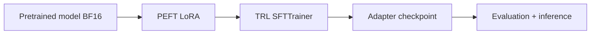
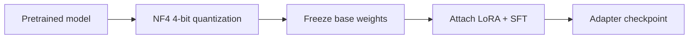
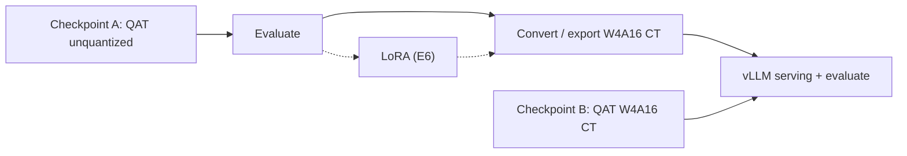
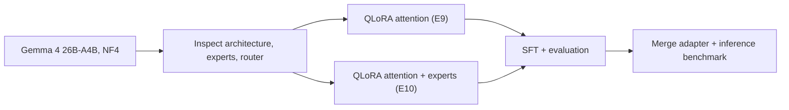

# LLM Optimization Lab

Nghiên cứu có thực nghiệm về **fine-tuning (LoRA, QLoRA)**, **quantization (PTQ W4A16, Gemma QAT)** và **deployment (vLLM)** cho mô hình ngôn ngữ lớn trên một GPU **NVIDIA L40 48GB**.

README này dùng để **theo dõi tiến độ** và **bắt đầu code**. Lập luận đầy đủ cho từng lựa chọn nằm trong [proposal.md](proposal.md).

**Bài toán:** information extraction. Input là **ảnh** hoặc **spatial text**, kèm system prompt mô tả chi tiết các thông tin cần trích xuất. Output là các trường thông tin đó. Context khoảng **21K – 32K tokens**.

**Mục tiêu triển khai:**
- **Chất lượng:** tối thiểu **95% exact match** và **95% field-level accuracy** trên test set.
- **Serving:** tham chiếu **60 request đồng thời**, theo model Qwen3-4B đang chạy thực tế.
- **Model:** họ **Gemma 4** cỡ nhỏ và vừa.

> **Kết quả cuối cùng:** một bảng quyết định kỹ thuật (accuracy, VRAM, latency, concurrency) và một recommendation trả lời câu hỏi *nên dùng model nào, workflow nào, và vì sao*.

---

## 1. Câu hỏi nghiên cứu

| ID | Câu hỏi | Tuần | Experiments |
|----|---------|:----:|-------------|
| Q1 | Fine-tune LoRA BF16 ở context 32K trên L40 tốn bao nhiêu VRAM và thời gian? Rank nhỏ nhất đạt 95% ở cả hai metric là bao nhiêu? | 1 | E0, E1, E3 |
| Q2 | QLoRA NF4 giảm bao nhiêu VRAM khi train, và accuracy giảm bao nhiêu so với LoRA BF16? | 2 | E2 |
| Q3 | LoRA → merge → W4A16 → vLLM có giữ được ngưỡng 95% không, và giảm VRAM/latency bao nhiêu so với BF16? | 3 | E4 |
| Q4 | Checkpoint Gemma QAT, dùng trực tiếp hoặc fine-tune thêm, có lợi thế thực tế so với fine-tune model thường rồi PTQ không? | 3 | E5, E6 |
| Q5 | Pipeline nào vừa đạt 95% vừa phục vụ được 60 request đồng thời trên một L40, so với Qwen3-4B đang chạy thực tế? | 3 | E4, E5, E7, R0 |
| Q6 | LoRA trên MoE (Gemma 4 26B-A4B) có khả thi trên L40 không? Nên target attention hay experts? Có đáng so với dense không? | 4 | E9, E10, E12 |

## 2. Phần cứng và model

**NVIDIA L40** (không phải L40S): 48 GB GDDR6 ECC, 864 GB/s, kiến trúc Ada (SM 8.9), Tensor Core hỗ trợ BF16 / FP16 / FP8 / INT8 / INT4. Không có NVLink, không hỗ trợ MIG, nên mọi experiment là **single-GPU**.

Mọi model Gemma 4 dưới đây đều nhận **ảnh + text**.

| Model | Hugging Face ID | Vai trò | Experiments |
|-------|-----------------|---------|-------------|
| Gemma 4 E2B IT | `google/gemma-4-E2B-it` | Model debug và pipeline chính | E0 – E4 |
| Gemma 4 E2B QAT unquantized | `google/gemma-4-E2B-it-qat-q4_0-unquantized` | Base QAT để dùng trực tiếp hoặc fine-tune thêm | E5, E6 |
| Gemma 4 E2B QAT W4A16 CT | `google/gemma-4-E2B-it-qat-w4a16-ct` | QAT đã quantize sẵn cho vLLM | E5 |
| Gemma 4 E4B IT | `google/gemma-4-E4B-it` | Scale-up nếu E2B chưa đạt 95% | E7 |
| Gemma 4 E4B QAT | `google/gemma-4-E4B-it-qat-q4_0-unquantized`, `google/gemma-4-E4B-it-qat-w4a16-ct` | Lặp lại E5, E6 nếu chọn E4B | — |
| Gemma 4 12B IT | `google/gemma-4-12B-it` | Dense cỡ vừa, cận trên của phạm vi | E8 |
| Gemma 4 26B-A4B IT | `google/gemma-4-26B-A4B-it` | MoE duy nhất của Gemma 4, chỉ chạy được ở 4-bit trên L40 | E9 – E12 |
| Qwen3-4B | `Qwen/Qwen3-4B` | Model đang chạy thực tế, **chỉ nhận text**, dùng làm mốc so sánh | R0 |

**Không dùng:** Gemma 4 31B vì quá lớn, Qwen3-8B / Qwen3-30B-A3B vì không nhận ảnh và nằm ngoài họ Gemma.

> [!NOTE]
> Gemma 4 E2B, E4B và 12B đều có bản QAT unquantized và bản W4A16 CT chính thức. Bản 26B-A4B chỉ có QAT unquantized và GGUF, nên phải tự quantize nếu cần W4A16. Ở BF16, weights của 26B-A4B cần khoảng 52 GB nên không vừa L40.

### Rủi ro 1: bộ nhớ train ở context 32K

Phần nguy hiểm nhất là **logits**: mỗi vị trí trong chuỗi sinh ra một vector dài bằng vocab. Gemma 4 có vocab 262.144 token, nên với một chuỗi 32.768 token:

| Dtype logits | Bộ nhớ |
|--------------|-------:|
| BF16 | ~17 GB |
| FP32 | ~34 GB |

Con số trên chưa tính gradient của logits, vốn có cùng kích thước. Biện pháp, thử theo thứ tự:

1. **Batch size 1**, gradient accumulation, gradient checkpointing.
2. **Chỉ áp `lm_head` lên các vị trí output** (labels khác `-100`) bằng custom `compute_loss`. Output ngắn hơn input nhiều, nên logits giảm theo tỉ lệ tương ứng.
3. **Fused linear cross-entropy** (Liger Kernel, có option `use_liger_kernel` trong TRL). Cần kiểm tra Gemma 4 đã được hỗ trợ chưa.
4. **Smoke test** vài step với mẫu dài nhất trước khi train full, để biết peak VRAM thật.

### Rủi ro 2: KV cache ở 60 request đồng thời

Ước tính KV cache BF16 cho request dài 32K token, tính từ config và số tham số của từng model:

| Model | Weights BF16 | KV mỗi request | KV 60 request | Weights + KV 60 request |
|-------|-------------:|---------------:|--------------:|------------------------:|
| Gemma 4 E2B | ~10 GB | ~0,21 GB | ~12,5 GB | ~23 GB |
| Gemma 4 E4B | ~16 GB | ~0,56 GB | ~33,5 GB | ~50 GB |
| Gemma 4 12B | ~24 GB | ~0,87 GB | ~52 GB | ~76 GB |
| Gemma 4 26B-A4B | ~52 GB | ~0,88 GB | ~53 GB | ~105 GB |
| Qwen3-4B | ~8 GB | ~4,83 GB | ~290 GB | ~298 GB |

Ước tính giả định vLLM chỉ giữ KV trong cửa sổ của các layer sliding-window, và dùng lại KV giữa các layer có chia sẻ KV. Số thật đo ở Day 15. Hệ quả:

- **E2B** vừa 60 request ở BF16.
- **E4B** chỉ vừa khi weights là W4A16 hoặc KV cache là FP8.
- **12B và 26B-A4B** cần cả hai.
- **Qwen3-4B** không thể chạy 60 request ở 32K token trên một L40. Bản production hẳn dùng context ngắn hơn, nhiều GPU hơn, hoặc xếp hàng request. Cần biết setup này để so sánh công bằng (xem [mục 4](#còn-mở)).
- **Prefix caching** giảm đáng kể con số thật, vì system prompt dài được dùng chung giữa các request. Day 2 cần đo riêng độ dài system prompt.

## 3. Trạng thái tổng quan

**Chú thích:** ⬜ chưa bắt đầu · 🟡 đang làm · ✅ xong · ⛔ bị chặn · ⏭️ bỏ qua

**Ngày bắt đầu:** `YYYY-MM-DD` · **Cập nhật lần cuối:** `2026-11-19`

| Giai đoạn | Nội dung | Trạng thái | Bắt đầu | Kết thúc | Report |
|-----------|----------|:----------:|---------|----------|--------|
| Chuẩn bị | Chốt task, dataset, metric, model, mục tiêu serving | ✅ | 2026-11-19 | 2026-11-19 | — |
| Tuần 1 | Environment, baseline, LoRA BF16, merge | ⬜ | | | `reports/baseline.md` |
| Tuần 2 | QLoRA, adapter inference vs merge, quyết định scale-up | ⬜ | | | `reports/lora_vs_qlora.md` |
| Tuần 3 | PTQ W4A16, Gemma QAT, vLLM deployment ở 60 request | ⬜ | | | `reports/quantization.md` |
| Tuần 4 | MoE LoRA, tổng hợp và recommendation | ⬜ | | | `reports/moe_lora.md`, `reports/final_recommendation.md` |

Timeline dự kiến là 4 tuần (khoảng 20 ngày làm việc). Nếu song song với công việc chính, giãn thành 5–6 tuần. Các mục còn mở ở mục 4 không chặn tuần 1.

## 4. Các mục đã chốt và còn mở

### Đã chốt (2026-11-19)

| Mục | Quyết định | Hệ quả cho kế hoạch |
|-----|------------|---------------------|
| Task | Information extraction: ảnh hoặc spatial text → các trường mô tả trong system prompt | Model phải nhận được ảnh. Mọi metric báo cáo tách theo loại input. |
| Metric | Exact match, field-level accuracy, thêm NED | `evaluate.py` tính cả ba, kèm parse rate (xem mục 7). |
| Chuẩn hóa | Post-processing đưa prediction và ground truth về cùng định dạng chuẩn rồi mới so sánh | Viết `scripts/postprocess.py` dùng chung cho evaluation và production. |
| Dataset | Private, chia `train` / `validation` / `test` / `calibration` | Không commit, không upload lên Hugging Face Hub hay dịch vụ ngoài. Mỗi split giữ tỉ lệ ảnh và spatial text như dữ liệu thật. |
| Quality target | Tối thiểu 95% cho **cả** exact match và field-level accuracy | Một pipeline chỉ "đạt" khi qua cả hai ngưỡng. Exact match thường là ngưỡng khó hơn. |
| Context | 21K – 32K tokens; số token input/output thay đổi theo đầu vào | `max_seq_length` khoảng 32K. Benchmark bằng phân phối độ dài thật. |
| Model | Họ Gemma 4 cỡ nhỏ và vừa | Bỏ Qwen3-8B và Qwen3-30B-A3B. Dense dùng E2B, E4B, 12B; MoE dùng 26B-A4B. |
| Concurrency | Tham chiếu 60 request đồng thời, theo Qwen3-4B đang chạy thực tế với input chỉ là text | Benchmark quét tới 60 request. Thêm R0 để đo Qwen3-4B làm mốc. |
| Model access | Chấp nhận license Gemma 4, đã có HF token trên server | Không còn blocker. |
| GPU quota | GPU dùng chung nhưng được ưu tiên | Không giới hạn số lần chạy. Khi đo VRAM và latency cần đảm bảo không có process khác trên GPU. |

### Còn mở

- [ ] **Setup của Qwen3-4B production:** GPU nào, context thực tế mỗi request, latency p95, có bật prefix caching không. Cần trước tuần 3 để so sánh công bằng.
- [ ] **Latency chấp nhận được ở 60 request đồng thời:** ví dụ p95 tối đa bao nhiêu giây. Không có ngưỡng này thì vLLM chỉ xếp hàng request, và con số 60 không có ý nghĩa.
- [ ] **Có giữ tuần MoE với Gemma 4 26B-A4B không?** Model này lớn hơn mức "nhỏ và vừa", nhưng là MoE duy nhất của Gemma 4. Kế hoạch tạm giữ vì câu hỏi MoE của leader. Nếu bỏ, tuần 4 chuyển sang E8 với Gemma 4 12B.

## 5. Roadmap chi tiết

Mỗi tuần kết thúc bằng một **điều kiện chuyển tuần**. Chưa đạt thì chưa sang tuần sau, vì debug sẽ khó hơn nhiều khi chồng thêm quantization hoặc MoE.

### Tuần 1 — Environment, baseline và LoRA BF16

**Mục tiêu:** chứng minh có thể setup L40, load model, chạy baseline, fine-tune LoRA ở context 32K, save/load adapter, đo VRAM và runtime. Chưa làm quantization hay MoE.

**Day 1 — Môi trường GPU** (xem [Bắt đầu nhanh](#9-bắt-đầu-nhanh-day-1))
- [ ] Chạy `nvidia-smi` và `nvidia-smi -q`: GPU, VRAM, driver, CUDA, process đang chiếm GPU
- [ ] Tạo môi trường `uv`, cài PyTorch đúng CUDA runtime và stack Hugging Face
- [ ] Xác nhận bản `transformers` đã cài có `Gemma4ForConditionalGeneration`
- [ ] Viết `scripts/check_gpu.py` và xác nhận BF16 hoạt động
- [ ] Ghi `reports/environment.md` (version của GPU, driver, CUDA, Python, PyTorch, Transformers, PEFT, TRL, bitsandbytes)

**Day 2 — Dữ liệu, evaluation và baseline inference (E0)**
- [ ] Chia dataset thành `train` / `validation` / `test` / `calibration`, giữ tỉ lệ ảnh và spatial text trong mỗi split
- [ ] Thống kê độ dài token (p50 / p95 / max), tách riêng system prompt, nội dung tài liệu và output, tách theo loại input; chốt `max_seq_length` từ đây
- [ ] Viết `scripts/postprocess.py` theo [quy tắc chuẩn hóa](#quy-tắc-chuẩn-hóa)
- [ ] Viết `scripts/evaluate.py`: exact match, field-level accuracy, NED, parse rate, accuracy theo từng loại field, tách theo loại input
- [ ] Viết `scripts/baseline_inference.py`: load model và processor (ảnh + text), đọc prompts, generate, lưu output thô, đo latency, tokens/s, peak VRAM
- [ ] Chạy E0 và lưu metrics, viết `reports/baseline.md`

**Day 3 — LoRA BF16 (E1)**
- [ ] Clone `google-gemma/gemma-skills`, đọc template SFT, lấy target modules từ template thay vì tự đoán tên module
- [ ] Viết `configs/gemma4_e2b/lora_bf16.yaml` và `scripts/train_lora.py` (PEFT + TRL `SFTTrainer`, đọc mọi tham số từ config)
- [ ] Gắn LoRA vào language model, giữ vision encoder đóng băng
- [ ] Xử lý bộ nhớ logits ở context 32K (xem [Rủi ro 1](#rủi-ro-1-bộ-nhớ-train-ở-context-32k)); smoke test với mẫu dài nhất trước
- [ ] Train, lưu adapter vào `artifacts/adapters/`
- [ ] Đo training loss, validation loss, exact match, field-level accuracy, NED, trainable params, peak VRAM, training time

**Day 4 — So sánh rank (biến thể của E1)**
- [ ] Chạy rank 8 / 16 / 32 (alpha = 2 × rank), cố định dataset, seed, epoch, learning rate, batch size, eval
- [ ] Điền bảng so sánh, chọn **rank nhỏ nhất đạt 95% ở cả hai metric**

  | Rank | Trainable params | VRAM | Training time | Exact match | Field acc. | NED |
  |:----:|------------------|------|---------------|-------------|------------|-----|
  | 8 | | | | | | |
  | 16 | | | | | | |
  | 32 | | | | | | |

**Day 5 — Adapter inference và merge (E3)**
- [ ] Viết `scripts/merge_adapter.py`
- [ ] So sánh output của base, base + LoRA adapter, merged model
- [ ] Xác nhận adapter inference và merged inference tương đương trong sai số numerical
- [ ] Cập nhật `reports/baseline.md` với kết quả LoRA và merge

> **Điều kiện chuyển tuần 1 → 2:** baseline inference, LoRA BF16 ở context thật, adapter inference và merge đều chạy được, có metrics accuracy/VRAM/runtime.

### Tuần 2 — QLoRA và các phương án fine-tuning

**Mục tiêu:** quantize base model xuống 4-bit trước khi fine-tune thì giảm VRAM được bao nhiêu, và accuracy có giảm so với LoRA BF16 không?

**Day 6 — Load model 4-bit NF4**
- [ ] Load bằng `BitsAndBytesConfig` (NF4, double quant, compute dtype BF16)
- [ ] Ghi VRAM khi load, sau khi attach LoRA, trong training step với mẫu 32K, và có OOM hay không

**Day 7 — QLoRA (E2)**
- [ ] Viết `configs/gemma4_e2b/qlora_nf4.yaml`, giữ nguyên mọi tham số của E1 trừ phần quantization
- [ ] Viết `scripts/train_qlora.py` và train
- [ ] So sánh với E1: training peak VRAM, training time, exact match, field-level accuracy, NED, loss, trainable params, throughput

**Day 8 — Adapter inference vs merge cho QLoRA**
- [ ] Option 1: quantized base + adapter → inference
- [ ] Option 2: merge adapter vào base high-precision → export
- [ ] Ghi rõ merge trên base nào; không merge thẳng vào quantized weights nếu backend không hỗ trợ

**Day 9 — Trade-off chất lượng và bộ nhớ**
- [ ] Vẽ biểu đồ accuracy vs VRAM, accuracy vs training time, accuracy vs inference latency cho Base, LoRA, QLoRA, Merged LoRA; đánh dấu ngưỡng 95%

**Day 10 — Report QLoRA và quyết định scale-up**
- [ ] Viết `reports/lora_vs_qlora.md` và `results/tables/lora_vs_qlora.csv`
- [ ] Trả lời: QLoRA tiết kiệm bao nhiêu VRAM? Training nhanh hay chậm hơn? Accuracy giảm bao nhiêu, còn trên 95% không? Có đáng dùng không? Adapter inference có overhead không? Merge có thành công không? Nếu deploy 4-bit thì phương án nào giữ accuracy tốt hơn?
- [ ] **Quyết định scale-up:** nếu E2B chưa đạt 95% ở cả hai metric, chạy E7 (Gemma 4 E4B) với cấu hình tốt nhất của E1/E2

> **Điều kiện chuyển tuần 2 → 3:** QLoRA train thành công, có bảng LoRA vs QLoRA và kết luận về merge/export. Tuần 3 quantize model tốt nhất đã đạt 95%. Nếu chưa có model nào đạt, vẫn dùng E2B để hoàn thiện pipeline.

### Tuần 3 — Quantization, Gemma QAT và deployment

**Mục tiêu:** chạy được chuỗi BF16 → LoRA → merge → W4A16 → compressed-tensors → vLLM, so sánh với đường QAT, và kiểm tra mục tiêu 60 request đồng thời.

**Day 11 — PTQ W4A16 (E4)**
- [ ] Tạo môi trường riêng cho LLM Compressor
- [ ] Đọc recipes: `GPTQModifier`, `AWQModifier`, group size, ignored layers, compressed-tensors format, và example cho model multimodal
- [ ] Viết `quantization/quantize_w4a16.py`: merged BF16 (từ E3) → W4A16 → export compressed-tensors
- [ ] Chỉ quantize language model, giữ vision encoder ở BF16 qua ignored layers
- [ ] Chỉ dùng **một** recipe W4A16 làm baseline, chưa thử GPTQ/AWQ/FP8/INT8 cùng lúc

**Day 12 — Calibration data**
- [ ] Tạo `data/calibration/` gồm cả mẫu ảnh và spatial text, độ dài giống workload thật
- [ ] Dùng một calibration set cố định; so sánh nhiều calibration set để sang P2

**Day 13 — Benchmark BF16 vs W4A16**
- [ ] Replay tập benchmark (xem [Benchmark protocol](#7-benchmark-protocol)), ghi loading memory, peak inference memory, TTFT, TPOT, tokens/s
- [ ] Báo cáo p50 / p95 latency và accuracy tách theo ảnh và spatial text

  | Model | Exact match | Field acc. | NED | VRAM | Latency p50 / p95 | Throughput |
  |-------|-------------|------------|-----|------|-------------------|------------|
  | Fine-tuned BF16 | | | | | | |
  | Fine-tuned W4A16 | | | | | | |

**Day 14 — Gemma QAT checkpoints (E5, E6)**
- [ ] E5, checkpoint A (unquantized): load → evaluate → convert/export W4A16 CT → load bằng vLLM → evaluate
- [ ] E5, checkpoint B (W4A16 CT): load bằng vLLM → evaluate
- [ ] E6: fine-tune LoRA trên checkpoint A với config tốt nhất của E1 → merge → W4A16 CT → so sánh với E4; có thể mất thêm một ngày
- [ ] Trả lời: có cần tự quantize A không? B có đúng là bản quantized tương ứng không? Accuracy, VRAM, latency khác nhau thế nào? Fine-tune trên QAT có giữ accuracy sau quantize tốt hơn PTQ không? Checkpoint nào hợp cho fine-tuning, checkpoint nào hợp cho serving?

**Day 15 — vLLM deployment ở 60 request đồng thời**
- [ ] Tạo môi trường riêng cho vLLM với `inference/requirements.txt`
- [ ] Viết `inference/serve_vllm.sh` với `--max-model-len` đủ cho 32K input cộng output, và `inference/benchmark_api.py` (gọi OpenAI-compatible API)
- [ ] Xác nhận prefix caching đang bật, vì system prompt dài được dùng chung giữa các request
- [ ] Quét concurrency 1 / 8 / 16 / 32 / 60 cho các bản đạt 95%; ghi KV cache thật và số request chạy song song tối đa
- [ ] Nếu KV cache không đủ cho 60 request, thử `--kv-cache-dtype fp8` và đo lại accuracy
- [ ] R0: chạy Qwen3-4B trên phần spatial text với cùng workload để làm mốc
- [ ] Viết `reports/quantization.md`

> **Điều kiện chuyển tuần 3 → 4:** checkpoint W4A16 load được bằng vLLM, có bảng accuracy/VRAM/latency/throughput BF16 vs W4A16, so sánh QAT, và đường cong latency theo concurrency tới 60 request.

### Tuần 4 — MoE LoRA và tổng hợp kết quả

**Mục tiêu:** LoRA trên Gemma 4 26B-A4B có khả thi trên L40 không? Fine-tune phần nào? Ảnh hưởng tới inference ra sao? Có đáng dùng so với dense không? Weights BF16 không vừa L40, nên mọi experiment MoE đều load base ở 4-bit.

**Day 16 — Load MoE và phân tích architecture**
- [ ] Load `google/gemma-4-26B-A4B-it` ở NF4 và chạy baseline inference
- [ ] Viết `scripts/inspect_moe.py`: in module names, types, parameter shapes, parameter count, expert tensors, router/gate tensors
- [ ] Ghi MoE architecture report: total/active params, số experts, experts kích hoạt mỗi token, router modules, expert modules, shared experts hoặc dense FFN đi kèm

**Day 17 — QLoRA trên attention (E9)**
- [ ] Target `q_proj`, `k_proj`, `v_proj`, `o_proj`; không train router hoặc experts
- [ ] Đo trainable params, training VRAM, training time, accuracy, inference latency, adapter size

**Day 18 — QLoRA trên attention + experts (E10)**
- [ ] Xác định chính xác tên và shape tensor của experts; dùng `target_parameters` của PEFT nếu experts là fused `nn.Parameter`
- [ ] So sánh với E9, đặc biệt là **inference latency** (expert LoRA có thể gây overhead; merge adapter có thể loại bỏ overhead này)
- [ ] Merge vào base BF16 cần khoảng 52 GB, nên làm trên CPU RAM của server

  | Metric | Attention only (E9) | Attention + experts (E10) |
  |--------|---------------------|---------------------------|
  | Trainable parameters | | |
  | Training VRAM | | |
  | Training time | | |
  | Exact match / Field acc. | | |
  | Adapter size | | |
  | Inference latency | | |

**Day 19 — Tùy chọn: Router LoRA (E12) và dense 12B (E8)**
- [ ] Chỉ làm Router LoRA nếu E9 và E10 không đạt 95%, hoặc có lý do cho thấy task cần đổi routing
- [ ] Nếu còn thời gian, chạy E8 (Gemma 4 12B QLoRA) để có thêm một điểm dense cỡ vừa

**Day 20 — Report và recommendation**
- [ ] Viết `reports/moe_lora.md`
- [ ] Điền [bảng quyết định cuối cùng](#13-bảng-quyết-định-cuối-cùng) và viết `reports/final_recommendation.md`

## 6. Experiment matrix

Bảng quan trọng nhất để quản lý nghiên cứu. Cập nhật cột **Trạng thái** và **Kết quả chính** sau mỗi lần chạy.

| ID | Ưu tiên | Model | Training → Deployment | Mục tiêu | Config | Trạng thái | Kết quả chính |
|----|:------:|-------|-----------------------|----------|--------|:----------:|---------------|
| E0 | P0 | Gemma 4 E2B | None → BF16 | Baseline | `gemma4_e2b/baseline.yaml` | ⬜ | |
| E1 | P0 | Gemma 4 E2B | LoRA BF16 → BF16 | Baseline fine-tuning | `gemma4_e2b/lora_bf16.yaml` | ⬜ | |
| E2 | P0 | Gemma 4 E2B | QLoRA NF4 → NF4 + adapter | Training memory | `gemma4_e2b/qlora_nf4.yaml` | ⬜ | |
| E3 | P0 | Gemma 4 E2B | LoRA BF16 → Merged BF16 | Merge validation | `gemma4_e2b/lora_bf16.yaml` | ⬜ | |
| E4 | P0 | Gemma 4 E2B | LoRA BF16 → W4A16 (vLLM) | Post-training quantization | `gemma4_e2b/quant_w4a16.yaml` | ⬜ | |
| E5 | P1 | Gemma 4 E2B QAT | None → QAT W4A16 CT | QAT baseline | `gemma4_e2b_qat/baseline.yaml` | ⬜ | |
| E6 | P1 | Gemma 4 E2B QAT | LoRA trên QAT unquantized → W4A16 CT* | Fine-tune QAT checkpoint | `gemma4_e2b_qat/lora_bf16.yaml` | ⬜ | |
| E7 | P1 | Gemma 4 E4B | LoRA BF16 → W4A16 | Scale-up nếu E2B chưa đạt 95% | `gemma4_e4b/lora_bf16.yaml` | ⬜ | |
| E8 | P2 | Gemma 4 12B | QLoRA NF4 → W4A16 | Dense cỡ vừa, cận trên | `gemma4_12b/qlora_nf4.yaml` | ⬜ | |
| E9 | P1 | Gemma 4 26B-A4B | QLoRA attention → 4-bit + adapter | MoE LoRA baseline | `gemma4_26b_a4b/qlora_attention.yaml` | ⬜ | |
| E10 | P1 | Gemma 4 26B-A4B | QLoRA attention + experts → merged | Expert adaptation | `gemma4_26b_a4b/qlora_experts.yaml` | ⬜ | |
| E11 | — | — | Gộp vào E9, E10 | MoE chỉ chạy được ở 4-bit trên L40 | — | ⏭️ | |
| E12 | P2 | Gemma 4 26B-A4B | Router adaptation → merged | Routing adaptation (tùy chọn) | TBD | ⬜ | |
| R0 | P1 | Qwen3-4B | Model đang chạy thực tế → vLLM | Mốc accuracy và latency trên spatial text | `qwen3_4b/baseline.yaml` | ⬜ | |

\* E6 cần xác nhận framework, target modules và export compatibility trước khi chạy. Không mặc định rằng tính chất QAT được giữ nguyên sau fine-tuning.

Config nằm trong `configs/`. Mức ưu tiên của E7, E8 và R0 được suy ra từ mục tiêu dự án; điều chỉnh nếu leader có yêu cầu khác.

## 7. Benchmark protocol

### Metrics chất lượng

- **Exact match:** tỉ lệ mẫu có **mọi** field đều đúng. Ngưỡng 95%.
- **Field-level accuracy:** số field đúng chia cho tổng số field kỳ vọng trên toàn test set. Ngưỡng 95%.
- **NED (normalized edit distance):** khoảng cách Levenshtein giữa prediction và ground truth, chia cho độ dài chuỗi dài hơn. Tính cho từng field rồi lấy trung bình; 0 là khớp hoàn toàn. NED cho biết một field sai là sai vài ký tự hay sai hẳn.
- **Parse rate:** tỉ lệ output đúng format và parse được. Output không parse được tính là sai mọi field.

Mọi metric luôn báo cáo **tách theo ảnh và spatial text**, kèm accuracy theo từng loại field để thấy field nào kéo điểm xuống.

### Quy tắc chuẩn hóa

`scripts/postprocess.py` áp **cùng một** hàm cho prediction và ground truth trước khi so sánh. Hàm này cũng nên là hàm chạy trong production, để metric phản ánh đúng kết quả thật.

- **Unicode NFC**, để ký tự có dấu được biểu diễn thống nhất.
- **Khoảng trắng:** bỏ ở đầu, cuối, và gộp khoảng trắng thừa ở giữa.
- **Chữ hoa/thường:** đưa về cùng một dạng.
- **Ngày:** đưa về ISO 8601 `YYYY-MM-DD`.
- **Số:** bỏ dấu phân cách hàng nghìn, thống nhất dấu thập phân. Quy tắc này cần theo từng loại field, vì `1.234` có thể là một nghìn hai trăm ba mươi tư hoặc một phẩy hai ba bốn.
- **Rỗng:** field rỗng, thiếu, hoặc giá trị tương đương rỗng đều đưa về `null`.

Lưu cả output thô và output sau chuẩn hóa để debug.

### Bộ metrics đầy đủ

Mọi experiment đều đo:

1. **Accuracy:** exact match, field-level accuracy, NED, parse rate trên cùng một test set.
2. **Training VRAM:** peak GPU memory khi train.
3. **Training speed:** steps/s và tổng thời gian train.
4. **Inference VRAM:** peak GPU memory khi generate, gồm cả KV cache.
5. **Latency:** TTFT, TPOT, tổng latency, báo cáo p50 và p95.
6. **Throughput:** tokens/s và requests/s.
7. **Concurrency:** latency và throughput tại từng mức concurrency, tới 60 request.
8. **Model size:** kích thước checkpoint và adapter.
9. **Stability:** OOM, lỗi load model, lỗi numerical.

### Workload benchmark inference

Vì độ dài input và output thay đổi theo từng mẫu, benchmark dùng **dữ liệu thật** thay vì một độ dài cố định:

```text
Tập benchmark: data/benchmark/, lấy mẫu từ test set, giữ nguyên giữa mọi candidate
Context:       21K – 32K tokens, theo dữ liệu thật
Output:        theo dữ liệu thật, ghi lại p50 / p95
Concurrency:   1 / 8 / 16 / 32 / 60
Temperature:   0
GPU:           L40, không có process khác khi đo
```

GPU được dùng chung, nên trước mỗi lần đo VRAM hoặc latency cần chạy `nvidia-smi` để xác nhận không có process khác, và lưu output đó cùng kết quả.

## 8. Quy ước thực nghiệm

### Config-driven

Mỗi experiment chỉ thay config, không sửa code training. Ví dụ `configs/gemma4_e2b/qlora_nf4.yaml`:

```yaml
experiment_id: E2
run_name: gemma4_e2b_qlora_r16
seed: 42

model:
  id: google/gemma-4-E2B-it
  dtype: bfloat16

method:
  name: qlora               # lora | qlora
  quantization: nf4
  double_quant: true
  compute_dtype: bfloat16

lora:
  rank: 16
  alpha: 32
  dropout: 0.05
  target_modules: []        # lấy từ template gemma-skills, không tự đoán
  train_vision_encoder: false

training:
  learning_rate: 2.0e-4
  batch_size: 1
  gradient_accumulation_steps: 8
  epochs: 2
  max_seq_length: 32768     # chốt theo thống kê độ dài ở Day 2
  gradient_checkpointing: true

evaluation:
  metrics: [exact_match, field_accuracy, ned, parse_rate]
  quality_target:           # phải đạt cả hai
    exact_match: 0.95
    field_accuracy: 0.95
  batch_size: 1
  temperature: 0
```

### Định dạng metrics

Mọi script ghi kết quả ra `results/metrics/<experiment_id>_<run_name>.json` với cùng schema. Trường nào không áp dụng thì để `null`.

```json
{
  "experiment_id": "E2",
  "run_name": "gemma4_e2b_qlora_r16",
  "config": "configs/gemma4_e2b/qlora_nf4.yaml",
  "git_commit": "abc1234",
  "seed": 42,
  "timestamp": "2026-11-20T10:00:00",
  "max_seq_length": 32768,
  "exact_match": null,
  "field_accuracy": null,
  "ned_mean": null,
  "parse_rate": null,
  "meets_target": null,
  "by_input_type": {
    "image":        { "n": null, "exact_match": null, "field_accuracy": null, "ned_mean": null },
    "spatial_text": { "n": null, "exact_match": null, "field_accuracy": null, "ned_mean": null }
  },
  "train_peak_vram_gb": null,
  "train_time_s": null,
  "train_steps_per_s": null,
  "trainable_params": null,
  "infer_peak_vram_gb": null,
  "kv_cache_gb": null,
  "ttft_ms_p50": null,
  "ttft_ms_p95": null,
  "tpot_ms_p50": null,
  "latency_ms_p50": null,
  "latency_ms_p95": null,
  "tokens_per_s": null,
  "requests_per_s": null,
  "concurrency": null,
  "checkpoint_size_gb": null,
  "adapter_size_mb": null,
  "stability_notes": ""
}
```

### Sau mỗi lần chạy

1. Commit config và code **trước** khi chạy, ghi `git_commit` vào metrics.
2. Lưu metrics JSON vào `results/metrics/` và log vào `results/logs/`.
3. Cập nhật cột Trạng thái và Kết quả chính trong [experiment matrix](#6-experiment-matrix).
4. Ghi một hai dòng vào [nhật ký tiến độ](#14-nhật-ký-tiến-độ).

### Nguyên tắc

- **Mỗi lần chỉ đổi một biến.** Đổi cùng lúc rank, learning rate, sequence length và dataset thì không biết thay đổi đến từ đâu.
- **Test set cố định** và không trùng với training; generation settings cố định.
- **Dữ liệu private ở lại trên server.** Không commit, không đẩy lên Hugging Face Hub hay dịch vụ ngoài. Adapter và model đã fine-tune cũng giữ private.
- **Stack Hugging Face trước**, Unsloth chỉ dùng sau khi baseline ổn định (P2).
- **Không sửa repo đã clone.** Dùng chúng làm dependency hoặc reference.
- **Tách môi trường.** Không cài vLLM, Unsloth, LLM Compressor, FlashAttention chung với môi trường training.
- **Không commit** `artifacts/`, `data/`, `.venv*`, `third_party/`.

## 9. Bắt đầu nhanh (Day 1)

**Kiểm tra GPU trên server:**

```bash
nvidia-smi        # GPU, VRAM, driver, CUDA, process đang chạy
nvidia-smi -q     # memory, nhiệt độ, power, clocks
```

**Tạo môi trường training** ở thư mục gốc repo:

```bash
uv init --bare --python 3.11     # chỉ tạo pyproject.toml
```

Cài PyTorch bản CUDA khớp với driver của server, theo [hướng dẫn PyTorch cho uv](https://docs.astral.sh/uv/guides/integration/pytorch/). Không tự ý đổi driver hoặc cài CUDA toolkit trên server công ty.

```bash
uv add transformers accelerate datasets evaluate
uv add peft trl bitsandbytes
uv add sentencepiece protobuf safetensors pyyaml pillow
uv add rapidfuzz    # Levenshtein cho NED
```

**Kiểm tra BF16 và hỗ trợ Gemma 4** với `scripts/check_gpu.py`:

```python
import torch
import transformers

print("CUDA available:", torch.cuda.is_available())
print("GPU:", torch.cuda.get_device_name(0))
print("BF16 support:", torch.cuda.is_bf16_supported())
print("PyTorch:", torch.__version__, "| CUDA runtime:", torch.version.cuda)
print("Transformers:", transformers.__version__,
      "| Gemma 4:", hasattr(transformers, "Gemma4ForConditionalGeneration"))
```

```bash
uv run python scripts/check_gpu.py
```

**Ghi lại môi trường** vào `reports/environment.md`:

```text
GPU:
GPU VRAM:
Driver:
CUDA:
Python:
PyTorch:
Transformers:
PEFT:
TRL:
bitsandbytes:
BF16 supported:
```

**Clone repo tham khảo** (Day 2–3):

```bash
mkdir -p third_party && cd third_party
git clone https://github.com/google-gemma/gemma-skills.git
```

**Môi trường riêng cho tuần 3:**

```bash
# LLM Compressor
uv venv .venv-quant --python 3.11 && source .venv-quant/bin/activate
uv pip install -r quantization/requirements.txt

# vLLM
uv venv .venv-vllm --python 3.11 && source .venv-vllm/bin/activate
uv pip install -r inference/requirements.txt
```

## 10. Cấu trúc repo

Cấu trúc mục tiêu, tạo dần theo từng tuần:

```text
llm-optimization-lab/
├── README.md                  # kế hoạch và theo dõi tiến độ (file này)
├── proposal.md                # đề xuất gốc, lập luận chi tiết
├── pyproject.toml             # môi trường training (uv)
├── uv.lock
│
├── configs/
│   ├── gemma4_e2b/
│   │   ├── baseline.yaml
│   │   ├── lora_bf16.yaml
│   │   ├── qlora_nf4.yaml
│   │   ├── quant_w4a16.yaml
│   │   └── vllm.yaml
│   ├── gemma4_e2b_qat/
│   │   ├── baseline.yaml
│   │   └── lora_bf16.yaml
│   ├── gemma4_e4b/
│   │   └── lora_bf16.yaml
│   ├── gemma4_12b/
│   │   └── qlora_nf4.yaml
│   ├── gemma4_26b_a4b/
│   │   ├── qlora_attention.yaml
│   │   └── qlora_experts.yaml
│   └── qwen3_4b/
│       └── baseline.yaml      # mốc production, chỉ spatial text
│
├── data/                      # private, không commit
│   ├── train/
│   ├── validation/
│   ├── test/
│   ├── calibration/
│   └── benchmark/             # mẫu lấy từ test set cho benchmark vLLM
│
├── scripts/
│   ├── check_gpu.py
│   ├── inspect_model.py
│   ├── inspect_moe.py
│   ├── postprocess.py         # chuẩn hóa dùng chung cho eval và production
│   ├── baseline_inference.py
│   ├── train_lora.py
│   ├── train_qlora.py
│   ├── merge_adapter.py
│   ├── evaluate.py
│   └── benchmark.py
│
├── quantization/              # môi trường riêng: LLM Compressor
│   ├── requirements.txt
│   ├── quantize_w4a16.py
│   ├── quantize_fp8.py
│   ├── convert_gemma_qat.py
│   └── verify_quantized.py
│
├── inference/                 # môi trường riêng: vLLM
│   ├── requirements.txt
│   ├── serve_vllm.sh
│   └── benchmark_api.py
│
├── artifacts/                 # không commit
│   ├── adapters/
│   ├── merged/
│   └── quantized/
│
├── results/
│   ├── metrics/               # <experiment_id>_<run_name>.json
│   ├── logs/
│   ├── tables/
│   └── figures/
│
├── reports/
│   ├── environment.md
│   ├── baseline.md
│   ├── lora_vs_qlora.md
│   ├── quantization.md
│   ├── moe_lora.md
│   └── final_recommendation.md
│
└── third_party/               # repo clone để tham khảo, không commit
```

## 11. Workflows

### Workflow 1 — LoRA BF16 (E1, E3, E7)

Baseline cho chất lượng và training memory.



### Workflow 2 — QLoRA (E2, E8, E9, E10)

Giảm VRAM khi fine-tuning. Đây là cách duy nhất để fine-tune 26B-A4B trên L40.



### Workflow 3 — LoRA → Merge → Quantize → Deploy (E3, E4, E7)

Production candidate: giảm inference VRAM và latency trong khi giữ accuracy.


### Workflow 4 — Gemma QAT (E5, E6)

Xác định lợi thế thực tế của QAT checkpoint so với fine-tune model thường rồi PTQ. Chỉ làm sau khi Workflow 3 ổn định.



### Workflow 5 — MoE LoRA (E9, E10, E12)

Đánh giá tính khả thi và chi phí của LoRA trên Gemma 4 26B-A4B.



## 12. Thứ tự ưu tiên

Mục tiêu là một kết luận đáng tin cậy, không phải hoàn thành đủ mọi experiment. Nếu thiếu thời gian, làm xong P0 trước, sau đó ưu tiên các mục P1 trả lời câu hỏi serving.

**P0 — Bắt buộc**
- [ ] GPU environment + baseline (E0)
- [ ] LoRA BF16 (E1)
- [ ] QLoRA NF4 (E2)
- [ ] Merge LoRA (E3)
- [ ] Benchmark inference BF16 vs 4-bit
- [ ] W4A16 export + vLLM serving (E4)

**P1 — Để trả lời đúng câu hỏi của leader**
- [ ] Gemma QAT unquantized vs W4A16 CT (E5)
- [ ] Fine-tune trên QAT checkpoint (E6)
- [ ] Scale-up lên E4B nếu E2B chưa đạt 95% (E7)
- [ ] Benchmark concurrency tới 60 request và mốc Qwen3-4B (R0)
- [ ] Trade-off accuracy – VRAM – latency sau quantization
- [ ] MoE QLoRA trên attention (E9)
- [ ] MoE QLoRA trên experts (E10)

**P2 — Nghiên cứu nâng cao, chỉ làm khi kết quả cho thấy cần thiết**
- [ ] Dense 12B (E8)
- [ ] Router LoRA (E12)
- [ ] So sánh calibration set
- [ ] Unsloth vs training Hugging Face chuẩn
- [ ] FP8 weights
- [ ] Tối ưu MoE nâng cao / expert parallelism
- [ ] Rút gọn system prompt sau fine-tuning: model đã học schema thì có thể bỏ bớt phần mô tả dài, giảm context và latency

**Đường ngắn nhất đến một kết quả có giá trị:** Gemma E2B baseline → LoRA BF16 → QLoRA NF4 → merge và verify → W4A16 + vLLM ở 60 request → so sánh Gemma QAT → MoE attention QLoRA → MoE expert QLoRA → final report.

## 13. Bảng quyết định cuối cùng

Điền khi kết thúc tuần 4, dùng làm phần chính của `reports/final_recommendation.md`. Một pipeline chỉ **đạt** khi cả exact match và field-level accuracy từ 95% trở lên.

| Pipeline | ID | Exact match | Field acc. | NED | Đạt? | Inference VRAM | Latency p95 ở 60 request | Recommendation |
|----------|----|-------------|------------|-----|:----:|----------------|--------------------------|----------------|
| E2B LoRA BF16 | E1 | | | | | | | |
| E2B QLoRA NF4 | E2 | | | | | | | |
| E2B LoRA → merge → W4A16 | E4 | | | | | | | |
| E2B QAT W4A16 CT | E5 | | | | | | | |
| E2B QAT + LoRA → W4A16 | E6 | | | | | | | |
| E4B LoRA → W4A16 | E7 | | | | | | | |
| 12B QLoRA → W4A16 | E8 | | | | | | | |
| 26B-A4B QLoRA attention | E9 | | | | | | | |
| 26B-A4B QLoRA attention + experts | E10 | | | | | | | |
| Qwen3-4B production, chỉ spatial text | R0 | | | | | | | |

Mẫu recommendation:

> Với yêu cầu exact match và field-level accuracy tối thiểu 95%, GPU L40 48GB, context 21K – 32K tokens, workload information extraction từ ảnh và spatial text ở 60 request đồng thời với p95 latency dưới T giây, workflow A cho kết quả tốt nhất về memory–latency trade-off. Workflow B giảm VRAM nhiều hơn nhưng accuracy rơi xuống dưới 95%. So với Qwen3-4B đang chạy thực tế, workflow A thêm khả năng đọc ảnh và thay đổi latency Y%.

## 14. Nhật ký tiến độ

Cập nhật cuối mỗi tuần, hoặc sau mỗi experiment quan trọng.

### Chuẩn bị · `2026-11-19`
- **Đã xong:** chốt task (information extraction từ ảnh hoặc spatial text), metric (exact match, field-level accuracy, NED), quy tắc chuẩn hóa, cách chia dataset, ngưỡng 95% cho cả hai metric, context 21K – 32K, họ model Gemma 4 nhỏ và vừa, mục tiêu tham chiếu 60 request đồng thời, quyền truy cập Gemma 4, GPU quota.
- **Phát hiện:** logits ở context 32K là rủi ro OOM lớn nhất khi train. Ở 60 request, KV cache chỉ vừa L40 với E2B ở BF16; E4B cần W4A16 hoặc FP8 KV cache. Qwen3-4B cần khoảng 290 GB KV cache cho 60 request 32K, nên setup production của nó cần được làm rõ.
- **Còn mở:** setup của Qwen3-4B production, latency chấp nhận được ở 60 request, có giữ tuần MoE với 26B-A4B không.

### Tuần 1 · `YYYY-MM-DD` → `YYYY-MM-DD`
- **Đã xong:**
- **Kết quả chính:**
- **Vấn đề / blocker:**
- **Tuần sau:**

### Tuần 2 · `YYYY-MM-DD` → `YYYY-MM-DD`
- **Đã xong:**
- **Kết quả chính:**
- **Vấn đề / blocker:**
- **Tuần sau:**

### Tuần 3 · `YYYY-MM-DD` → `YYYY-MM-DD`
- **Đã xong:**
- **Kết quả chính:**
- **Vấn đề / blocker:**
- **Tuần sau:**

### Tuần 4 · `YYYY-MM-DD` → `YYYY-MM-DD`
- **Đã xong:**
- **Kết quả chính:**
- **Vấn đề / blocker:**
- **Kết luận:**

## 15. Tài liệu tham khảo

| Repo | Dùng để |
|------|---------|
| [google-gemma/gemma-skills](https://github.com/google-gemma/gemma-skills) | Template LoRA/QLoRA SFT chính thức cho Gemma (ưu tiên) |
| [huggingface/peft](https://github.com/huggingface/peft) | LoRA, adapter config, `target_parameters` cho MoE |
| [vllm-project/llm-compressor](https://github.com/vllm-project/llm-compressor) | PTQ, W4A16, GPTQ, AWQ, compressed-tensors |
| [vllm-project/vllm](https://github.com/vllm-project/vllm) | Serving và benchmark inference |
| [unslothai/unsloth](https://github.com/unslothai/unsloth) | Tối ưu training, chỉ dùng sau khi baseline ổn định |
| [Ademo93/qlora-finetuning-lab](https://github.com/Ademo93/qlora-finetuning-lab) | Starter tham khảo cho LoRA → QLoRA → merge → inference |

Kiểm tra README, commit history, version compatibility, model support và license của từng repo trước khi dùng cho công việc công ty.
