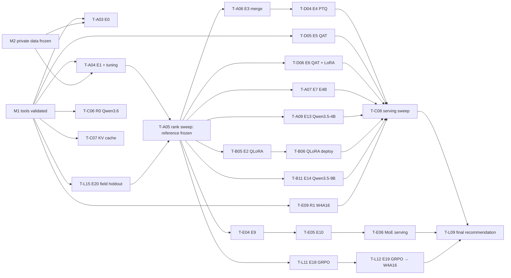

# Tasks

Who does what, in which order, and what "done" means. The research plan (what we test
and why) is in [README.md](README.md). File formats every track shares are in
[docs/formats.md](docs/formats.md).

**Status:** ⬜ todo · 🟡 in progress · ✅ done · ⛔ blocked · ⏭️ skipped

## How the work is split

Two phases:

1. **Phase 1: shared tools.** Every tool every workflow needs (training, HF inference,
   merge, quantization, vLLM serving, benchmark, evaluation) is built once. The lead has
   drafted all of them and run them on CPU with a tiny Gemma 4 model ([T-002](#t-002--phase-1-tool-drafts-)).
   Each member **validates, fixes and then maintains** one set of tools on real GPUs and
   real model sizes, using the public dev set (CORD v2).
2. **Phase 2: one workflow per person, end to end.** Each member owns one research
   question and runs its pipeline end to end with the shared tools: train, merge, quantize,
   serve, evaluate, tune, report. Owners run every step themselves instead of handing work over.

Phase 2 assumes the private data and ground truth exist for every doc type. Collecting
them is a separate effort, split by doc type; the lead owns the shared data tasks.

| Member | Phase 1: validates and maintains | Phase 2: owns end to end | Answers |
|--------|----------------------------------|--------------------------|:-------:|
| Lead | Core package, dev set, data tasks, `train_grpo.py`, field requests (T-L14) | **E20 field holdout** (gates M3); **W6 RL (GRPO):** E18, E19; plus integration, reviews, result tables, final recommendation | Q8, Q9 |
| A | SFT data, `train.py`, 32K training memory | **W1 LoRA BF16 and small models:** E0, E1, rank sweep, E3, E7, E13 (Qwen3.5-4B), E16 (Qwen3.5-2B, spatial text); publishes the reference config | Q1, Q7 |
| B | Training environment, model loading, `inspect_model.py`, HF predictor, `merge_adapter.py`, the same tools on Qwen3.5 | **W2 QLoRA and medium models:** E2, QLoRA deployment options, E8, E14 (Qwen3.5-9B), E17 (NuExtract3), Unsloth (P2) | Q2, Q7 |
| C | vLLM serve, vLLM predictor, benchmark harness | **Serving at 60:** production requirements, R0 (Qwen3.6-35B-A3B-FP8), KV cache / prefix caching / FP8 KV, serving sweep of every candidate, one model vs one per flow | Q5, Q7 |
| D | `quantize_w4a16.py`, `verify_quantized.py`, the Qwen W4A16 recipe | **W3 PTQ + W4 QAT:** E4, E5, E6, W4A16 of every chosen candidate, calibration and FP8 (P2) | Q3, Q4 |
| E | MoE inspection, expert LoRA study, MoE quantization check | **W5 MoE:** E9, E10, E12, R1 (production model W4A16), E15 (production model QLoRA), MoE serving vs dense | Q6 |

Letters are placeholders until the team is fixed. Everyone is full-time and can ask
anyone for help; the author of a tool reviews changes to it.

**With fewer people:**
- **4 people:** A also owns W2 (B's tasks); QLoRA is a one-variable change from W1.
- **3 people:** additionally, D also owns W5 (E's tasks); MoE needs self-quantization anyway.

**Hardware:** 3–5 × L40 48 GB for real runs and every measurement, 2 × ~24 GB GPUs for
development and smoke tests. Agree GPU use among yourselves; a run that measures VRAM or
latency needs a GPU with no other process. Expect the GPUs, not people, to be the
bottleneck in phase 2: queue long runs overnight.

## Rules for experiments and results (agreed 2026-11-20)

1. **Tune on validation only.** Tuning runs evaluate with `--split validation` (metrics go to
   `results/metrics/<run_id>__validation.json`). The test split is evaluated only for a
   **final** run, once per config.
2. **Reference config.** A publishes `configs/reference/gemma4_e2b_lora.yaml`: provisional
   after E1, **frozen** after the rank sweep (M3). Every other experiment `extends:` it and
   overrides only its own variable. Changing it after the freeze needs the lead's approval
   and a list of runs to redo.
3. **Extra tuning is reported separately.** An experiment tuned beyond its one variable is a
   separate run (`run_name` ending in `_tuned`) and a separate row in the matrix.
4. **Results enter the matrix only through a PR** with the config and the metrics JSON. The
   lead reviews it before the [experiment matrix](README.md#6-experiment-matrix) is updated.
5. **Scoring changes re-score everything.** When postprocess or metric rules change, the lead
   runs `scripts/reevaluate.py` on every saved prediction (no GPU needed).
6. **Same evaluation settings for everyone:** temperature 0, `max_new_tokens` from T-L04,
   the frozen split (hashes in `reports/data_quality.md`) and the same benchmark set.
7. **Dev runs are never results.** `configs/dev/` (experiment ID `DEV`, public CORD data) only
   validates tools.

## How to work with this file

- **Pick up a task:** set it to 🟡 and tick each step as you finish it.
- **End of the day:** if the task is not finished, leave it 🟡 with the finished steps
  ticked, and add one line to your section of the [daily log](#daily-log). Continue the
  next day from the first unticked step.
- **Branch and PR:** one branch per task (`T-A01-train-validation`), PR title `T-A01: ...`.
  The lead reviews every PR. A task is ✅ only when its **Done when** holds and the PR is merged.
- **Avoid conflicts:** edit only your own task blocks and your own daily-log section.
- **Core is shared:** `src/llm_opt_lab/` and `docs/formats.md` are used by every track.
  Change them only in a PR the lead reviews, with tests.
- **Blocked:** set ⛔, write what blocks you, and tell the owner of the blocking task the same day.
- **Every run:** commit config and code first; the tools save an `nvidia-smi` snapshot and
  record metrics with `record_metrics`.
- **Private data stays on the servers:** never commit it, never upload it to external services.

## Milestones

| ID | Milestone | Reached when | Status |
|----|-----------|--------------|:------:|
| M0 | Core and tool drafts | T-001, T-002 done | ✅ |
| M1 | Tools validated on GPU | On the dev set, end to end on real Gemma 4 E2B: train smoke → HF predict → merge → quantize → vLLM serve → vLLM predict → benchmark → evaluate; all phase-1 tasks done | ⬜ |
| M2 | Private data frozen | T-L03 and T-L04 done | ⬜ |
| M3 | Reference config frozen | E20 verdict in the reference config (T-L15), rank sweep done (T-A05), adapter inference and merge verified (T-A06) | ⬜ |
| M4 | Quantized model served at 60 | E4 evaluated (T-D04), latency curve up to 60 (T-C08) | ⬜ |
| M5 | MoE question answered | T-E06 and T-E09 done | ⬜ |
| M6 | RL question answered | T-L13 done | ⬜ |
| M7 | Final recommendation | T-L09 done | ⬜ |

Phase 2 starts for everyone at **M1 + M2**. A can start E0/E1 as soon as M2 is reached.

## Start here

| Member | Day 1 | Needs |
|--------|-------|-------|
| Lead | T-L01 and T-L14 (copy `cord` and `cord_full` to the servers, merge), T-003, then T-L15 (E20) and T-L10 (GRPO on an L40) | — |
| A | T-A01 (with the smoke config) | Dev set from T-L01, environment from T-B01 |
| B | T-B01, then T-B02, T-B10 (Qwen3.5) | — |
| C | T-C01, T-C05 | — |
| D | T-D01 | — |
| E | T-E01 | Training environment (T-B01) for `inspect_model.py` |

## Phase 2 dependencies

---

## Lead — core, shared data, integration

### T-001 · Core package ✅

**Done 2026-11-19.** `src/llm_opt_lab/`: config, dataset records, doc types, prompts,
parsing, postprocess, metrics, evaluation, predictions, metrics JSON, paths, split,
profiling; `scripts/evaluate.py`, `scripts/split_dataset.py`; CPU tests, ruff, CI,
`docs/formats.md`.

### T-002 · Phase-1 tool drafts ✅

**Done 2026-11-20.** Every phase-1 tool is drafted. What was run on CPU with
`trl-internal-testing/tiny-Gemma4ForConditionalGeneration` (Gemma 4 architecture, random
weights, transformers 5.23, peft 0.22, LLM Compressor 0.15):

| Tool | Checked on CPU with tiny Gemma 4 | Not checked (needs GPU / real model / network) |
|------|----------------------------------|-------------------------------------------------|
| `hf/sft_data.py` | Answer-only labels for image and spatial-text samples; prompt is a token prefix of the full chat | Real image token counts |
| `scripts/train.py` | `--check-loss`: label-position loss = full loss (diff ≤ 2e-6); 4 steps with eval; LoRA only on the language model; adapter, log and metrics saved | BF16 on GPU, NF4 (bitsandbytes needs CUDA), 32K memory |
| `scripts/predict_hf.py` | Base, `--source adapter`, `--source merged`; resume | NF4, peak VRAM |
| `scripts/merge_adapter.py` | `--verify`: max logit diff 9e-7, identical outputs; merged model = adapter outputs on test | BF16 tolerance, CPU merge of 26B |
| `scripts/inspect_model.py` | Components, Linear names, decoder class `Gemma4TextDecoderLayer` | MoE (26B-A4B) |
| `scripts/data/token_stats.py` | Tables and recommendations | Real data |
| `quantization/quantize_w4a16.py` | `basic` pipeline with mixed image + text calibration; `sequential` pipeline with one input type; checkpoint passes `verify_quantized.py` | Group size 128 (the tiny model's layers are too narrow; run used 16); GPU memory and time; vLLM load |
| `quantization/verify_quantized.py` | Unit tests with synthetic headers; real tiny checkpoints | — |
| `inference/*` (serve, predict, benchmark) | Command building, closed loop, stats, `/metrics` parsing are unit-tested | Never run against a vLLM server |
| `scripts/data/convert_cord.py` | Conversion functions are unit-tested | Downloading CORD v2 |

Findings already fixed in the code: Gemma 4's processor needs `torchvision`;
transformers 5 replaced `warmup_ratio` with a fractional `warmup_steps`; LLM Compressor's
`sequential` pipeline cannot mix image and spatial-text calibration samples, and needs
`per_layer_model_projection` in the ignore list (it gets no calibration data).

### T-003 · Move the repo to GitHub Enterprise ⬜

**Owner:** Lead · **Priority:** P0 · **Estimate:** 0.5 day

- [ ] Create a private repo on the company GitHub Enterprise and push the history
- [ ] Make CI run: replace `runs-on: ubuntu-latest` with the org's runner label if needed; check that org policy allows `astral-sh/setup-uv`
- [ ] Protect `main`: PR required, 1 approval, CI green; add `CODEOWNERS` (lead on `src/llm_opt_lab/`, `docs/formats.md`; tool authors on their tools)
- [ ] Agree where data and artifacts live on each GPU server (shared NFS or one copy per server); document `LLMOPT_DATA_DIR` and `LLMOPT_ARTIFACTS_DIR` per server in README quick start
- [ ] Decide whether `proposal.md` and the research report behind the 2026-11-26 decisions (`reports/Trích xuất trường chưa gán nhãn.md`, `research_notes/`; Vietnamese, untracked) are committed

**Done when:** every member can clone, open a PR, and see CI run on it.

### T-L01 · Public dev set (CORD v2) 🟡

**Owner:** Lead · **Depends on:** — · **Priority:** P0 · **Estimate:** 0.5 day

The dev set lets phase-1 validation start before private data exists.

- [x] Check the CORD v2 license (CC BY 4.0) is fine for internal use; note it in `docs/datasets.md`
- [x] `uv run --group data python scripts/data/convert_cord.py --out-dir "$LLMOPT_DATA_DIR/public/cord"` (fixed: a section annotated twice lost all its values)
- [x] `uv run python scripts/data/validate.py --data-dir "$LLMOPT_DATA_DIR/public/cord"`: 2,000 records, 0 errors
- [x] Split: `scripts/split_dataset.py --data-dir ... --input .../all.jsonl`; benchmark set: `scripts/data/make_benchmark.py --data-dir ... --n 100`; no receipt in two splits; hashes in `docs/datasets.md`
- [ ] Make the dev set available on every GPU server: `rsync` the built folder, check `SHA256SUMS` (commands in `docs/datasets.md`)

**Done when:** `configs/dev/*.yaml` find their data on every server.

### T-L02 · Ground-truth guideline ⬜

**Owner:** Lead · **Depends on:** — · **Priority:** P0 · **Estimate:** 2 days

Data is collected by doc type, by different people. Without one guideline, per-doc-type
metrics measure annotation style instead of model errors. Since 2026-11-26 the guideline
also has to keep labels valid when fields and business rules change
([formats §1–2](docs/formats.md#1-dataset-records)).

- [ ] Write `docs/annotation_guideline.md`:
  - **Raw data only:** copy every value exactly as printed (`"5 Pallet"`, `"45,500"`). Never convert units or codes and never apply a customer rule: normalization and business rules run in code (T-L05). Split a printed fact into its printed parts when the registry asks for them (quantity and unit as two fields), but never combine facts
  - **Annotated vs absent:** every field the record is annotated for has its key; `null` (`[]` for lists) means "checked, not on the document", never `""`; a field not annotated has no key. Every entry of a list annotates the same keys
  - **Lists:** one item per printed entry, in reading order; what to do with entries that span several lines
  - **Numbers and dates:** as printed; the registry's `x-field-type` only tells the scorer how to normalize
  - **Illegible or ambiguous values:** what to write, plus a flag in `meta.flags`
  - **Label source:** `label_source` is `human`, `teacher` (Qwen3.6 output, not checked) or `teacher_reviewed`; reviewing a teacher label means checking every annotated field, not only the visible errors
  - **Boxes (when provided):** the VLM's 0–1000 boxes are approximate; snap a value's box to the OCR words whose text matches it (normalized edit distance < 0.2), and flag values not found in the OCR for review first
- [ ] **Field registry per doc type** (`doc_types/<name>/schema.json`, [formats §2](docs/formats.md#2-doc-types)), written with the people who know the business: for every field a `description` that says where it is printed, 1–3 `examples`, `x-field-type`, and `x-mode` (`extract` for printed facts, `derive` for values a business rule computes); 2–4 `x-decoys`. The registry grows field by field; nobody has to list every field of a House B/L up front
- [ ] Review the current production fields: every field whose value depends on a customer rule (e.g. "3 Pallet, 5 Carton" read as cartons, pallets or 8 units) becomes `derive`, plus the printed facts it needs as `extract` fields
- [ ] Worked examples per doc type (one clean, one tricky)
- [ ] Agreement check: two people annotate the same 20 documents; score one against the other with `scripts/evaluate.py`; fold disagreements into the guideline

**Done when:** agreement ≥ 98% field accuracy on the check set, or every disagreement is resolved in the guideline.

### T-L03 · Private data: validate, split, benchmark set ⬜

**Owner:** Lead · **Depends on:** private data and ground truth, T-L02 · **Priority:** P0 · **Estimate:** 1 day

- [ ] One doc type folder per company doc type: `instructions.md` (the production prompt without its field list and without business rules) and the field registry `schema.json` (T-L02)
- [ ] Targets hold printed facts only: values a customer rule computed (the latest production prompt still applied the Pallet/Carton rules) are replaced by the printed facts they came from, or dropped from the target
- [ ] `scripts/data/validate.py` passes on `$LLMOPT_DATA_DIR/private/all.jsonl`, and with `--reviewed-only` on `test.jsonl`: the test split is human-checked, otherwise "95%" only measures agreement with Qwen3.6
- [ ] Teacher error audit: on a random sample of `teacher` labels, the share of wrong values per field (before review); it bounds what a model trained on unreviewed labels can reach
- [ ] Agree split ratios (default 80/5/10/5). With ~200 test samples per doc type, a 95% exact match has a standard error of ~1.5 points; raise the test share if per-doc-type results matter (T-L06)
- [ ] Run `scripts/split_dataset.py` **once**; never `--overwrite` after the first experiment
- [ ] `scripts/data/make_benchmark.py --n 300` (≥ 5 × the highest concurrency)
- [ ] Record the SHA-256 of every split file and counts per doc type × input type in `reports/data_quality.md`, with null rate per field, annotated share per field (fields added later are annotated on fewer records), `label_source` counts and list lengths
- [ ] Copy to every GPU server

**Done when:** splits, benchmark set and hashes exist; M2 is reached together with T-L04.

### T-L04 · Token statistics ⬜

**Owner:** Lead · **Depends on:** T-L03, T-B01 · **Priority:** P0 · **Estimate:** 0.5 day

- [ ] `scripts/data/token_stats.py --config <E2B config> --split train --out reports/data_stats.md` (CPU is enough); repeat with the Qwen3.5 processor (`configs/dev/cord_qwen35_4b_base.yaml` pointed at private data)
- [ ] Agree the image processor settings per model family with A: Gemma 4 has a fixed image token budget (70–1120), Qwen grows with resolution (one token per 32×32 px). Add `model.processor_kwargs` to the config and apply it in `load_processor` and in the vLLM command (`--mm-processor-kwargs`), so training, HF inference and serving see the same image (core PR)
- [ ] Write `training.max_seq_length` and `evaluation.max_new_tokens` into the reference config (with A) and README §4; decide the over-length policy (drop or fail)
- [ ] Note the system prompt share per doc type for C (prefix caching). The system prompt is now rendered from the registry (descriptions and examples of every field), so it is longer than a bare field list; sampled training requests are shorter than the inference one

**Done when:** both lengths are agreed and written down.

### T-L05 · Port the production postprocess and the business-rule layer ⬜

**Owner:** Lead · **Depends on:** production code (T-C05), T-L02 · **Priority:** P0 · **Estimate:** 4 days

The model returns printed values only; everything else runs in code, in production as in
scoring ([formats §2](docs/formats.md#2-doc-types)), so a rule or code-list change never
needs new labels or retraining.

- [ ] **Normalization** (one value, a mapping that does not depend on the customer): implement the field-type rules in `src/llm_opt_lab/postprocess.py` (date → ISO 8601, numbers per field, unit and package codes such as UN/ECE Recommendation 21 `PX` pallet / `CT` carton, ...), replacing every `TODO(T-L05)`
- [ ] Align `EMPTY_VALUES` with production; tag every schema leaf with its `x-field-type`
- [ ] **Business rules** for `derive` fields: per customer and doc type, versioned, unit-tested, outside the model (e.g. "3 Pallet, 5 Carton" → 3 cartons on an invoice, 8 units on a warehouse note). Decide where they live with the production team (this repo or the production service) and how a release pins (model, registry, rule) versions
- [ ] Unit tests from real (anonymized) examples
- [ ] `scripts/reevaluate.py` on everything evaluated so far

**Done when:** no `TODO(T-L05)` is left, every `derive` field has a tested rule, and tests pass.

### T-L06 · Metric decisions ⬜

**Owner:** Lead · **Depends on:** first E0 predictions (T-A03) · **Priority:** P1 · **Estimate:** 1 day

- [ ] **List matching:** items are compared by position. Measure on E0 how often the right items come in another order; if often, switch to content-based matching
- [ ] **Target scope:** 95% overall, or per input type / per doc type? (with T-C05)
- [ ] **Extra fields:** keep them out of field accuracy (current), or count them?
- [ ] Implement changes in `metrics.py` with tests; update `docs/formats.md` §5 and README §7; re-score

**Done when:** the decisions are in README §4.

### T-L07 · Result tables, charts, error analysis 🟡

**Owner:** Lead · **Depends on:** first metrics files · **Priority:** P1 · **Estimate:** 3 days

- [x] `scripts/aggregate_results.py`: `results/metrics/*.json` → `results/tables/experiments.csv` and Markdown for the README matrix and final table; flags runs with uncommitted code
- [x] `scripts/plot_tradeoffs.py`: accuracy vs VRAM, training time and latency, with the 95% line → `results/figures/`
- [x] `scripts/error_analysis.py`: worst fields, wrong values, parse failures, and run-vs-run diffs from `artifacts/eval/`; also failure kinds (missing, invented, near miss) and reordered list items for T-L06
- [ ] Run on the first real metrics files (dev runs at M1) and adjust columns and figures to what the owners need

**Done when:** one command regenerates every table and figure.

### T-L08 · Integration and review 🟡

**Owner:** Lead · **Priority:** P0 · **Estimate:** ongoing

- [ ] Review PRs within one working day; core changes need tests; result PRs follow the [rules](#rules-for-experiments-and-results-agreed-2026-11-20)
- [ ] Weekly: milestones, experiment matrix and weekly progress log in README
- [ ] Keep the [decision log](#decision-log) current; unblock ⛔ tasks the same day

### T-L09 · Final recommendation ⬜

**Owner:** Lead (with all) · **Depends on:** every owner's report · **Priority:** P0 · **Estimate:** 2 days

- [ ] Fill the [final decision table](README.md#13-final-decision-table); write `reports/final_recommendation.md` answering Q1–Q8, per-doc-type breakdown in an appendix
- [ ] Review with every owner before it goes to the leader

### Field generalization (Q9, decided 2026-11-26)

Required fields change weekly during go-live and monthly in production: fields are added
and removed, new doc types arrive, and business rules change per customer. Training on one
fixed prompt per doc type teaches the model one output format, so every change would need
new labels and a new fine-tune. Instead the model is trained to **read the field list**
(schema-conditioned extraction): each training sample asks for a random subset of its
annotated fields, sometimes with decoys whose answer is `null`. It returns printed values
only; normalization and business rules run in code (T-L05). Self-supervised pretraining
(MLM-style) was considered and rejected as the main path: no study shows it extracts fields
that were never labeled, and the base models already read documents. Evidence and sources:
the research report listed in T-003.

#### T-L14 · Schema-conditioned extraction tools (core) 🟡

**Owner:** Lead · **Depends on:** — · **Priority:** P0 · **Estimate:** 3 days

Done 2026-11-26 on branch `T-L14-schema-conditioned-extraction` (T-L01 merged in), checked
on CPU: 112 tests, tiny Gemma 4 / Qwen3.5 / Qwen3.6 MoE tests (SFT → GRPO on sampled
requests) pass.

- [x] Doc types: `instructions.md` (no field list) + field registry in `schema.json` (`description`, `examples`, `x-mode`, `x-decoys`); `cord_receipt` rewritten, `cord_receipt_full` added (every CORD field)
- [x] Records: a field is annotated when its key is present; optional `label_source`; `validate.py` rejects `derive` fields in targets and lists whose entries annotate different keys, and `--reviewed-only` checks a test split
- [x] `field_requests.py`: inference request (`fields.inference`, `fields.decoys`), training request (fixed, or sampled with `fields.sampling`), `fields.holdout`, projection of the target on a request
- [x] Prompt rendered from the registry for the request; SFT, GRPO, HF and vLLM prediction, calibration (`quantization.calibration_requests`) and token stats all go through it; predictions record the requested `fields`
- [x] Scoring: requested fields only, unannotated fields skipped, key presence, field groups (seen / held out / decoy) with missed and invented value rates; rewards `value_recall` and `null_accuracy`
- [x] `public/cord_full` built with `convert_cord.py --relabel-from` (same ids, splits and images as `public/cord`; human labels); E20 configs in `configs/field_holdout/`
- [x] Merged into `main` with T-L01 and T-L07 on 2026-11-27, without a PR (the lead's decision; GitHub Enterprise and PR rules come with T-003)
- [x] Token lengths on `cord_full` (Qwen3.5-4B processor): system prompt 1,135 tokens for the full request; answers p95 602, max 1,604 (`max_new_tokens: 2048` fits); images up to 13.6K tokens with Qwen, so a Qwen E20 run needs `max_seq_length: 16384`
- [ ] Copy `public/cord_full` to the GPU servers with `public/cord` (its `images` is a relative link to `../cord/images`)
- [ ] On an L40, with the dev smoke configs (which now sample requests): the prefix check passes for sampled requests on real E2B and Qwen3.5-4B tokenizers (T-A01, T-B10); `quantize_w4a16.py` with `calibration_requests: sampled` (T-D02)

**Done when:** the dev smoke runs pass on an L40 with sampled requests.

#### T-L15 · E20 field holdout: fixed vs sampled requests ⬜

**Owner:** Lead · **Depends on:** T-L14, M1 · **GPU:** L40 · **Priority:** P0 (gates M3) · **Estimate:** 4 days + GPU time

Answers Q9 on public data before the reference config is frozen. Configs:
`configs/field_holdout/` (Gemma 4 E2B). Data: `public/cord_full`, human labels, frozen dev
split. Held out: `subtotal.tax_price`, `total.change_price`, `total.menu_quantity_count`,
`menu[].unit_price` (36, 64, 29 and 30 of the 100 test receipts), plus the two decoys
asked at evaluation.

- [ ] **Agree the decision rule before running** (proposal): adopt sampled requests in the reference config if B is within noise of A on T1 (seen fields only: exact match and field accuracy, 95% bootstrap interval over receipts) and clearly better on the held-out group of the full request. If B loses on T1, raise `full_rate` before giving up on it
- [ ] Z1: base E2B zero-shot (`gemma4_e2b_base.yaml`): the floor
- [ ] A (`gemma4_e2b_fixed.yaml`) and B (`gemma4_e2b_sampled.yaml`): train; tune on validation only; then evaluate on test with the full request (T3), `__seen` (T1), `__held_out` (T2) and `__decoys` (T5), each with `predict_hf.py --source adapter:E20_gemma4_e2b_<arm>`
- [ ] Report per field group: field accuracy, key presence, missed and invented value rates, exact match; by input type
- [ ] Zero-shot references on the full request: NuExtract3 (with B, T-B12) and Qwen3.6-35B-A3B-FP8, the system the new model must not fall behind on new fields (with C)
- [ ] Repeat A and B on Qwen3.5-4B (rankings of small models differ between benchmarks)
- [ ] After the verdict: learning curve for the held-out fields (0 / 10 / 25 / 50 / 100 labeled receipts added to the best arm, with replay), which sizes "labels needed per new field"
- [ ] After the verdict: the best arm through merge → W4A16 with `calibration_requests: full` vs `sampled` (with D): does quantization widen the gap between seen and held-out fields?
- [ ] `reports/field_generalization.md`; write the verdict into README §4 and the reference config (with A)

**Done when:** the verdict is in README §4 and the reference config uses it, before M3.

### W6 — RL with extraction rewards (Q8)

SFT teaches the output format and most values; RL with a verifiable reward then optimizes
the metric itself. It is the same recipe as RLVR (Tulu 3), DeepSeek-R1's rule-based
rewards and reinforcement fine-tuning services, with our evaluation scorer as the
verifier. Reading: [docs/reading.md §7](docs/reading.md#7-rl-fine-tuning-w6).

#### T-L10 · GRPO tool on GPU 🟡

**Owner:** Lead · **Depends on:** T-L01, T-B01, a dev SFT adapter (T-A01) · **GPU:** L40 · **Priority:** P1 · **Estimate:** 2 days

Drafted 2026-11-20: `src/llm_opt_lab/rewards.py`, `scripts/train_grpo.py`, the `rl:` config
section, `configs/dev/cord_e2b_grpo_smoke.yaml`. Checked on CPU:
- rewards equal the evaluation scorer (unit tests);
- the prompt TRL rebuilds is token-identical to the SFT prompt, for image and spatial text;
- SFT → GRPO continuing the SFT adapter runs end to end on tiny Gemma 4, Qwen3.5 and Qwen3.6 MoE models.

Not run on a GPU yet.

- [x] Rewards from the evaluation scorer: field accuracy, exact match, similarity (1 − NED), parse
- [x] `train_grpo.py`: continues the SFT adapter (`rl.init_adapter`), one prompt group per generation batch (image and spatial text never mixed), completions never logged
- [x] Tiny-model tests (`LLMOPT_RUN_TINY=1`)
- [x] 2026-11-26 (T-L14): each prompt asks for a training request (sampled once per sample with `fields.sampling`) and is scored on those fields only; new reward components `value_recall` (values not answered null) and `null_accuracy` (no invented values), weight 0 by default
- [ ] On an L40: `scripts/train.py --config configs/dev/cord_e2b_lora_smoke.yaml`, then `scripts/train_grpo.py --config configs/dev/cord_e2b_grpo_smoke.yaml`; record peak VRAM, seconds per step, and whether `rewards/*/mean` rise in `train_log.jsonl`
- [ ] Memory at real lengths: G completions of a 21K–32K prompt per step. If it does not fit: fewer generations (≥ 4), `training.batch_size: 1`, QLoRA
- [ ] Generation speed: HF `generate` is slow for long prompts. Try `rl.use_vllm: true` (`vllm_mode: colocate`) in a separate `.venv-rl` with TRL's vLLM extra; never install vLLM in the training environment
- [ ] `predict_hf.py --source adapter` and `evaluate.py` on the GRPO adapter; compare with the SFT adapter on the dev validation split

**Done when:** a dev GRPO run trains, saves and evaluates on an L40, and the fixes are merged.

#### T-L11 · E18 GRPO on the reference SFT adapter ⬜

**Owner:** Lead · **Depends on:** T-L10, M3 (reference frozen) · **Priority:** P1 · **Estimate:** 4 days + GPU time

- [ ] `configs/rl/gemma4_e2b_grpo.yaml`: `extends:` the reference, `rl.init_adapter: adapter:<E1 run id>`; tune on validation only
- [ ] Reward weights (one variable per run): `field_accuracy` + `exact_match` (default) vs adding `similarity`, `value_recall` (rare fields are null on most documents, so field accuracy alone rewards answering null) or `null_accuracy`; watch for reward hacking (e.g. dropping list items to avoid wrong ones)
- [ ] Requests as the reference SFT (sampled if E20 says so); also score the GRPO adapter on E20's held-out and decoy conditions: RL is expected to keep generalization better than SFT, but only if the SFT start did not overfit
- [ ] Group size (4 / 8), `beta` 0 vs 0.01, learning rate (LoRA RL usually needs ~10× the full fine-tuning rate)
- [ ] Final run on test: exact match and field accuracy vs the SFT start, by input type and doc type; training cost (GPU hours, peak VRAM)
- [ ] If E2B already passes 95% after SFT: run E18 on the weakest candidate that misses it (e.g. Qwen3.5-2B on spatial text)

#### T-L12 · E19 RL → merge → W4A16 → vLLM (P2) ⬜

**Owner:** Lead · **Depends on:** T-L11, T-D04 · **Priority:** P2 · **Estimate:** 2 days

- [ ] `merge_adapter.py`, then `quantize_w4a16.py` with D's recipe, serve with C's harness
- [ ] Does the RL gain survive W4A16? Compare with E4 (SFT → W4A16)

#### T-L13 · Q8 report ⬜

**Owner:** Lead · **Depends on:** T-L11 · **Priority:** P1 · **Estimate:** 1 day

- [ ] `reports/rl.md`: gain over SFT per metric and input type, cost, failure modes, recommendation

---

## A — W1 LoRA BF16 (Q1)

### Phase 1

#### T-A01 · Validate SFT data and training on Gemma 4 ⬜

**Owner:** A · **Depends on:** T-B01, T-L01 · **GPU:** ~24 GB, then L40 · **Priority:** P0 · **Estimate:** 2 days

- [ ] Agree the LoRA `target_modules` with B from `scripts/inspect_model.py` and the gemma-skills SFT template (`third_party/gemma-skills`); compare its chat formatting and loss masking with `hf/sft_data.py`
- [ ] `scripts/train.py --config configs/dev/cord_e2b_lora_smoke.yaml --check-loss 8` on real E2B: the two losses agree (BF16 tolerance ~1e-3 relative) for image and spatial-text samples
- [ ] Smoke run on a ~24 GB GPU, then a 200-step run on an L40: loss goes down, eval loss runs, the adapter loads in `predict_hf.py --source adapter`
- [ ] Check the log line "LoRA on N modules": language model only
- [ ] The smoke config samples requests (`fields.sampling`, T-L14): `--check-loss` and a few `SFTDataset` draws on real E2B pass the prefix check, and decoded answers hold exactly the requested fields
- [ ] Fix what breaks, with tests where possible (`LLMOPT_RUN_TINY=1 uv run --group train pytest tests/test_hf_tiny.py`)

**Done when:** a dev LoRA run trains, saves and predicts on an L40, and the fixes are merged.

#### T-A02 · Training memory at 32K context ⬜

**Owner:** A · **Depends on:** T-A01, T-L04 · **GPU:** L40 · **Priority:** P0 · **Estimate:** 2 days

See [Risk 1](README.md#risk-1-training-memory-at-32k-context).

- [ ] Peak VRAM of one step on the longest real sample, E2B and E4B, `training.loss: label_positions` vs `full`
- [ ] If it still does not fit: check Liger Kernel fused linear cross-entropy for Gemma 4, and add it as a `training.loss` option (core PR)
- [ ] Write `reports/notes/long_context_memory.md`; E reuses it

**Done when:** one step on the longest sample fits on an L40 with margin, for E2B and E4B.

### Phase 2

#### T-A03 · E0 baseline ⬜

**Owner:** A · **Depends on:** M1, M2 · **Priority:** P0 · **Estimate:** 1 day

- [ ] `configs/gemma4_e2b/baseline.yaml`; `predict_hf.py` on test; `evaluate.py`; `reports/baseline.md`

#### T-A04 · E1 LoRA BF16 and tuning ⬜

**Owner:** A · **Depends on:** T-A02, T-A03 · **Priority:** P0 · **Estimate:** 3 days + GPU time

- [ ] `configs/reference/gemma4_e2b_lora.yaml` (rank 16, alpha 32, `fields.sampling` as E20 decides, T-L15): train, evaluate on **validation**
- [ ] Tune on validation (learning rate, epochs, image settings); one variable per run
- [ ] Publish the config as the **provisional reference**; tell B, D, E
- [ ] Final run on test

#### T-A05 · Rank sweep and reference freeze ⬜

**Owner:** A · **Depends on:** T-A04 · **GPU:** 3 × L40 in parallel · **Priority:** P0 · **Estimate:** 1 day + GPU time

- [ ] Ranks 8 / 16 / 32 (alpha = 2 × rank) in parallel, each `extends:` the reference
- [ ] Choose the smallest rank reaching 95% on both metrics; **freeze the reference config** (M3)

#### T-A06 · E3 merge and equivalence ⬜

**Owner:** A · **Depends on:** T-A05 · **Priority:** P0 · **Estimate:** 1 day

- [ ] `merge_adapter.py --verify 20`; evaluate the merged model; tell D the merged run id for E4

#### T-A07 · E7 Gemma 4 E4B ⬜

**Owner:** A · **Depends on:** T-A05 · **Priority:** P1 · **Estimate:** 3 days

- [ ] Do not wait for the E2B verdict: LoRA on E4B (`extends:` the reference, only `model.id` changes), merge, W4A16 with D's script, serve and benchmark with C's harness

#### T-A08 · Q1 report ⬜

**Owner:** A · **Depends on:** T-A03–T-A07, T-A09 · **Priority:** P0 · **Estimate:** 1 day

- [ ] `reports/baseline.md`: VRAM and time at 32K, rank table, smallest rank at 95%, adapter vs merged, E2B vs E4B vs Qwen3.5-4B

#### T-A09 · E13 Qwen3.5-4B ⬜

**Owner:** A · **Depends on:** T-A05, T-B10 · **Priority:** P1 · **Estimate:** 3 days

- [ ] Zero-shot baseline first (`enable_thinking: false`), then LoRA: `extends:` the reference; `model.id`, `chat_template_kwargs` and `lora.target_modules` change (Qwen3.5 names: `q/k/v/o_proj`, `linear_attn.in_proj_qkv/in_proj_z/out_proj`, MLP; from T-B10)
- [ ] Merge, W4A16 with D's Qwen recipe (T-D09), serve and benchmark with C's harness
- [ ] Compare with E7 (Gemma 4 E4B) by input type: same size class, different family

#### T-A10 · E16 Qwen3.5-2B on spatial text only (P2) ⬜

**Owner:** A · **Depends on:** T-A09 · **Priority:** P2 · **Estimate:** 2 days

- [ ] `data.input_types: [spatial_text]`; LoRA as E13; serve text-only (`serving.extra_args: [--language-model-only]`)
- [ ] Does a 2B model reach 95% on spatial text? If yes, C evaluates a split deployment (T-C08)

---

## B — W2 QLoRA and dense scale (Q2)

### Phase 1

#### T-B01 · Training environment ⬜

**Owner:** B · **Depends on:** — · **GPU:** every server · **Priority:** P0 · **Estimate:** 1 day

- [ ] On each server: `nvidia-smi`, `nvidia-smi -q`; note driver and CUDA
- [ ] Pin the `train` group in `pyproject.toml` (transformers 5.x with Gemma 4; torchvision is required); point torch at the CUDA wheel index matching the driver (`[[tool.uv.index]]`); commit `uv.lock`
- [ ] `uv sync --group train && uv run python scripts/check_gpu.py` on every server
- [ ] `reports/environment.md`, one block per server; exact setup commands in README quick start

**Done when:** the environment works on an L40 and a ~24 GB GPU, and CI still passes.

#### T-B02 · Model loading and structure ⬜

**Owner:** B · **Depends on:** T-B01 · **GPU:** L40 · **Priority:** P0 · **Estimate:** 1 day

- [ ] `scripts/inspect_model.py` for E2B, E4B, 12B (no GPU needed) → `reports/notes/model_structure.md`; agree `target_modules` with A
- [ ] `hf/loading.py`: load E2B and E4B in BF16 and **NF4** on an L40 (bitsandbytes was not testable on CPU); record load VRAM
- [ ] `model.attn_implementation`: compare the default with `sdpa` / `eager` for Gemma 4 (speed, memory, equality)

#### T-B03 · Validate the HF predictor ⬜

**Owner:** B · **Depends on:** T-B02, T-A01 (smoke adapter) · **GPU:** L40 · **Priority:** P0 · **Estimate:** 1 day

- [ ] `predict_hf.py` on the dev test split: base, NF4 base, `--source adapter`, `--source merged`; interrupt and resume
- [ ] Compare with vLLM predictions of the same model (with C, T-C03): same greedy outputs on most samples; explain differences (chat template, image preprocessing)

#### T-B04 · Validate merging ⬜

**Owner:** B · **Depends on:** T-B03 · **GPU:** L40 · **Priority:** P0 · **Estimate:** 0.5 day

- [ ] `merge_adapter.py --verify 20` on a dev LoRA adapter and a dev QLoRA adapter (merged into BF16); record the BF16 tolerance
- [ ] The merged checkpoint serves with vLLM (with C)

#### T-B10 · The same tools on Qwen3.5 ⬜

**Owner:** B · **Depends on:** T-B02 · **GPU:** L40 · **Priority:** P1 · **Estimate:** 2 days

The tiny-model tests already pass on Qwen3.5 and Qwen3.6 MoE (CPU). On real weights:

- [ ] `inspect_model.py --model-id Qwen/Qwen3.5-4B` (and 9B, 2B) → `reports/notes/model_structure.md`; confirm the LoRA targets in `configs/dev/cord_qwen35_4b_lora_smoke.yaml` and that nothing in `model.visual` gets LoRA
- [ ] Load Qwen3.5-4B and 9B in BF16 and NF4; `predict_hf.py --config configs/dev/cord_qwen35_4b_base.yaml`; check that outputs contain no thinking block
- [ ] `train.py --check-loss 8`, then the smoke run with `configs/dev/cord_qwen35_4b_lora_smoke.yaml`; adapter predict and merge
- [ ] Note the speed of the Gated DeltaNet layers in HF (does it need the `flash-linear-attention` / `causal-conv1d` kernels? install them only if the training env pin allows)

### Phase 2

#### T-B05 · E2 QLoRA NF4 ⬜

**Owner:** B · **Depends on:** reference config (provisional after T-A04, re-run if it changes before the freeze) · **Priority:** P0 · **Estimate:** 2 days

- [ ] `configs/gemma4_e2b/qlora_nf4.yaml`: `extends:` the reference, only `method` changes
- [ ] VRAM at load, after LoRA attach, and in a step on the longest sample; OOM or not
- [ ] Train, evaluate (NF4 + adapter)

#### T-B06 · QLoRA deployment options ⬜

**Owner:** B · **Depends on:** T-B05 · **Priority:** P0 · **Estimate:** 2 days

- [ ] Option 1: NF4 base + adapter (`predict_hf.py --source adapter`), accuracy and HF latency
- [ ] Option 2: merge into the **BF16** base, never into NF4 weights; evaluate; quantize to W4A16 with D's script; serve with C's harness

#### T-B07 · E8 Gemma 4 12B QLoRA (P2) ⬜

**Owner:** B · **Depends on:** T-B05 · **Priority:** P2 · **Estimate:** 3 days

- [ ] `extends:` the reference with `model.id` 12B and QLoRA; merge, W4A16, serve. Also a dense point of comparison for MoE (E)

#### T-B08 · Unsloth vs Hugging Face training (P2) ⬜

**Owner:** B · **Priority:** P2 · **Estimate:** 2 days

#### T-B11 · E14 Qwen3.5-9B ⬜

**Owner:** B · **Depends on:** T-B05, T-B10 · **Priority:** P1 · **Estimate:** 3 days

- [ ] Zero-shot baseline, then QLoRA NF4 (`extends:` the reference with Qwen's `model.id`, `chat_template_kwargs`, `lora.target_modules`); also try BF16 LoRA if it fits at 32K
- [ ] Merge into BF16, W4A16 (T-D09), serve; compare with E13 (4B) and E8 (Gemma 4 12B)

#### T-B12 · E17 NuExtract3 ⬜

**Owner:** B · **Depends on:** T-B10 · **Priority:** P1 (was P2; raised 2026-11-26) · **Estimate:** 2 days

NuExtract3 is a public model already trained to read a field template, the interface the
team now trains for, on the Qwen3.5-4B base.

- [ ] Zero-shot in NuExtract3's own format: a template derived from each doc type's field registry (types, plus descriptions where the format allows; `chat_template_kwargs.template`), on validation; thinking off
- [ ] The same on E20's `cord_full` with the full request, as a zero-shot reference for T-L15
- [ ] If it beats Qwen3.5-4B zero-shot clearly: LoRA with our prompts (sampled requests) as E13, then W4A16

#### T-B09 · Q2 report ⬜

**Owner:** B · **Depends on:** T-B05, T-B06, T-B11 · **Priority:** P0 · **Estimate:** 1 day

- [ ] `reports/lora_vs_qlora.md`: VRAM saved, training speed, accuracy vs 95%, adapter overhead, which 4-bit deployment keeps accuracy best

---

## C — Serving at 60 concurrent requests (Q5)

### Phase 1

#### T-C01 · vLLM environment ⬜

**Owner:** C · **Depends on:** — · **GPU:** L40 · **Priority:** P0 · **Estimate:** 1 day

- [ ] `.venv-vllm`; pin `vllm` in `inference/requirements.txt` to a version that serves Gemma 4 multimodal, compressed-tensors W4A16 on Ada, and FP8 KV cache

#### T-C02 · Validate the serve script ⬜

**Owner:** C · **Depends on:** T-C01, T-L01 · **GPU:** L40 · **Priority:** P0 · **Estimate:** 1 day

- [ ] `inference/serve_vllm.py --config configs/dev/cord_e2b_base_vllm.yaml` and `configs/dev/cord_e2b_qat_w4a16ct_vllm.yaml`; fix flags this vLLM version names differently (`--limit-mm-per-prompt` format, prefix caching flags)
- [ ] Confirm `POST /reset_prefix_cache` works with `VLLM_SERVER_DEV_MODE=1`

#### T-C03 · Validate the vLLM predictor ⬜

**Owner:** C · **Depends on:** T-C02 · **Priority:** P0 · **Estimate:** 1 day

- [ ] `inference/predict_vllm.py` on the dev test split; `scripts/evaluate.py` scores it
- [ ] HF vs vLLM comparison with B (T-B03), written in `reports/serving.md`

#### T-C04 · Validate the benchmark harness ⬜

**Owner:** C · **Depends on:** T-C02 · **Priority:** P0 · **Estimate:** 2 days

- [ ] `inference/benchmark_api.py` on base E2B and QAT W4A16 CT: two repeats agree within ±5%
- [ ] Check the `/metrics` names of this vLLM version against the constants in `src/llm_opt_lab/serving.py`; fix them (core PR)
- [ ] Confirm the prefix cache really resets between levels (hit rate near the system-prompt share, not ~100%)

#### T-C05 · Clarify production requirements ⬜

**Owner:** C (with Lead) · **Depends on:** — · **Priority:** P0 · **Estimate:** 2 days (calendar time may be longer)

Production serves Qwen3.6-35B-A3B-FP8 on one L40 for both flows. Its weights take 37.5 GB,
so by our estimate only ~4–5 GB remain for KV cache: a handful of long requests at once.
Production must queue or use shorter contexts.

- [ ] Meet the people who run the Qwen3.6 service and the members who own that part
- [ ] vLLM version and full serve command (`--max-model-len`, `--max-num-seqs`, `--gpu-memory-utilization`, `--kv-cache-dtype`, prefix caching, chunked prefill, `--limit-mm-per-prompt`, `--mm-processor-kwargs`)
- [ ] From the server log: `GPU KV cache size: N tokens` and `Maximum concurrency`; peak `num_requests_waiting` under real load
- [ ] Real context and output length per request (p50/p95), per flow; image resolution sent to the model; are the 60 requests really concurrent at 21–32K tokens?
- [ ] Current latency p50/p95 per flow and the **acceptable p95 at 60 concurrent requests** (the SLO)
- [ ] Arrival pattern (bursts of 60, steady rate, offline batches); thinking mode off?
- [ ] Production postprocess code (for T-L05), system prompts and schemas per doc type (for T-L03)
- [ ] Does the 95% target apply per doc type? (for T-L06)
- [ ] Write `reports/production_reference.md`; update README §4

**Done when:** every item is answered, or marked unknown with a person responsible for it.

### Phase 2

#### T-C06 · R0 Qwen3.6-35B-A3B-FP8 reference ⬜

**Owner:** C · **Depends on:** T-C05, M2 · **Priority:** P1 · **Estimate:** 2 days

- [ ] `configs/qwen36_35b_a3b/production.yaml`: `model.id: Qwen/Qwen3.6-35B-A3B-FP8`, `chat_template_kwargs: {enable_thinking: false}`, both input types, production serve settings and prompts
- [ ] Accuracy on the test split by input type, and the same latency sweep: the reference every candidate is compared with

#### T-C07 · KV cache, prefix caching, FP8 KV ⬜

**Owner:** C · **Depends on:** M1, M2 · **Priority:** P1 · **Estimate:** 2 days

- [ ] Real KV per request vs the [Risk 2](README.md#risk-2-kv-cache-at-60-concurrent-requests) estimate; maximum concurrent requests for E2B BF16, E2B W4A16, E4B W4A16, Qwen3.5-4B W4A16, R0
- [ ] Prefix caching on vs off (experimental for Qwen's hybrid layers in vLLM); `kv_cache_dtype: fp8` concurrency gain and accuracy delta. On Qwen3.5/3.6, first check that FP8 KV cache gives correct outputs (reported broken for Gated DeltaNet models, vLLM issue #37554)
- [ ] Replace the estimates in README Risk 2 with measured values

#### T-C08 · Serving sweep and Q5 / Q7 report ⬜

**Owner:** C · **Depends on:** candidates from A, B, D (and E) · **Priority:** P0 · **Estimate:** 3 days

- [ ] Sweep every candidate reaching 95% to 60 concurrent requests on the same server settings; check p95 against the SLO; R0 and R1 on the same plot
- [ ] One model for both flows vs one model per flow (e.g. a small text-only model for spatial text from E16 + an image model), on one or two L40s, with the real mix of image and spatial-text requests
- [ ] `reports/serving.md`: latency vs concurrency per candidate; which pipelines meet both the quality target and the SLO (Q5); which model per flow (Q7)

#### T-C09 · Structured outputs and LoRA serving (P2) ⬜

**Owner:** C · **Priority:** P2 · **Estimate:** 2 days

- [ ] vLLM structured outputs from the doc type `schema.json` projected on the request (a schema that forces exactly the requested keys): parse rate, key presence, accuracy, latency
- [ ] Multi-LoRA serving (one adapter per doc type?) vs a merged model. The "shorter system prompt after fine-tuning" idea is dropped (2026-11-26): the field list is what lets a field change be a registry change

---

## D — W3 PTQ and W4 Gemma QAT (Q3, Q4)

### Phase 1

#### T-D01 · LLM Compressor environment ⬜

**Owner:** D · **Depends on:** — · **Priority:** P0 · **Estimate:** 1 day

- [ ] `.venv-quant`; pin `llmcompressor` in `quantization/requirements.txt` (0.15.0 worked on CPU with transformers 5.21 and tiny Gemma 4)
- [ ] Read GPTQ/AWQ, W4A16 presets, ignore lists, pipelines (`basic`, `sequential`); notes in `reports/notes/llmcompressor.md`

#### T-D02 · Validate quantization on base E2B ⬜

**Owner:** D · **Depends on:** T-D01, T-L01 · **GPU:** L40 · **Priority:** P0 · **Estimate:** 2 days

- [ ] `quantization/quantize_w4a16.py --config configs/dev/cord_e2b_base_w4a16.yaml` with `pipeline: basic` (default): GPU memory and time at real lengths
- [ ] Same with `pipeline: sequential`, `sequential_targets: [Gemma4TextDecoderLayer]` (check the class name), one input type; needed later for 26B-A4B
- [ ] Once with `quantization.calibration_requests: sampled` (needs `fields.sampling` in the config): the calibration set mixes request shapes (T-L14)
- [ ] `quantization/verify_quantized.py` passes; the checkpoint serves with vLLM (with C)

#### T-D03 · First accuracy delta ⬜

**Owner:** D · **Depends on:** T-D02, T-C03 · **Priority:** P0 · **Estimate:** 1 day

- [ ] Base BF16 vs base W4A16 on the dev validation split through vLLM; table in `reports/quantization.md`

#### T-D09 · W4A16 recipe for Qwen3.5 / Qwen3.6 ⬜

**Owner:** D (with E) · **Depends on:** T-D02, T-B10 · **GPU:** L40 · **Priority:** P1 · **Estimate:** 2 days

The default ignore list now keeps `visual` and the MoE router gates in BF16. Qwen's own
GPTQ-Int4 checkpoint of Qwen3.5-35B-A3B also keeps every `attn` module (full attention and
Gated DeltaNet `linear_attn`), `shared_expert` and `mtp` in BF16.

- [ ] Quantize base Qwen3.5-4B on the dev set with the default ignore list plus `re:.*attn.*`; `verify_quantized.py` shows no packed `visual` tensor
- [ ] Serve with vLLM (with C); accuracy vs BF16 on the dev validation split
- [ ] Try quantizing `linear_attn` too: does vLLM load it (its `in_proj_a/b` layers have only 16–32 outputs) and is accuracy kept?
- [ ] Write the recipe into `reports/notes/llmcompressor.md`; A, B, E reuse it for E13, E14, R1

### Phase 2

#### T-D04 · E4 PTQ of the fine-tuned model ⬜

**Owner:** D · **Depends on:** T-A06 · **Priority:** P0 · **Estimate:** 2 days

- [ ] `configs/gemma4_e2b/quant_w4a16.yaml`: `extends:` the reference, `quantization.source: merged:<E3 run id>`, `serving.source: quantized`
- [ ] Quantize, verify, serve, evaluate, benchmark; BF16 vs W4A16 table (accuracy by input type, VRAM, latency p50/p95, throughput)
- [ ] Only after this baseline: tune the recipe on validation, one variable per run: GPTQ vs AWQ (GPTQ fits its calibration set more closely), `calibration_requests: full` vs `sampled`. Judge each by the drop from BF16 on seen fields and on E20's held-out and decoy conditions, not on the fixed request alone: a calibration set of one fixed prompt can narrow the model a second time

#### T-D05 · E5 Gemma QAT checkpoints ⬜

**Owner:** D · **Depends on:** M1, M2 · **Priority:** P1 · **Estimate:** 2 days

- [ ] Checkpoint A (`...qat-q4_0-unquantized`): HF evaluate; quantize with `quantize_w4a16.py`; serve and evaluate
- [ ] Checkpoint B (`...qat-w4a16-ct`): serve and evaluate
- [ ] Is B the matching quantized version of A? Compare accuracy, VRAM, latency

#### T-D06 · E6 LoRA on the QAT checkpoint ⬜

**Owner:** D · **Depends on:** reference config, T-D05 · **Priority:** P1 · **Estimate:** 3 days

- [ ] Check checkpoint A's module names match the regular model
- [ ] `extends:` the reference with `model.id` = checkpoint A; train with `train.py`, merge, quantize, serve, evaluate
- [ ] Compare with E4: does fine-tuning on QAT keep accuracy after quantization better than PTQ? Measure it, do not assume it

#### T-D07 · Calibration comparison and FP8 weights (P2) ⬜

**Owner:** D · **Priority:** P2 · **Estimate:** 2 days

- [ ] Calibration mixes beyond T-D04: task samples with sampled requests plus general Vietnamese instruction data (a proposed starting mix is half task, a quarter Vietnamese instructions, a quarter multilingual chat; unvalidated); 2–3 random draws of each mix to see the variance
- [ ] Vietnamese canary: exact match with diacritics on name and address fields, BF16 vs W4A16

#### T-D08 · Q3 / Q4 report ⬜

**Owner:** D · **Depends on:** T-D04–T-D06 · **Priority:** P0 · **Estimate:** 1 day

- [ ] `reports/quantization.md`: does LoRA → merge → W4A16 keep 95%, VRAM and latency saved, QAT vs PTQ, which checkpoint suits fine-tuning and which suits serving

---

## E — W5 MoE (Q6)

### Phase 1

#### T-E01 · Inspect Gemma 4 26B-A4B ⬜

**Owner:** E · **Depends on:** T-B01 · **GPU:** L40 for the NF4 load · **Priority:** P1 · **Estimate:** 2 days

- [ ] `scripts/inspect_model.py --model-id google/gemma-4-26B-A4B-it --out reports/moe_architecture.md` (no weights downloaded): experts (fused `nn.Parameter` or `nn.Linear`?), router, shared experts, decoder layer class
- [ ] Load in NF4 on an L40; record VRAM; generate on a few dev samples
- [ ] Check server CPU RAM and disk: merging in BF16 on CPU needs ~52 GB for weights alone (≥ 128 GB RAM recommended)

#### T-E02 · Expert LoRA feasibility ⬜

**Owner:** E · **Depends on:** T-E01 · **GPU:** L40 · **Priority:** P1 · **Estimate:** 2 days

- [ ] Does PEFT `target_parameters` work on fused expert parameters **while they are 4-bit**? This is the most likely blocker; list alternatives if not
- [ ] `train.py --check-loss` with `lora.target_parameters`; check that `check_lora_placement` handles parameter-only LoRA
- [ ] Go/no-go for E10 with the exact `target_modules` / `target_parameters`

#### T-E03 · MoE quantization check ⬜

**Owner:** E (with D) · **Depends on:** T-D02 · **Priority:** P1 · **Estimate:** 1 day

- [ ] 26B-A4B has no official W4A16 CT checkpoint. Run `quantize_w4a16.py` with `pipeline: sequential` on the base model (one input type); check how experts and the router are handled

### Phase 2

#### T-E04 · E9 QLoRA on attention ⬜

**Owner:** E · **Depends on:** reference config, T-A02 · **Priority:** P1 · **Estimate:** 3 days

- [ ] `configs/gemma4_26b_a4b/qlora_attention.yaml`: `extends:` the reference; `model.id` 26B-A4B; QLoRA; `q_proj`, `k_proj`, `v_proj`, `o_proj` only
- [ ] Trainable params, VRAM, time, accuracy, HF latency, adapter size

#### T-E05 · E10 QLoRA on attention + experts ⬜

**Owner:** E · **Depends on:** T-E02, T-E04 · **GPU:** L40 + large CPU RAM · **Priority:** P1 · **Estimate:** 3 days

- [ ] Train and evaluate; compare **adapter inference latency** with E9
- [ ] `merge_adapter.py --device cpu`; evaluate the merged model

#### T-E06 · MoE serving and comparison with dense ⬜

**Owner:** E · **Depends on:** T-E05, T-E03 · **Priority:** P1 · **Estimate:** 2 days

- [ ] Quantize the merged E10 model, serve, sweep to 60; compare with E4, E7, E8

#### T-E07 · E12 router LoRA (P2) ⬜

**Owner:** E · **Priority:** P2 · **Estimate:** 2 days

- [ ] Only if E9 and E10 both miss 95%; measure the routing distribution before and after

#### T-E09 · R1 production model in W4A16 ⬜

**Owner:** E (with D) · **Depends on:** T-D09, T-C06 · **GPU:** L40 + ≥ 96 GB CPU RAM · **Priority:** P1 · **Estimate:** 3 days

The cheapest possible speed-up: same model, same prompts, about 20 GB of weights instead
of 37.5 GB, so more room for KV cache.

- [ ] `inspect_model.py --model-id Qwen/Qwen3.6-35B-A3B`: experts fused or not, router and shared-expert names
- [ ] `configs/qwen36_35b_a3b/w4a16.yaml`: `quantization.source: base` (`Qwen/Qwen3.6-35B-A3B`, BF16), `pipeline: sequential` with one input type, D's Qwen ignore list
- [ ] Verify, serve, evaluate, benchmark to 60 against R0: accuracy delta and concurrency gain

#### T-E10 · E15 QLoRA on the production model (P2) ⬜

**Owner:** E · **Depends on:** T-E02, T-E09 · **Priority:** P2 · **Estimate:** 3 days

- [ ] Same feasibility questions as T-E02 (expert parameters in 4-bit) on Qwen3.6-35B-A3B; go/no-go
- [ ] If go: attention + shared expert first, then experts; merge on CPU into BF16, W4A16 as R1, serve

#### T-E08 · Q6 report ⬜

**Owner:** E · **Depends on:** T-E04–T-E06, T-E09 · **Priority:** P1 · **Estimate:** 1 day

- [ ] `reports/moe_lora.md`: feasible on an L40? attention vs experts? worth it vs dense? How much does W4A16 alone gain on the production model (R1)?

---

## Decision log

Decisions made while working. Move settled ones into README §4.

| Date | Decision | By | Task |
|------|----------|----|------|
| 2026-11-19 | Repo docs and code are written in English | Lead | — |
| 2026-11-19 | One dataset record per (document, input type); records of one document share `group_id` and stay in one split | Lead | T-001 |
| 2026-11-19 | Each doc type has its own `system_prompt.md` and `schema.json`; one model per experiment is trained on all doc types and both input types (default, revisit if one doc type lags) | Lead | T-001 |
| 2026-11-19 | List items are compared by position (to review) | Lead | T-L06 |
| 2026-11-20 | Two phases: shared tools first, then one workflow per person end to end | Lead | — |
| 2026-11-20 | Experiment and result rules 1–7 above | Lead | — |
| 2026-11-20 | Plans assume private data and ground truth exist; the lead owns the shared data tasks; phase 1 uses the public CORD v2 dev set | Lead | T-L01 |
| 2026-11-20 | Configs inherit with `extends:`; experiments override only their variable against the reference config | Lead | T-002 |
| 2026-11-20 | HF `Trainer` with our own collator and loss instead of TRL `SFTTrainer` (needed for answer-only labels on multimodal input and the label-position loss) | Lead | T-002 |
| 2026-11-20 | One `scripts/inspect_model.py` for dense and MoE models (meta device, no weights downloaded) | Lead | T-002 |
| 2026-11-20 | Quantization calibrates with the `basic` pipeline by default (mixed image + spatial text); `sequential` (large models) needs one input type | Lead | T-002 |
| 2026-11-20 | Production model is Qwen3.6-35B-A3B-FP8 on one L40, both flows (not Qwen3-4B); R0 measures it, R1 quantizes it | Lead | T-C05 |
| 2026-11-20 | Candidate models: Gemma 4 (E2B, E4B, 12B, 26B-A4B), Qwen3.5 (2B, 4B, 9B), NuExtract3, Qwen3.6-35B-A3B; reasons in `docs/models.md` | Lead | — |
| 2026-11-20 | Speculative decoding (MTP, drafters) is out of scope: serving-only | Lead | — |
| 2026-11-20 | The lead owns W6, RL with GRPO on top of SFT; TRL is used for GRPO only; the RL run continues the SFT adapter | Lead | T-L10 |
| 2026-11-20 | `visual` (Qwen's vision tower) and MoE router gates are excluded from LoRA / W4A16 by default | Lead | T-D09 |
| 2026-11-25 | CORD is re-split by receipt with our default ratios, not the official split; it is built once and copied to every server, checked with `SHA256SUMS` | Lead | T-L01 |
| 2026-11-26 | The model is trained to read the field list (schema-conditioned extraction): the system prompt is rendered from a field registry for each request; training requests are sampled subsets with decoys; E20 checks this against one fixed prompt before M3. MLM-style self-supervised pretraining is not the main path | Lead | T-L14, T-L15 |
| 2026-11-26 | The model returns printed values only. Normalization and per-customer business rules (`derive` fields) run in code, versioned, never in the model or the labels | Lead | T-L02, T-L05 |
| 2026-11-26 | A field is annotated when its key is present (`null` = checked absent); the registry grows field by field; the test split is human-checked (`label_source`) | Lead | T-L02, T-L03 |
| 2026-11-26 | E17 (NuExtract3) is P1; the P2 idea "shorter system prompt after fine-tuning" is dropped | Lead | T-B12, T-C09 |

## Daily log

One line per working day: task IDs, what moved, what is next or blocking. Newest on top.

### Lead
- 2026-11-26 · Research on generalizing to new fields (report listed in T-003); plan changed: Q9, T-L14, T-L15 (E20), T-L02/T-L03/T-L05 extended. T-L14 🟡: branch `T-L14-schema-conditioned-extraction` (T-L01 merged in): field registry, field requests, sampled SFT/GRPO requests, scoring by field group, `public/cord_full`, E20 configs; 112 CPU tests and the tiny-model tests pass. 2026-11-27: merged into `main` with T-L01 and T-L07 and pushed. Next: copy `cord` and `cord_full` to the GPU servers, T-003, then T-L15 on an L40 once M1 is reached.
- 2026-11-25 · T-L07 🟡: aggregate_results, plot_tradeoffs (`report` group, in CI), error_analysis, with tests on synthetic metrics and fixture evaluations. Next: run them on the first dev metrics.
- 2026-11-25 · T-L01 🟡: CORD v2 converted, validated, split (800/50/100/50 receipts), benchmark set of 100, `docs/datasets.md`; converter fix for sections annotated twice. Next: copy to the GPU servers, then T-L07.
- 2026-11-20 · Candidate models researched (`docs/models.md`), reading list (`docs/reading.md`), plan updated for Qwen3.5/3.6 (E13–E19, R1, Q7, Q8). T-L10 🟡: GRPO drafted and CPU-checked on tiny Gemma 4 / Qwen3.5 / Qwen3.6 MoE, paused before the GPU run. Next: T-L01, then the T-L10 GPU steps.
- 2026-11-20 · T-002 ✅ phase-1 tool drafts (training, HF predict, merge, inspect, quantize, verify, vLLM serve/predict/benchmark, data tools), CPU-checked on tiny Gemma 4; TASKS.md restructured into two phases. Next: T-L01, T-003.
- 2026-11-19 · T-001 ✅ core package, `TASKS.md`, README in English.

### A

### B

### C

### D

### E
