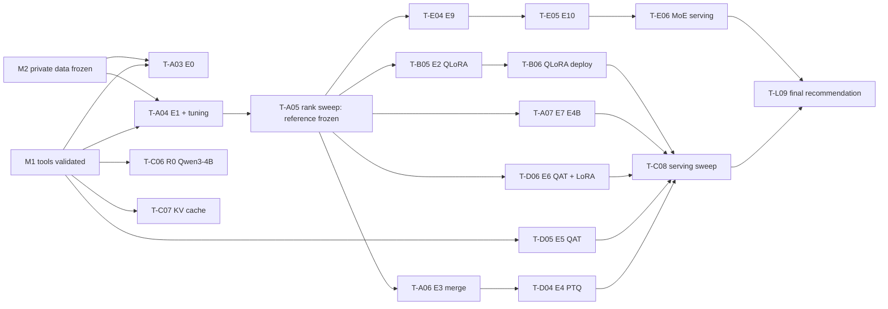

# Tasks

Who does what, in which order, and what "done" means. The research plan (what we test
and why) is in [README.md](README.md). File formats every track shares are in
[docs/formats.md](docs/formats.md).

**Status:** ⬜ todo · 🟡 in progress · ✅ done · ⛔ blocked · ⏭️ skipped

## How the work is split

Two phases:

1. **Phase 1: shared tools.** Every tool every workflow needs (training, HF inference,
   merge, quantization, vLLM serving, benchmark, evaluation) is built once. The lead has
   drafted all of them and run them on CPU with a tiny Gemma 4 model ([T-002](#t-002--phase-1-tool-drafts-)).
   Each member **validates, fixes and then maintains** one set of tools on real GPUs and
   real model sizes, using the public dev set (CORD v2).
2. **Phase 2: one workflow per person, end to end.** Each member owns one research
   question and runs its pipeline end to end with the shared tools: train, merge, quantize,
   serve, evaluate, tune, report. Owners run every step themselves instead of handing work over.

Phase 2 assumes the private data and ground truth exist for every doc type. Collecting
them is a separate effort, split by doc type; the lead owns the shared data tasks.

| Member | Phase 1: validates and maintains | Phase 2: owns end to end | Answers |
|--------|----------------------------------|--------------------------|:-------:|
| Lead | Core package, dev set, data tasks | Integration, reviews, result tables, final recommendation | — |
| A | SFT data, `train.py`, 32K training memory | **W1 LoRA BF16:** E0, E1, rank sweep, E3, E7; publishes the reference config | Q1 |
| B | Training environment, model loading, `inspect_model.py`, HF predictor, `merge_adapter.py` | **W2 QLoRA and dense scale:** E2, QLoRA deployment options, E8, Unsloth (P2) | Q2 |
| C | vLLM serve, vLLM predictor, benchmark harness | **Serving at 60:** production requirements, R0, KV cache / prefix caching / FP8 KV, serving sweep of every candidate | Q5 |
| D | `quantize_w4a16.py`, `verify_quantized.py` | **W3 PTQ + W4 QAT:** E4, E5, E6, calibration and FP8 (P2) | Q3, Q4 |
| E | MoE inspection, expert LoRA study, MoE quantization check | **W5 MoE:** E9, E10, E12, MoE serving vs dense | Q6 |

Letters are placeholders until the team is fixed. Everyone is full-time and can ask
anyone for help; the author of a tool reviews changes to it.

**With fewer people:**
- **4 people:** A also owns W2 (B's tasks); QLoRA is a one-variable change from W1.
- **3 people:** additionally, D also owns W5 (E's tasks); MoE needs self-quantization anyway.

**Hardware:** 3–5 × L40 48 GB for real runs and every measurement, 2 × ~24 GB GPUs for
development and smoke tests. Agree GPU use among yourselves; a run that measures VRAM or
latency needs a GPU with no other process. Expect the GPUs, not people, to be the
bottleneck in phase 2: queue long runs overnight.

## Rules for experiments and results (agreed 2026-11-20)

1. **Tune on validation only.** Tuning runs evaluate with `--split validation` (metrics go to
   `results/metrics/<run_id>__validation.json`). The test split is evaluated only for a
   **final** run, once per config.
2. **Reference config.** A publishes `configs/reference/gemma4_e2b_lora.yaml`: provisional
   after E1, **frozen** after the rank sweep (M3). Every other experiment `extends:` it and
   overrides only its own variable. Changing it after the freeze needs the lead's approval
   and a list of runs to redo.
3. **Extra tuning is reported separately.** An experiment tuned beyond its one variable is a
   separate run (`run_name` ending in `_tuned`) and a separate row in the matrix.
4. **Results enter the matrix only through a PR** with the config and the metrics JSON. The
   lead reviews it before the [experiment matrix](README.md#6-experiment-matrix) is updated.
5. **Scoring changes re-score everything.** When postprocess or metric rules change, the lead
   runs `scripts/reevaluate.py` on every saved prediction (no GPU needed).
6. **Same evaluation settings for everyone:** temperature 0, `max_new_tokens` from T-L04,
   the frozen split (hashes in `reports/data_quality.md`) and the same benchmark set.
7. **Dev runs are never results.** `configs/dev/` (experiment ID `DEV`, public CORD data) only
   validates tools.

## How to work with this file

- **Pick up a task:** set it to 🟡 and tick each step as you finish it.
- **End of the day:** if the task is not finished, leave it 🟡 with the finished steps
  ticked, and add one line to your section of the [daily log](#daily-log). Continue the
  next day from the first unticked step.
- **Branch and PR:** one branch per task (`T-A01-train-validation`), PR title `T-A01: ...`.
  The lead reviews every PR. A task is ✅ only when its **Done when** holds and the PR is merged.
- **Avoid conflicts:** edit only your own task blocks and your own daily-log section.
- **Core is shared:** `src/llm_opt_lab/` and `docs/formats.md` are used by every track.
  Change them only in a PR the lead reviews, with tests.
- **Blocked:** set ⛔, write what blocks you, and tell the owner of the blocking task the same day.
- **Every run:** commit config and code first; the tools save an `nvidia-smi` snapshot and
  record metrics with `record_metrics`.
- **Private data stays on the servers:** never commit it, never upload it to external services.

## Milestones

| ID | Milestone | Reached when | Status |
|----|-----------|--------------|:------:|
| M0 | Core and tool drafts | T-001, T-002 done | ✅ |
| M1 | Tools validated on GPU | On the dev set, end to end on real Gemma 4 E2B: train smoke → HF predict → merge → quantize → vLLM serve → vLLM predict → benchmark → evaluate; all phase-1 tasks done | ⬜ |
| M2 | Private data frozen | T-L03 and T-L04 done | ⬜ |
| M3 | Reference config frozen | Rank sweep done (T-A05), adapter inference and merge verified (T-A06) | ⬜ |
| M4 | Quantized model served at 60 | E4 evaluated (T-D04), latency curve up to 60 (T-C08) | ⬜ |
| M5 | MoE question answered | T-E06 done | ⬜ |
| M6 | Final recommendation | T-L09 done | ⬜ |

Phase 2 starts for everyone at **M1 + M2**. A can start E0/E1 as soon as M2 is reached.

## Start here

| Member | Day 1 | Needs |
|--------|-------|-------|
| Lead | T-L01 (dev set), T-003 | — |
| A | T-A01 (with the smoke config) | Dev set from T-L01, environment from T-B01 |
| B | T-B01, then T-B02 | — |
| C | T-C01, T-C05 | — |
| D | T-D01 | — |
| E | T-E01 | Training environment (T-B01) for `inspect_model.py` |

## Phase 2 dependencies

---

## Lead — core, shared data, integration

### T-001 · Core package ✅

**Done 2026-11-19.** `src/llm_opt_lab/`: config, dataset records, doc types, prompts,
parsing, postprocess, metrics, evaluation, predictions, metrics JSON, paths, split,
profiling; `scripts/evaluate.py`, `scripts/split_dataset.py`; CPU tests, ruff, CI,
`docs/formats.md`.

### T-002 · Phase-1 tool drafts ✅

**Done 2026-11-20.** Every phase-1 tool is drafted. What was run on CPU with
`trl-internal-testing/tiny-Gemma4ForConditionalGeneration` (Gemma 4 architecture, random
weights, transformers 5.23, peft 0.22, LLM Compressor 0.15):

| Tool | Checked on CPU with tiny Gemma 4 | Not checked (needs GPU / real model / network) |
|------|----------------------------------|-------------------------------------------------|
| `hf/sft_data.py` | Answer-only labels for image and spatial-text samples; prompt is a token prefix of the full chat | Real image token counts |
| `scripts/train.py` | `--check-loss`: label-position loss = full loss (diff ≤ 2e-6); 4 steps with eval; LoRA only on the language model; adapter, log and metrics saved | BF16 on GPU, NF4 (bitsandbytes needs CUDA), 32K memory |
| `scripts/predict_hf.py` | Base, `--source adapter`, `--source merged`; resume | NF4, peak VRAM |
| `scripts/merge_adapter.py` | `--verify`: max logit diff 9e-7, identical outputs; merged model = adapter outputs on test | BF16 tolerance, CPU merge of 26B |
| `scripts/inspect_model.py` | Components, Linear names, decoder class `Gemma4TextDecoderLayer` | MoE (26B-A4B) |
| `scripts/data/token_stats.py` | Tables and recommendations | Real data |
| `quantization/quantize_w4a16.py` | `basic` pipeline with mixed image + text calibration; `sequential` pipeline with one input type; checkpoint passes `verify_quantized.py` | Group size 128 (the tiny model's layers are too narrow; run used 16); GPU memory and time; vLLM load |
| `quantization/verify_quantized.py` | Unit tests with synthetic headers; real tiny checkpoints | — |
| `inference/*` (serve, predict, benchmark) | Command building, closed loop, stats, `/metrics` parsing are unit-tested | Never run against a vLLM server |
| `scripts/data/convert_cord.py` | Conversion functions are unit-tested | Downloading CORD v2 |

Findings already fixed in the code: Gemma 4's processor needs `torchvision`;
transformers 5 replaced `warmup_ratio` with a fractional `warmup_steps`; LLM Compressor's
`sequential` pipeline cannot mix image and spatial-text calibration samples, and needs
`per_layer_model_projection` in the ignore list (it gets no calibration data).

### T-003 · Move the repo to GitHub Enterprise ⬜

**Owner:** Lead · **Priority:** P0 · **Estimate:** 0.5 day

- [ ] Create a private repo on the company GitHub Enterprise and push the history
- [ ] Make CI run: replace `runs-on: ubuntu-latest` with the org's runner label if needed; check that org policy allows `astral-sh/setup-uv`
- [ ] Protect `main`: PR required, 1 approval, CI green; add `CODEOWNERS` (lead on `src/llm_opt_lab/`, `docs/formats.md`; tool authors on their tools)
- [ ] Agree where data and artifacts live on each GPU server (shared NFS or one copy per server); document `LLMOPT_DATA_DIR` and `LLMOPT_ARTIFACTS_DIR` per server in README quick start
- [ ] Decide whether `proposal.md` (Vietnamese, untracked) is committed

**Done when:** every member can clone, open a PR, and see CI run on it.

### T-L01 · Public dev set (CORD v2) ⬜

**Owner:** Lead · **Depends on:** — · **Priority:** P0 · **Estimate:** 0.5 day

The dev set lets phase-1 validation start before private data exists.

- [ ] Check the CORD v2 license (CC BY 4.0) is fine for internal use; note it in `docs/datasets.md`
- [ ] `uv run --group data python scripts/data/convert_cord.py --out-dir "$LLMOPT_DATA_DIR/public/cord"`
- [ ] `uv run python scripts/data/validate.py --data-dir "$LLMOPT_DATA_DIR/public/cord"`
- [ ] Split: `scripts/split_dataset.py --data-dir ... --input .../all.jsonl`; benchmark set: `scripts/data/make_benchmark.py --data-dir ... --n 100`
- [ ] Make the dev set available on every GPU server

**Done when:** `configs/dev/*.yaml` find their data on every server.

### T-L02 · Ground-truth guideline ⬜

**Owner:** Lead · **Depends on:** — · **Priority:** P0 · **Estimate:** 2 days

Data is collected by doc type, by different people. Without one guideline, per-doc-type
metrics measure annotation style instead of model errors.

- [ ] Write `docs/annotation_guideline.md`:
  - **Value format:** follow the output format the doc type's system prompt asks for; if it says nothing, copy the value as printed
  - **Absent fields:** keep every schema key and use `null`, never `""`
  - **Lists:** one item per printed entry, in reading order; what to do with entries that span several lines
  - **Numbers:** follow the schema type
  - **Illegible or ambiguous values:** what to write, plus a flag in `meta.flags`
- [ ] Worked examples per doc type (one clean, one tricky)
- [ ] Agreement check: two people annotate the same 20 documents; score one against the other with `scripts/evaluate.py`; fold disagreements into the guideline

**Done when:** agreement ≥ 98% field accuracy on the check set, or every disagreement is resolved in the guideline.

### T-L03 · Private data: validate, split, benchmark set ⬜

**Owner:** Lead · **Depends on:** private data and ground truth, T-L02 · **Priority:** P0 · **Estimate:** 1 day

- [ ] One doc type folder per company doc type: `doc_types/<name>/system_prompt.md` (the production prompt) and `schema.json` (written from it, leaves tagged with `x-field-type`)
- [ ] `scripts/data/validate.py` passes on `$LLMOPT_DATA_DIR/private/all.jsonl`
- [ ] Agree split ratios (default 80/5/10/5). With ~200 test samples per doc type, a 95% exact match has a standard error of ~1.5 points; raise the test share if per-doc-type results matter (T-L06)
- [ ] Run `scripts/split_dataset.py` **once**; never `--overwrite` after the first experiment
- [ ] `scripts/data/make_benchmark.py --n 300` (≥ 5 × the highest concurrency)
- [ ] Record the SHA-256 of every split file and counts per doc type × input type in `reports/data_quality.md`, with null rate per field and list lengths
- [ ] Copy to every GPU server

**Done when:** splits, benchmark set and hashes exist; M2 is reached together with T-L04.

### T-L04 · Token statistics ⬜

**Owner:** Lead · **Depends on:** T-L03, T-B01 · **Priority:** P0 · **Estimate:** 0.5 day

- [ ] `scripts/data/token_stats.py --config <E2B config> --split train --out reports/data_stats.md` (CPU is enough); repeat with the Qwen3 tokenizer for spatial text (R0)
- [ ] Agree the image processor settings with A (they set the image token count)
- [ ] Write `training.max_seq_length` and `evaluation.max_new_tokens` into the reference config (with A) and README §4; decide the over-length policy (drop or fail)
- [ ] Note the system prompt share per doc type for C (prefix caching)

**Done when:** both lengths are agreed and written down.

### T-L05 · Port the production postprocess ⬜

**Owner:** Lead · **Depends on:** production code (T-C05) · **Priority:** P0 · **Estimate:** 3 days

- [ ] Implement the field-type rules in `src/llm_opt_lab/postprocess.py` (date → ISO 8601, numbers per field, codes, ...), replacing every `TODO(T-L05)`
- [ ] Align `EMPTY_VALUES` with production; tag every schema leaf with its `x-field-type`
- [ ] Unit tests from real (anonymized) examples
- [ ] `scripts/reevaluate.py` on everything evaluated so far

**Done when:** no `TODO(T-L05)` is left and tests pass.

### T-L06 · Metric decisions ⬜

**Owner:** Lead · **Depends on:** first E0 predictions (T-A03) · **Priority:** P1 · **Estimate:** 1 day

- [ ] **List matching:** items are compared by position. Measure on E0 how often the right items come in another order; if often, switch to content-based matching
- [ ] **Target scope:** 95% overall, or per input type / per doc type? (with T-C05)
- [ ] **Extra fields:** keep them out of field accuracy (current), or count them?
- [ ] Implement changes in `metrics.py` with tests; update `docs/formats.md` §5 and README §7; re-score

**Done when:** the decisions are in README §4.

### T-L07 · Result tables, charts, error analysis ⬜

**Owner:** Lead · **Depends on:** first metrics files · **Priority:** P1 · **Estimate:** 3 days

- [ ] `scripts/aggregate_results.py`: `results/metrics/*.json` → `results/tables/experiments.csv` and Markdown for the README matrix and final table
- [ ] `scripts/plot_tradeoffs.py`: accuracy vs VRAM, training time and latency, with the 95% line → `results/figures/`
- [ ] `scripts/error_analysis.py`: worst fields, wrong values, parse failures, and run-vs-run diffs from `artifacts/eval/`

**Done when:** one command regenerates every table and figure.

### T-L08 · Integration and review 🟡

**Owner:** Lead · **Priority:** P0 · **Estimate:** ongoing

- [ ] Review PRs within one working day; core changes need tests; result PRs follow the [rules](#rules-for-experiments-and-results-agreed-2026-11-20)
- [ ] Weekly: milestones, experiment matrix and weekly progress log in README
- [ ] Keep the [decision log](#decision-log) current; unblock ⛔ tasks the same day

### T-L09 · Final recommendation ⬜

**Owner:** Lead (with all) · **Depends on:** every owner's report · **Priority:** P0 · **Estimate:** 2 days

- [ ] Fill the [final decision table](README.md#13-final-decision-table); write `reports/final_recommendation.md` answering Q1–Q6, per-doc-type breakdown in an appendix
- [ ] Review with every owner before it goes to the leader

---

## A — W1 LoRA BF16 (Q1)

### Phase 1

#### T-A01 · Validate SFT data and training on Gemma 4 ⬜

**Owner:** A · **Depends on:** T-B01, T-L01 · **GPU:** ~24 GB, then L40 · **Priority:** P0 · **Estimate:** 2 days

- [ ] Agree the LoRA `target_modules` with B from `scripts/inspect_model.py` and the gemma-skills SFT template (`third_party/gemma-skills`); compare its chat formatting and loss masking with `hf/sft_data.py`
- [ ] `scripts/train.py --config configs/dev/cord_e2b_lora_smoke.yaml --check-loss 8` on real E2B: the two losses agree (BF16 tolerance ~1e-3 relative) for image and spatial-text samples
- [ ] Smoke run on a ~24 GB GPU, then a 200-step run on an L40: loss goes down, eval loss runs, the adapter loads in `predict_hf.py --source adapter`
- [ ] Check the log line "LoRA on N modules": language model only
- [ ] Fix what breaks, with tests where possible (`LLMOPT_RUN_TINY=1 uv run --group train pytest tests/test_hf_tiny.py`)

**Done when:** a dev LoRA run trains, saves and predicts on an L40, and the fixes are merged.

#### T-A02 · Training memory at 32K context ⬜

**Owner:** A · **Depends on:** T-A01, T-L04 · **GPU:** L40 · **Priority:** P0 · **Estimate:** 2 days

See [Risk 1](README.md#risk-1-training-memory-at-32k-context).

- [ ] Peak VRAM of one step on the longest real sample, E2B and E4B, `training.loss: label_positions` vs `full`
- [ ] If it still does not fit: check Liger Kernel fused linear cross-entropy for Gemma 4, and add it as a `training.loss` option (core PR)
- [ ] Write `reports/notes/long_context_memory.md`; E reuses it

**Done when:** one step on the longest sample fits on an L40 with margin, for E2B and E4B.

### Phase 2

#### T-A03 · E0 baseline ⬜

**Owner:** A · **Depends on:** M1, M2 · **Priority:** P0 · **Estimate:** 1 day

- [ ] `configs/gemma4_e2b/baseline.yaml`; `predict_hf.py` on test; `evaluate.py`; `reports/baseline.md`

#### T-A04 · E1 LoRA BF16 and tuning ⬜

**Owner:** A · **Depends on:** T-A02, T-A03 · **Priority:** P0 · **Estimate:** 3 days + GPU time

- [ ] `configs/reference/gemma4_e2b_lora.yaml` (rank 16, alpha 32): train, evaluate on **validation**
- [ ] Tune on validation (learning rate, epochs, image settings); one variable per run
- [ ] Publish the config as the **provisional reference**; tell B, D, E
- [ ] Final run on test

#### T-A05 · Rank sweep and reference freeze ⬜

**Owner:** A · **Depends on:** T-A04 · **GPU:** 3 × L40 in parallel · **Priority:** P0 · **Estimate:** 1 day + GPU time

- [ ] Ranks 8 / 16 / 32 (alpha = 2 × rank) in parallel, each `extends:` the reference
- [ ] Choose the smallest rank reaching 95% on both metrics; **freeze the reference config** (M3)

#### T-A06 · E3 merge and equivalence ⬜

**Owner:** A · **Depends on:** T-A05 · **Priority:** P0 · **Estimate:** 1 day

- [ ] `merge_adapter.py --verify 20`; evaluate the merged model; tell D the merged run id for E4

#### T-A07 · E7 Gemma 4 E4B ⬜

**Owner:** A · **Depends on:** T-A05 · **Priority:** P1 · **Estimate:** 3 days

- [ ] Do not wait for the E2B verdict: LoRA on E4B (`extends:` the reference, only `model.id` changes), merge, W4A16 with D's script, serve and benchmark with C's harness

#### T-A08 · Q1 report ⬜

**Owner:** A · **Depends on:** T-A03–T-A07 · **Priority:** P0 · **Estimate:** 1 day

- [ ] `reports/baseline.md`: VRAM and time at 32K, rank table, smallest rank at 95%, adapter vs merged, E2B vs E4B

---

## B — W2 QLoRA and dense scale (Q2)

### Phase 1

#### T-B01 · Training environment ⬜

**Owner:** B · **Depends on:** — · **GPU:** every server · **Priority:** P0 · **Estimate:** 1 day

- [ ] On each server: `nvidia-smi`, `nvidia-smi -q`; note driver and CUDA
- [ ] Pin the `train` group in `pyproject.toml` (transformers 5.x with Gemma 4; torchvision is required); point torch at the CUDA wheel index matching the driver (`[[tool.uv.index]]`); commit `uv.lock`
- [ ] `uv sync --group train && uv run python scripts/check_gpu.py` on every server
- [ ] `reports/environment.md`, one block per server; exact setup commands in README quick start

**Done when:** the environment works on an L40 and a ~24 GB GPU, and CI still passes.

#### T-B02 · Model loading and structure ⬜

**Owner:** B · **Depends on:** T-B01 · **GPU:** L40 · **Priority:** P0 · **Estimate:** 1 day

- [ ] `scripts/inspect_model.py` for E2B, E4B, 12B (no GPU needed) → `reports/notes/model_structure.md`; agree `target_modules` with A
- [ ] `hf/loading.py`: load E2B and E4B in BF16 and **NF4** on an L40 (bitsandbytes was not testable on CPU); record load VRAM
- [ ] `model.attn_implementation`: compare the default with `sdpa` / `eager` for Gemma 4 (speed, memory, equality)

#### T-B03 · Validate the HF predictor ⬜

**Owner:** B · **Depends on:** T-B02, T-A01 (smoke adapter) · **GPU:** L40 · **Priority:** P0 · **Estimate:** 1 day

- [ ] `predict_hf.py` on the dev test split: base, NF4 base, `--source adapter`, `--source merged`; interrupt and resume
- [ ] Compare with vLLM predictions of the same model (with C, T-C03): same greedy outputs on most samples; explain differences (chat template, image preprocessing)

#### T-B04 · Validate merging ⬜

**Owner:** B · **Depends on:** T-B03 · **GPU:** L40 · **Priority:** P0 · **Estimate:** 0.5 day

- [ ] `merge_adapter.py --verify 20` on a dev LoRA adapter and a dev QLoRA adapter (merged into BF16); record the BF16 tolerance
- [ ] The merged checkpoint serves with vLLM (with C)

### Phase 2

#### T-B05 · E2 QLoRA NF4 ⬜

**Owner:** B · **Depends on:** reference config (provisional after T-A04, re-run if it changes before the freeze) · **Priority:** P0 · **Estimate:** 2 days

- [ ] `configs/gemma4_e2b/qlora_nf4.yaml`: `extends:` the reference, only `method` changes
- [ ] VRAM at load, after LoRA attach, and in a step on the longest sample; OOM or not
- [ ] Train, evaluate (NF4 + adapter)

#### T-B06 · QLoRA deployment options ⬜

**Owner:** B · **Depends on:** T-B05 · **Priority:** P0 · **Estimate:** 2 days

- [ ] Option 1: NF4 base + adapter (`predict_hf.py --source adapter`), accuracy and HF latency
- [ ] Option 2: merge into the **BF16** base, never into NF4 weights; evaluate; quantize to W4A16 with D's script; serve with C's harness

#### T-B07 · E8 Gemma 4 12B QLoRA (P2) ⬜

**Owner:** B · **Depends on:** T-B05 · **Priority:** P2 · **Estimate:** 3 days

- [ ] `extends:` the reference with `model.id` 12B and QLoRA; merge, W4A16, serve. Also a dense point of comparison for MoE (E)

#### T-B08 · Unsloth vs Hugging Face training (P2) ⬜

**Owner:** B · **Priority:** P2 · **Estimate:** 2 days

#### T-B09 · Q2 report ⬜

**Owner:** B · **Depends on:** T-B05, T-B06 · **Priority:** P0 · **Estimate:** 1 day

- [ ] `reports/lora_vs_qlora.md`: VRAM saved, training speed, accuracy vs 95%, adapter overhead, which 4-bit deployment keeps accuracy best

---

## C — Serving at 60 concurrent requests (Q5)

### Phase 1

#### T-C01 · vLLM environment ⬜

**Owner:** C · **Depends on:** — · **GPU:** L40 · **Priority:** P0 · **Estimate:** 1 day

- [ ] `.venv-vllm`; pin `vllm` in `inference/requirements.txt` to a version that serves Gemma 4 multimodal, compressed-tensors W4A16 on Ada, and FP8 KV cache

#### T-C02 · Validate the serve script ⬜

**Owner:** C · **Depends on:** T-C01, T-L01 · **GPU:** L40 · **Priority:** P0 · **Estimate:** 1 day

- [ ] `inference/serve_vllm.py --config configs/dev/cord_e2b_base_vllm.yaml` and `configs/dev/cord_e2b_qat_w4a16ct_vllm.yaml`; fix flags this vLLM version names differently (`--limit-mm-per-prompt` format, prefix caching flags)
- [ ] Confirm `POST /reset_prefix_cache` works with `VLLM_SERVER_DEV_MODE=1`

#### T-C03 · Validate the vLLM predictor ⬜

**Owner:** C · **Depends on:** T-C02 · **Priority:** P0 · **Estimate:** 1 day

- [ ] `inference/predict_vllm.py` on the dev test split; `scripts/evaluate.py` scores it
- [ ] HF vs vLLM comparison with B (T-B03), written in `reports/serving.md`

#### T-C04 · Validate the benchmark harness ⬜

**Owner:** C · **Depends on:** T-C02 · **Priority:** P0 · **Estimate:** 2 days

- [ ] `inference/benchmark_api.py` on base E2B and QAT W4A16 CT: two repeats agree within ±5%
- [ ] Check the `/metrics` names of this vLLM version against the constants in `src/llm_opt_lab/serving.py`; fix them (core PR)
- [ ] Confirm the prefix cache really resets between levels (hit rate near the system-prompt share, not ~100%)

#### T-C05 · Clarify production requirements ⬜

**Owner:** C (with Lead) · **Depends on:** — · **Priority:** P0 · **Estimate:** 2 days (calendar time may be longer)

Qwen3-4B production runs on one L40, but by our estimate 60 × 32K tokens needs ~290 GB
of KV cache. Production must queue, use shorter contexts, or rely on prefix caching.

- [ ] Meet the people who run the Qwen3-4B service and the members who own that part
- [ ] vLLM version and full serve command (`--max-model-len`, `--max-num-seqs`, `--gpu-memory-utilization`, `--kv-cache-dtype`, prefix caching, chunked prefill)
- [ ] Real context and output length per request (p50/p95); are the 60 requests really concurrent at 21–32K tokens?
- [ ] Current latency p50/p95 and the **acceptable p95 at 60 concurrent requests** (the SLO)
- [ ] Arrival pattern (bursts of 60, steady rate, offline batches); Qwen3 thinking mode off?
- [ ] Production postprocess code (for T-L05), system prompts and schemas per doc type (for T-L03)
- [ ] Does the 95% target apply per doc type? (for T-L06)
- [ ] Write `reports/production_reference.md`; update README §4

**Done when:** every item is answered, or marked unknown with a person responsible for it.

### Phase 2

#### T-C06 · R0 Qwen3-4B reference ⬜

**Owner:** C · **Depends on:** T-C05, M2 · **Priority:** P1 · **Estimate:** 2 days

- [ ] `configs/qwen3_4b/baseline.yaml` (`architecture: causal_lm`, `chat_template_kwargs: {enable_thinking: false}`, `input_types: [spatial_text]`, production serve settings and prompts)
- [ ] Accuracy on the spatial-text test split, and the same latency sweep

#### T-C07 · KV cache, prefix caching, FP8 KV ⬜

**Owner:** C · **Depends on:** M1, M2 · **Priority:** P1 · **Estimate:** 2 days

- [ ] Real KV per request vs the [Risk 2](README.md#risk-2-kv-cache-at-60-concurrent-requests) estimate; maximum concurrent requests for E2B BF16, E2B W4A16, E4B W4A16
- [ ] Prefix caching on vs off; `kv_cache_dtype: fp8` concurrency gain and accuracy delta
- [ ] Replace the estimates in README Risk 2 with measured values

#### T-C08 · Serving sweep and Q5 report ⬜

**Owner:** C · **Depends on:** candidates from A, B, D (and E) · **Priority:** P0 · **Estimate:** 2 days

- [ ] Sweep every candidate reaching 95% to 60 concurrent requests on the same server settings; check p95 against the SLO
- [ ] `reports/serving.md`: latency vs concurrency per candidate; which pipelines meet both the quality target and the SLO (Q5)

#### T-C09 · Structured outputs and LoRA serving (P2) ⬜

**Owner:** C · **Priority:** P2 · **Estimate:** 2 days

- [ ] vLLM structured outputs from the doc type `schema.json`: parse rate, accuracy, latency
- [ ] Multi-LoRA serving (one adapter per doc type?) vs a merged model; shorter system prompt after fine-tuning

---

## D — W3 PTQ and W4 Gemma QAT (Q3, Q4)

### Phase 1

#### T-D01 · LLM Compressor environment ⬜

**Owner:** D · **Depends on:** — · **Priority:** P0 · **Estimate:** 1 day

- [ ] `.venv-quant`; pin `llmcompressor` in `quantization/requirements.txt` (0.15.0 worked on CPU with transformers 5.21 and tiny Gemma 4)
- [ ] Read GPTQ/AWQ, W4A16 presets, ignore lists, pipelines (`basic`, `sequential`); notes in `reports/notes/llmcompressor.md`

#### T-D02 · Validate quantization on base E2B ⬜

**Owner:** D · **Depends on:** T-D01, T-L01 · **GPU:** L40 · **Priority:** P0 · **Estimate:** 2 days

- [ ] `quantization/quantize_w4a16.py --config configs/dev/cord_e2b_base_w4a16.yaml` with `pipeline: basic` (default): GPU memory and time at real lengths
- [ ] Same with `pipeline: sequential`, `sequential_targets: [Gemma4TextDecoderLayer]` (check the class name), one input type; needed later for 26B-A4B
- [ ] `quantization/verify_quantized.py` passes; the checkpoint serves with vLLM (with C)

#### T-D03 · First accuracy delta ⬜

**Owner:** D · **Depends on:** T-D02, T-C03 · **Priority:** P0 · **Estimate:** 1 day

- [ ] Base BF16 vs base W4A16 on the dev validation split through vLLM; table in `reports/quantization.md`

### Phase 2

#### T-D04 · E4 PTQ of the fine-tuned model ⬜

**Owner:** D · **Depends on:** T-A06 · **Priority:** P0 · **Estimate:** 2 days

- [ ] `configs/gemma4_e2b/quant_w4a16.yaml`: `extends:` the reference, `quantization.source: merged:<E3 run id>`, `serving.source: quantized`
- [ ] Quantize, verify, serve, evaluate, benchmark; BF16 vs W4A16 table (accuracy by input type, VRAM, latency p50/p95, throughput)
- [ ] Only after this baseline: tune the recipe on validation (GPTQ vs AWQ, calibration mix)

#### T-D05 · E5 Gemma QAT checkpoints ⬜

**Owner:** D · **Depends on:** M1, M2 · **Priority:** P1 · **Estimate:** 2 days

- [ ] Checkpoint A (`...qat-q4_0-unquantized`): HF evaluate; quantize with `quantize_w4a16.py`; serve and evaluate
- [ ] Checkpoint B (`...qat-w4a16-ct`): serve and evaluate
- [ ] Is B the matching quantized version of A? Compare accuracy, VRAM, latency

#### T-D06 · E6 LoRA on the QAT checkpoint ⬜

**Owner:** D · **Depends on:** reference config, T-D05 · **Priority:** P1 · **Estimate:** 3 days

- [ ] Check checkpoint A's module names match the regular model
- [ ] `extends:` the reference with `model.id` = checkpoint A; train with `train.py`, merge, quantize, serve, evaluate
- [ ] Compare with E4: does fine-tuning on QAT keep accuracy after quantization better than PTQ? Measure it, do not assume it

#### T-D07 · Calibration comparison and FP8 weights (P2) ⬜

**Owner:** D · **Priority:** P2 · **Estimate:** 2 days

#### T-D08 · Q3 / Q4 report ⬜

**Owner:** D · **Depends on:** T-D04–T-D06 · **Priority:** P0 · **Estimate:** 1 day

- [ ] `reports/quantization.md`: does LoRA → merge → W4A16 keep 95%, VRAM and latency saved, QAT vs PTQ, which checkpoint suits fine-tuning and which suits serving

---

## E — W5 MoE (Q6)

### Phase 1

#### T-E01 · Inspect Gemma 4 26B-A4B ⬜

**Owner:** E · **Depends on:** T-B01 · **GPU:** L40 for the NF4 load · **Priority:** P1 · **Estimate:** 2 days

- [ ] `scripts/inspect_model.py --model-id google/gemma-4-26B-A4B-it --out reports/moe_architecture.md` (no weights downloaded): experts (fused `nn.Parameter` or `nn.Linear`?), router, shared experts, decoder layer class
- [ ] Load in NF4 on an L40; record VRAM; generate on a few dev samples
- [ ] Check server CPU RAM and disk: merging in BF16 on CPU needs ~52 GB for weights alone (≥ 128 GB RAM recommended)

#### T-E02 · Expert LoRA feasibility ⬜

**Owner:** E · **Depends on:** T-E01 · **GPU:** L40 · **Priority:** P1 · **Estimate:** 2 days

- [ ] Does PEFT `target_parameters` work on fused expert parameters **while they are 4-bit**? This is the most likely blocker; list alternatives if not
- [ ] `train.py --check-loss` with `lora.target_parameters`; check that `check_lora_placement` handles parameter-only LoRA
- [ ] Go/no-go for E10 with the exact `target_modules` / `target_parameters`

#### T-E03 · MoE quantization check ⬜

**Owner:** E (with D) · **Depends on:** T-D02 · **Priority:** P1 · **Estimate:** 1 day

- [ ] 26B-A4B has no official W4A16 CT checkpoint. Run `quantize_w4a16.py` with `pipeline: sequential` on the base model (one input type); check how experts and the router are handled

### Phase 2

#### T-E04 · E9 QLoRA on attention ⬜

**Owner:** E · **Depends on:** reference config, T-A02 · **Priority:** P1 · **Estimate:** 3 days

- [ ] `configs/gemma4_26b_a4b/qlora_attention.yaml`: `extends:` the reference; `model.id` 26B-A4B; QLoRA; `q_proj`, `k_proj`, `v_proj`, `o_proj` only
- [ ] Trainable params, VRAM, time, accuracy, HF latency, adapter size

#### T-E05 · E10 QLoRA on attention + experts ⬜

**Owner:** E · **Depends on:** T-E02, T-E04 · **GPU:** L40 + large CPU RAM · **Priority:** P1 · **Estimate:** 3 days

- [ ] Train and evaluate; compare **adapter inference latency** with E9
- [ ] `merge_adapter.py --device cpu`; evaluate the merged model

#### T-E06 · MoE serving and comparison with dense ⬜

**Owner:** E · **Depends on:** T-E05, T-E03 · **Priority:** P1 · **Estimate:** 2 days

- [ ] Quantize the merged E10 model, serve, sweep to 60; compare with E4, E7, E8

#### T-E07 · E12 router LoRA (P2) ⬜

**Owner:** E · **Priority:** P2 · **Estimate:** 2 days

- [ ] Only if E9 and E10 both miss 95%; measure the routing distribution before and after

#### T-E08 · Q6 report ⬜

**Owner:** E · **Depends on:** T-E04–T-E06 · **Priority:** P1 · **Estimate:** 1 day

- [ ] `reports/moe_lora.md`: feasible on an L40? attention vs experts? worth it vs dense?

---

## Decision log

Decisions made while working. Move settled ones into README §4.

| Date | Decision | By | Task |
|------|----------|----|------|
| 2026-11-19 | Repo docs and code are written in English | Lead | — |
| 2026-11-19 | One dataset record per (document, input type); records of one document share `group_id` and stay in one split | Lead | T-001 |
| 2026-11-19 | Each doc type has its own `system_prompt.md` and `schema.json`; one model per experiment is trained on all doc types and both input types (default, revisit if one doc type lags) | Lead | T-001 |
| 2026-11-19 | List items are compared by position (to review) | Lead | T-L06 |
| 2026-11-20 | Two phases: shared tools first, then one workflow per person end to end | Lead | — |
| 2026-11-20 | Experiment and result rules 1–7 above | Lead | — |
| 2026-11-20 | Plans assume private data and ground truth exist; the lead owns the shared data tasks; phase 1 uses the public CORD v2 dev set | Lead | T-L01 |
| 2026-11-20 | Configs inherit with `extends:`; experiments override only their variable against the reference config | Lead | T-002 |
| 2026-11-20 | HF `Trainer` with our own collator and loss instead of TRL `SFTTrainer` (needed for answer-only labels on multimodal input and the label-position loss) | Lead | T-002 |
| 2026-11-20 | One `scripts/inspect_model.py` for dense and MoE models (meta device, no weights downloaded) | Lead | T-002 |
| 2026-11-20 | Quantization calibrates with the `basic` pipeline by default (mixed image + spatial text); `sequential` (large models) needs one input type | Lead | T-002 |

## Daily log

One line per working day: task IDs, what moved, what is next or blocking. Newest on top.

### Lead
- 2026-11-20 · T-002 ✅ phase-1 tool drafts (training, HF predict, merge, inspect, quantize, verify, vLLM serve/predict/benchmark, data tools), CPU-checked on tiny Gemma 4; TASKS.md restructured into two phases. Next: T-L01, T-003.
- 2026-11-19 · T-001 ✅ core package, `TASKS.md`, README in English.

### A

### B

### C

### D

### E
